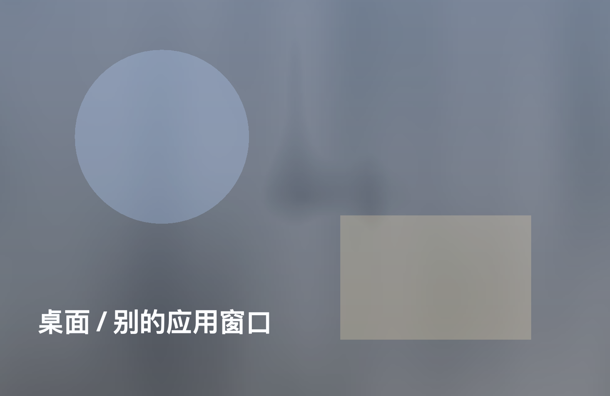

# Changelog

All notable changes to Potatoplayer Super are documented here.

## Versioning

- **Current release:** `s1.3.1`. The line started at `s1.0.0`; patch releases use
  the familiar `s1.0.x` sequence, while feature releases use a minor bump.
- The `s` prefix is the user-facing Super version label. The package and Maven
  metadata use the equivalent plain semver (`1.0.0`, `1.0.1`, …).
- Historical Super `1.0.0`–`1.0.4` entries are preserved below under
  **Legacy: Potatoplayer Super (1.0.x)**.
- The complete **Potatoplayer Java 2.1.19 and earlier** changelog — including the
  Python 1.x lineage it inherited — is preserved at the bottom under
  **Legacy: Potatoplayer Java (2.1.19 and earlier)**.

## s1.3.1 — 2026-10-28

### Changed

- **3D 舞台继续向 Folia 的画面密度靠拢**：
  - 唱到的字从金色实心改为更接近 Folia 的**白色描边 / 实心跟唱**，只有当前正在唱的字保留封面强调色；
  - 当前行之后挂载两句远处文字的幽灵层（带三维偏移与低透明度），让镜头移动时有“歌词走廊”纵深；
  - 新增 40 个点阵 3D 雕塑（近景大件 + 远景小件，分布在文字两侧和景深里），随镜头、音频与时间缓慢呼吸；
  - 近景点阵物件在边缘形成 Folia 式的前景遮挡与体积感，同时避开中央可读区。

### Verification

- 3D 舞台在 potatoHQ 下实拍：逐字中段、白色描边转实心、当前字强调色、远处下一句幽灵、近景/远景点阵物件、Bloom 与镜头移动同时正常。
- 无 JS 运行时错误；打开/关闭逐字辉光、舞台阵列、音频响应后对应元素正确消失。
- `npm run typecheck`、后端 63 项自检、Playwright UI smoke、静音 VLC 后端 smoke 全部通过。

## s1.3.0 — 2026-10-28

### Added

- **3D 演出 v2**：重做 Three.js 歌词舞台的表演层。参考 Folia 的 Diorama 镜头语言、逐字单元、舞台阵列与
  音频反应，按 Potatoplayer 的本地 LRC / potatoHQ 路径独立实现：
  - **逐字跟唱**：LRC 只有行时间戳时，按 CJK 单字、拉丁词、标点停顿推导时间；未唱的字显示为细描边，
    唱到的字切换为实心填充、金色辉光与轻微抬升，刚唱过的字生成上扬的灵魂残影。
  - **镜头调度**：13 种镜头运动（push-in / pull-back / orbit / track / crane / hold / swell / spiral /
    pendulum / flyby / arc / float / glide），按行长度、章节起点和随机种子选择，并避免连续重复；
    位置、注视点与 roll 使用平滑跟随，支持鼠标视差与音频 kick 抖动。
  - **舞台阵列**：每行根据镜头生成不同的点阵 3D 装置（门柱、柱廊、拱顶、螺旋、钟摆、轨道等），
    位于文字后方，随歌声呼吸、随拍脉冲，并在离场时溶解。
  - **potatoHQ 实时频谱**：48 段频谱通过宿主桥接进入 3D iframe，驱动低频 kick、粒子、光环、
    镜头震动和字体重心；VLC / mpv 下退回合成呼吸，不报错。
  - **画面合成**：启用 Bloom + 轻颗粒 + 轻微色差 + 扫描线后期，恢复舞台应有的光晕层次；
    舞台开关可分别关闭粒子 / 镜头 / 阵列 / 逐字辉光 / 音频响应。
  - **沉浸自定义**：3D 舞台新增舞台阵列、逐字辉光、音频响应开关，与粒子、镜头调度、强度一起持久化。

### Verification

- 使用 potatoHQ 实际播放验证：3D iframe 收到 48 段频谱；镜头在 spiral / pullBack / track 等不同行持续变化；
  逐字填充从 0 到全部完成，关闭阵列 / 逐字辉光 / 音频响应开关后对应效果消失；无 JS 运行时错误。
- 3D 舞台截图覆盖多行、不同镜头和逐字中段状态。
- `npm run typecheck`、后端 63 项自检、Playwright UI smoke、静音 VLC 后端 smoke 全部通过。

## s1.2.2 — 2026-10-28

### Fixed

- **衬线 / Editorial 沉浸模式与经典割裂**：Editorial 不再使用自己的一套沉浸排版与歌词卡片，
  而是完整继承经典沉浸模式的布局、字体尺度、歌词面板、背景、顶部栏与底部控制。经典沉浸的
  样式未做任何改动；两种外观现在在沉浸页看起来一致，只有全局强调色仍按用户选择生效。

### Verification

- 在同一曲目、同一时间点分别用 Editorial 与 Classic 进入沉浸模式，逐项比对歌词面板背景、
  圆角、内边距、模糊、歌词字号、当前行字号与标题字体，计算样式完全一致。
- 沉浸页的截图对照确认两者布局一致；动态频谱、自定义面板与无框歌词功能保持不变。

## s1.2.1 — 2026-10-28

### Added

- **沉浸模式动态频谱**：potatoHQ 的 48 段实时频谱现在也进入沉浸播放。经典视图中它位于进度条上方；
  3D 舞台中作为独立 HUD 悬浮在底部控制栏上方。沉浸自定义面板新增「动态频谱」区块，可单独
  开关、调节高度与存在感（不透明度），设置持久化；VLC / mpv 模式下显示说明并禁用控件。

### Verification

- 使用 potatoHQ 实际播放验证：沉浸经典模式与 3D 舞台均收到 48 段数据，关闭开关后频谱立即消失；
  自定义面板的高度 / 存在感滑块实时生效。
- `npm run typecheck`、后端 63 项自检、Playwright UI smoke 与静音 VLC 后端 smoke 全部通过。
- 沉浸自定义面板新增回归：VLC 下频谱控件禁用并提示 potatoHQ 限定。

## s1.2.0 — 2026-10-28

### Added

- **聆听统计页**：侧栏新增「统计」，后端把实际播放进度按本地日期、小时和曲目累计到
  `stats.json`。页面提供 GitHub 贡献图式年度热力图（时长 / 次数双指标、按当年分位数着色、
  点击某日查看明细）、总聆听时长、播放次数、活跃天数、当前 / 最长连续、24 小时聆听时钟、
  深夜 / 早晨 / 下午 / 夜晚占比，以及全部时间内最常听的歌曲与艺术家。数据完全留在本机；
  旧版只有播放次数、没有时间戳，因此不会伪造历史，统计从首次播放开始累计。
- **首页自定义**：首页新增「自定义」面板，可显示 / 隐藏、上移 / 下移六个模块
  （精选唱片、资料库概览、区块与流派、最近添加、反复聆听、常听艺术家），切换舒展 / 紧凑密度，
  一键恢复默认；配置写入 `localStorage` 的 `potato:home:v1`。
- **Songs 排序上下文列**：按评分排序时表格显示评分，按播放次数排序时显示次数，
  表头会随排序字段切换，不再需要在看不见依据的情况下排序。
- **详情页操作菜单**：专辑 / 艺术家详情的次要操作（下一首播放、加入队列、加入歌单、
  艺术家合集）收进一个「更多操作」菜单，主操作只保留播放、随机和更多。

- **可切换播放引擎**：设置 → 播放引擎，可选 **VLC（默认，保持原样）**、**potatoHQ**（自研原生引擎）、
  **mpv**。选择写入 `settings.json` 的 `playbackEngine`，**重启后生效**；目标引擎不可用时自动回退 VLC
  并弹出提示。`playback.state` 新增 `engine` 字段，bootstrap 新增 `engines` 可用性与
  `engineCapabilities` 能力矩阵，UI 据此显示或隐藏仅 potatoHQ 可用的功能。
- **听力安全警告**：切换到 potatoHQ / mpv 时弹出确认框，明确提示可能造成听力损伤，要求先调低音量、
  复位 EQ、摘下耳机后才能继续；VLC 不弹。
- **potatoHQ 无缝连播**：队列下一首提前通过 `playback.setNext` 交给引擎，播完由引擎在同一音频流里
  接力（不重开设备）；后端收到 `playback.track` 后同步队列指针与界面。VLC / mpv 保持原有切歌方式。
- **采样率跟随源（potatoHQ）**：播放前把设备切到文件采样率（设备支持时），退出时恢复原速率；
  96 kHz FLAC 不再经过引擎重采样。设置中可关闭。
- **空间声场（potatoHQ）**：四象限圆盘拖动声源位置，双击复位；引擎侧实现双耳电平差、0.6 ms 内的
  分数延迟时差（Hermite 插值）、后方 3.5 kHz 高频倾斜与距离衰减，参数 20 ms 平滑，关闭时逐样本直通。
- **频谱可视化（potatoHQ）**：引擎在最终输出上做 2048 点 FFT，以 20 Hz 推送 48 段频谱；播放页封面
  下方显示实时条。渲染回调只做定长拷贝，无分配、无锁。
- **交叉馈电（potatoHQ）**：0.3 ms 延迟 + 700 Hz 低通的耳机 crossfeed，强度可调；关闭或强度 0 时透传。
- **独占输出开关（potatoHQ）**：默认关闭；开启后下一次播放以 Hog Mode 独占设备。
- **输出模式（potatoHQ）**：PCM / DSD64(DoP) / DSD128(DoP)。DSD 需要 DAC 支持 176.4 / 352.8 kHz
  载波，设备不支持时播放前明确报错，不静默降级。

### Changed

- **统一圆角体系**：以 26 px 外壳、22 px 大面板、16 px 卡片、12 px 控件、10 px 字段为固定层级，
  统一侧栏、主画布、播放器、弹窗、按钮、输入框、下拉框、悬浮菜单、卡片与封面；
  「利落」模式按同一比例整体收缩，不再出现 17 / 19 / 25 / 27 / 30 px 混用。
- **更安静的按钮层级**：顶栏只保留下载、主题和设置；命令面板、歌曲编辑与重新扫描回到
  快捷键、侧栏和设置等各自归属的位置。现在播放头部的 MV 操作并入曲目菜单。
- **设置重新分组**：播放引擎与输出模式先出现，potatoHQ 的空间声场、交叉馈电、独占输出和
  采样率跟随统一收在「声音塑形」下；引擎卡片改为三列选择，VLC 模式下不显示专属控件。
- potatoHQ 的暂停与拖动：`seek` 改为原地重定位（不关闭/重开 CoreAudio 设备），并保持当前暂停状态；
  设备独占默认关闭，避免蓝牙设备被反复抢占导致无声。
- 暂停后忽略仍在途的 `playback.time` 事件，避免"界面显示暂停但时间还在走"的假象。

### Fixed

- **经典深色歌词不可见**：深色模式下未播放歌词使用暖白 68%、已播放歌词 54%、hover 76%、
  当前行 100% 的墨色，不再沿用浅色主题的近黑文字；翻译、空态和骨架也同步适配。
- **EQ 下拉框 / 保存菜单对比度**：深色模式为 EQ 预设下拉框和保存菜单指定深色表面与浅色文字，
  并为所有原生 `option` 设置深色背景，避免下拉时白底白字。
- **沉浸歌词真正无框**：关闭「歌词框」后彻底移除背景、描边、阴影、模糊和圆角，
  当前行也不再保留胶囊 / 色条；新增歌词模块填充、描边、模糊、圆角、行距、
  当前行高亮独立调节，全部持久化。
- **右栏长文本裁切**：Now Playing 的歌手 / 专辑 / 评分行改为可收缩省略，
  长专辑名不再顶出面板。
- **主页统计文案**：原先标为「聆听时长」的数值实际是资料库总时长，现改为「资料库时长」；
  真实聆听时长移到统计页。
- **EQ 响度事故的根因**：Super 的 EQ preamp 是 VLC 语义（`12 dB == 单位增益`，源自 VLC 的 0.25
  干声系数），两个新引擎此前把它当作普通 dB 直接叠加，等于平坦 EQ 也凭空 +12 dB，再叠加最多
  +20 dB 的频段。现在适配层先换算为 `p − 12.04 dB`，然后：
  - potatoHQ 在引擎内测量 10 段级联峰值，自动衰减 preamp，保证峰值 ≤ 0 dBFS；
  - mpv 在 Java 侧做同样的峰值测量，并追加 `alimiter=limit=0.95`；音量不再被 preamp 抬高。
- mpv 的 `observe_property` id 曾以浮点发送导致时间/时长始终为 0，已改为整数。
- 构建：`Makefile` 增加头文件依赖（`.d`），修复改头文件后增量构建踩旧对象导致崩溃的问题。

### Verification

- 引擎单测 **102 项**（升频、ΣΔ、抖动、DoP、EQ 头空间、空间声场、交叉馈电、频谱、gapless 相关）。
- 后端自检 **63 项**（新增 `StatsStore` 的日期、小时、上限和重载检查）。
- 端到端（真实后端 + 隔离数据目录）：暂停后时间冻结、暂停中拖动保持暂停、连续拖动不中断、
  两首曲目 gapless 交接、空间/交叉馈电实时开关。
- UI：设置页引擎选择、听力警告、空间圆盘、频谱条均用 Playwright + Electron（`--no-sandbox`）
  实拍验证；VLC 模式下不显示任何 potatoHQ 专属控件。
- UI 回归新增：统计页真实累时与热力图渲染、深色歌词墨色、EQ 下拉 / 保存菜单对比度、
  无框歌词的 0 描边 / 0 阴影、Songs 评分 / 次数列，以及首页模块隐藏与恢复。
- 截图对照覆盖经典浅色 / 深色、编辑纸感、统计页、首页自定义、设置引擎区与沉浸歌词。

## s1.1.0 — 2026-10-26

### Added
- **Appearance Studio.** Settings now contains a complete visual system:
  two preset views (**Classic** and **Editorial**), a cover-following or fixed
  accent colour (coral, sage, ocean, plum, amber), headline typeface
  (serif/sans), corner treatment (soft/crisp), density (airy/compact) and
  background atmosphere (rich/still). A live miniature preview and one-click
  reset make the controls self-explanatory.
- **Chinese / English interface.** Every page, shell component, dialog,
  empty state, tooltip, toast and accessible label is localized. Switching in
  Settings applies immediately and persists across reloads; dates, greetings
  and long durations are localized too. The v1.0 glass room remains the default
  for continuity, and English remains the default language.
- **Classic view preserved.** The original warm iOS-glass surfaces, pill
  controls, pink daylight wash, full-width Now Playing artwork and sans-serif
  headings are available as a first-class preset. The Editorial view adds paper
  surfaces, New York/Songti display type, grouped tools, tapered cards and the
  compact playback rail.
- **Immersive lyrics frame toggle.** The customizer can hide the glass box
  around the lyrics while keeping the lyric type scale, alignment, translations
  and active-line highlight.
- **Appearance persistence.** `potato:appearance:v1` stores style, accent,
  typeface, corners, density, atmosphere and language; `theme-init.js` applies
  them before the first paint to avoid flashes.

### Changed
- Rebalanced the shell around a quieter command bar, grouped utility actions,
  one library control card and a compact Now Playing deck.
- Reworked Home, library grids, table typography, tag cards, detail heroes,
  playlist mosaics, Search, Discover, Settings, the command palette, track menu,
  download panel and toasts for consistent spacing and hierarchy.
- Added responsive rules for 1080 px windows and short screens; compact action
  rails use labelled primary actions plus icon-only secondary actions with
  tooltips.
- New artworks that lack cover files use a subdued record-label fallback rather
  than a flat saturated block.
- Restored the Bilibili MV shortcut in the Now Playing header.

### Fixed
- Removed the stray artist initial that appeared below circular artist covers.
- Fixed the Lyrics tab label being covered by its animated active pill.
- Removed double focus outlines from search fields, the command palette, MV
  search and settings inputs.
- Kept toast stacks above the Songs bulk-selection bar.

### Verified
- `npm run typecheck` passes.
- `npm run test:backend`: 53 checks passed.
- `npm run test:ui`: full playback, queue, editor, taxonomy, search, Discover,
  appearance presets, language switch, lyrics-frame toggle, collapsed panel,
  dark/light reload and persistence checks pass. The UI test mutes its isolated
  backend before starting playback.
- `npm run build:renderer` produces the production bundle successfully.
- Existing real user data is untouched; the separate UI preview profile is the
  only profile used during visual verification.

## s1.0.7 — 2026-10-26

### Added
- **Bilibili MV search.** The Now Playing header and every song’s `···` menu now
  have **Find MV on Bilibili**. The dialog pre-fills `song title + artist + MV`,
  lets you edit the query, and lists up to 20 Bilibili results with cover,
  duration, uploader, type, views and publish date.
- Results open in the system browser; no Bilibili login, cookie, download or
  account is needed, and the music library is never touched.
- The backend calls Bilibili’s public video search directly, caches identical
  queries for three minutes, sanitizes HTML from titles/descriptions, normalizes
  protocol-relative thumbnails and builds canonical `bilibili.com/video/BV…`
  links.
- Rate-limit / network failures show an inline error with **Try again** and a
  fallback **Search on Bilibili** link.
- External opening is restricted in the Electron main process to `https://`
  URLs on `bilibili.com` / `b23.tv`.

### Verified
- Live backend search for `影二つ riya MV` returned 20 results; the first
  result thumbnail loaded at 1576 px.
- Light and dark dialogs both render correctly; a second search for
  `ヨルシカ MV` returned 20 results.
- A non-Bilibili external URL is rejected by the main-process handler.
- `npm run test:backend`: 53 checks passed (including Bilibili parsing).
- `npm run test:ui`: existing suite passes; typecheck and production builds pass.

## s1.0.6 — 2026-10-26

### Added
- **App-wide light/dark appearance switching.** A Sun/Moon control in the top
  bar and a two-card picker in **Settings → Appearance** switch the whole
  renderer, including pages, sidebar, Now Playing, dialogs, EQ, Discover,
  editor, download panel, command palette and the boot screen.
- The choice is stored in `localStorage` (`potato:theme`) and applied before the
  first React paint, so a dark-room user does not get a light flash on reload.
- The dark theme is a warm charcoal room rather than an inverted white theme:
  dark glass surfaces, cream primary actions, muted amber/coral accents, and
  cover-tinted cards. Immersive playback and the 3D stage stay cinematic dark,
  with a readable cream active pill.

### Changed
- Toasts are now mounted on `document.body`, so they stay above the floating
  Songs bulk bar instead of being hidden behind it. When the bulk bar is open,
  toasts lift above it.

### Verified
- `npm run test:backend`: 44 checks passed.
- `npm run test:ui`: passed, including a dark → reload → light persistence check.
- Typecheck, backend build and renderer build pass.
- Screenshots: `dark-home.jpg`, `dark-settings.jpg`, `dark-discover.jpg`.

## s1.0.5 — 2026-10-26

### Fixed
- **The online-source badge is clickable again on the active Discover page.**
  The active nav pill was painted above the small `NETEASE` / `QQ MUSIC`
  button. The badge now sits on its own stacking layer (`z-index: 2`), has a
  larger 21 px hit target, an explicit border and a clearer active state. It
  switches `NETEASE → QQ MUSIC → NETEASE` without re-opening the page.
- **IME confirmation no longer submits text fields.** Pressing Enter to confirm
  a Chinese/Japanese/Korean candidate in “New block / genre”, bulk assign,
  prompt dialogs, command search, NetEase cookie login, or the editor save
  shortcut used to fire the action immediately. A shared `isCommitEnter()`
  guard now ignores Enter while `isComposing` is true or `keyCode === 229`.
- **The Home “Now playing” card is no longer a near-black slab.** It is now a
  warm frosted card built from the cover tint: light background, dark text,
  soft rings, a muted record disc and lighter cover shadows. The Play / Lyrics
  controls and heart were restyled for the light surface.
- **Small dark controls are softer too.** Primary dark buttons, dark icon
  buttons, the transport play button, the mini-player play button and selected
  row checks moved from near-black (`#171719` / `#1d1d21`) to a warm graphite
  palette, with matching hover states.

### Changed
- Isolated UI runs now redirect Electron `userData` into `POTATOMUSIC_HOME`, so
  smoke tests no longer share `localStorage` or preferences with the real app.
- `ui-smoke` waits for VLC’s playback clock instead of asserting one snapshot,
  avoiding false failures when another player is using the audio device.

### Verified
- `npm run test:backend`: 44 checks passed.
- `npm run test:ui`: passed, including the new regressions:
  online source badge hit-testing and switching on Discover, IME Enter ignored
  while composing, and normal Enter still creating a block.
- Typecheck and production renderer/backend builds pass.
- Screenshots: `home.jpg`, `discover-source.jpg`.

## s1.0.4 — 2026-10-26

### Restored
- **The legacy Java equalizer is back in full.** The model now keeps a global
  curve, named presets and per-song presets at the same time. A song preset wins
  over global before playback starts, using the path relative to
  `PotatoLibrary` and falling back to the NetEase ID when a file moved.
- Ten bands from 31 Hz to 16 kHz, ±20 dB with 0.5 dB steps. Preamp 12 dB is
  unity; the dialog displays it as `0.0 dB` relative. Legacy v1 data receives the
  one-time +12 dB migration, while current-format data is no longer migrated
  twice.
- Startup merges the old `PotatoLibrary/source/eq.json` v2 file with the new
  app-data file once. Existing current curves and presets are kept (`1`), and
  the legacy `Dance改` preset plus all 11 per-song presets are imported. A
  `legacyMerged` marker prevents deleted legacy presets from reappearing on the
  next launch.
- The dialog supports live draft preview, save to this song / global / a new
  named preset, VLC factory presets, Bypass, Flat, Reset and named-preset
  deletion. Changing track or closing discards an unsaved draft and restores the
  saved curve.
- Saving in the new app writes the same v2 shape (`version`, `on`, `global`,
  `presets`, `songs` with `nid`) to `~/.potatoplayer-super/eq.json`; the legacy
  source file is imported read-only.

### Added
- **Immersive customizer is now a default-hidden right-side panel** (342 px,
  no scrim or dimming backdrop). Slider and toggle changes preview live on the
  cover, lyrics and scene behind it; the small top-right control still opens it.
- **Bulk queue actions in Songs multi-select:** Play next, Add to queue and Add
  to playlist. Selected order is preserved.
- **Whole-collection queue actions:** album, artist, block/genre, playlist and
  favorites pages can enqueue every song, play next, or add all songs to another
  playlist without replacing the current queue.
- `playlist.addTracks` backend RPC, so adding many songs to a playlist is one
  transaction and one event instead of one RPC per song.

### Fixed
- Current-format `eq.json` no longer gains an extra +12 dB on preamp when it is
  read as a legacy file.
- The Songs bulk bar is portalled to the viewport and centers with auto margins,
  so a transformed page container can no longer push it below the page content
  or clip its right edge.

### Verified
- `npm run test:backend`: **44 checks passed**, including legacy EQ merge,
  preamp migration, per-song path/ID lookup and save/reload.
- Hidden Electron UI runs confirmed the legacy `Dance改` preset and 11 song
  presets load, a song preset opens as the editing target, the customizer sits
  at the right edge with no scrim, bulk queue append works, and an 18-song album
  adds to queue and playlist without errors.
- `npm run test:ui` passed end-to-end on an isolated data directory: playback,
  immersive panel, EQ per-song save + named preset save, bulk queue append,
  search, favorites, editor, block filter, collections and NetEase search.
- Renderer build and TypeScript typecheck pass.

## s1.0.3 — 2026-10-26

### Fixed
- **Library root switches are no longer destructive.** Changing the music folder
  no longer clears the current track index, blocks or genres before the target
  scan finishes. Favorites and playlist membership are no longer pruned during a
  root switch.
- Every root switch and legacy-repair pass now writes a timestamped backup under
  `~/.potatoplayer-super/backups/`.
- A legacy `source` folder is normalised to `source/music`, so the old
  `ratings.json`, `covers/`, `lyrics/`, `blocks.json` and `genres.json` are found
  again.
- Startup repair fills missing ratings, notes, blocks, genres, cover paths and
  play counts from the legacy `ratings.json`.
- The lyrics service now receives the new root after a switch and also checks
  `<music>/../lyrics`, which is the legacy `source/lyrics` layout.
- The Electron cover allow-list is refreshed on `library.root` and `scan.done`,
  so covers no longer disappear after switching roots.

### Recovery note
- The existing `~/.potatoplayer-super/library.json` was backed up and repaired
  from `PotatoLibrary/source/ratings.json`; 313 tracks, their cover paths, blocks,
  genres, ratings and play counts were restored where legacy data existed.
- Favorites and playlist track membership could not be reconstructed: their
  previous values were pruned by the old root-switch code and no pre-switch
  `library.json` backup was present. Notes were empty in the legacy source.
- The correct library root is
  `.../PotatoLibrary/source/music`.

## s1.0.2 — 2026-10-26

### Added
- **QQ Music is now a second online source.** Click the `NETEASE` badge on the
  Discover item in the sidebar to switch it to `QQ MUSIC` and back. The selected
  source is persisted locally.
- QQ Music support uses the local MIT-licensed
  [qq-music-api](https://github.com/yakult-green-tea/qq-music-api) service:
  QR login with the QQ Music app, song search, new releases, recommended
  playlists, playlist detail and downloads.
- QQ downloads save audio, cover, `.lrc`/`.trans.lrc` and a binding, then trigger
  the normal library rescan. Login state is kept in the Java service's cookie
  jar; the renderer never receives QQ credentials.
- The download task model, playlist import and retry flow are now source-aware,
  so NetEase and QQ tasks can coexist in the same panel.
- `npm run setup:qq-api` installs the independent QQ service into
  `~/.potatoplayer-super/api/qq-music-api`.

### Changed
- Discover, login gate, search, recommendations, playlist labels and quality
  mapping adapt to the selected online source.
- NetEase download events now carry an explicit source, preventing retries of
  older queued jobs from being sent to the wrong service.

### Verified
- Backend and renderer builds/typechecks pass.
- The source switch was exercised in a frontend-only screenshot test.
- The installed QQ API service was probed for login, search, new releases,
  recommended playlists, playlist detail and lyric endpoint shapes.

## s1.0.1 — 2026-10-26

### Performance
- Removed the full-page blur filter from page transitions. Page changes now
  animate only opacity and a small translate, with a shorter duration.
- Stopped the continuously drifting ambient blobs. Their soft colour fields are
  now static, so the large `backdrop-filter` surfaces no longer resample the
  background every frame.
- Reduced the main glass blur radii and disabled redundant nested
  `backdrop-filter` passes inside the page shell, sidebar and Now Playing rail.
- Added paint containment and compositor hints to the large animated surfaces.
- Kept the equalizer animation but moved its transform origin to the bottom for
  cheaper compositing.

### Verified
- Frontend-only Chromium profiling with the mocked bridge:
  - before: page transitions produced 148–157ms long tasks;
  - after: page change, list scroll, command palette and customizer produced
    0 long tasks; the remaining first-paint task is ~131ms, and the first
    immersive entrance is ~87ms.
- Screenshots checked at 1440×900 for the home, songs, command palette,
  immersive view and customization modal.

## s1.0.0 — 2026-10-26

### Added
- **3D lyric performance inside immersive mode.** The immersive room now switches
  between the classic layout and a full-window 3D stage. The stage follows the
  main player clock and audio, so there is no duplicate playback, and it has
  parent transport controls for play, pause, seek, previous and next.
- **Cover-derived colour across the app.** Ambient background, immersive veil and
  the 3D stage all receive the current cover palette. The 3D stage uses a dark
  cover-tinted palette and a very light colour wash so it matches the artwork
  without becoming neon.
- **Immersive appearance customizer.** A small top-bar button opens a centred
  glass modal with classic/3D view switching, Split / Lyrics focus / Minimal
  layouts, element visibility toggles, lyric size/alignment/serif controls,
  cover blur/dim/grain/veil sliders, cover/warm/cool/rose/custom accents, and 3D
  particle/camera/intensity controls. Preferences persist locally.
- **NetEase playlist import to a local playlist.** NetEase playlist detail now
  offers *Import to playlist*. A local playlist is created, already-downloaded
  matches are added immediately, missing tracks are queued, and each finished
  download is added after the library scan.
- **Full download task panel.** A top-bar download entry opens a task drawer with
  Active / Finished / Failed / All filters, live progress, error messages, retry,
  clear-finished, playlist-import summaries and a running count badge. The small
  tray remains as a shortcut.

### Changed
- **Frameless immersive lyrics.** Removed the glass card and active-line pill from
  the classic immersive lyrics, and removed the per-character boxes and large
  wireframe boxes from the 3D stage. Lyrics are plain type with depth and shadow.
- **Cover artwork handling.** NetEase artwork URLs are normalised from HTTP to
  HTTPS, loaded without a referrer, and fall back to a generated gradient/icon
  instead of leaving a broken image icon when a CDN URL fails.
- App-facing version is now `s1.0.0`. Package/Maven metadata use `1.0.0`.

### Engineering
- The 3D stage is bundled as a single local script and embedded through a
  same-origin iframe, avoiding module/CORS issues under Electron `file://`.
- The stage supports host messages for initial lyrics, time updates, palette and
  visual-effect controls.

---

## Legacy: Potatoplayer Super (1.0.x)

The entries below are retained from the previous version line and are not
rewritten.

### 1.0.4 — 2026-10-25

### Added
- Song editor now includes a confirmed **Delete song** action. The track is
  removed from the library, favorites, all playlists and the play queue. Files
  inside the managed library are moved to the app trash for recovery.
- The current play queue and queue index persist with settings, so a restart
  resumes the same queue order as well as the current track and position.

### Fixed
- Playlist create/rename/delete/add/remove now save immediately, so a playlist
  created just before quitting survives the next launch.

### 1.0.3 — 2026-10-25

### Added
- A global 10-band VLC equalizer with per-band gain, preamp, bypass, VLC factory
  presets, saved custom curves and persistence in `eq.json`.
- Access from the Now Playing rail and from immersive playback; adjustments are
  applied to the active VLC output immediately.

### 1.0.2 — 2026-10-25

### Added
- Immersive playback: clicking the artwork in the Now Playing rail expands it
  into a full-window listening page with ambient cover background, large artwork,
  synced lyrics, progress, transport controls and volume.
- Click the large artwork again (or press `Esc`) to return to the app shell.

### 1.0.1 — 2026-10-25

### Added
- A full **Song editor** page with a searchable/filterable song browser, block and
  genre assignment, rating, up to 2,000-character personal notes, favorites,
  discard/save controls and previous/next stepping.
- Access from the sidebar, the top-bar pencil, the track `···` menu, and `⌘E`.
- Notes are persisted in `library.json`, imported from legacy ratings, and
  preserved across rescans.

### Fixed
- Collapsing the right-hand Now Playing panel no longer leaves a reserved empty
  column. The content area now expands to fill the window, with the Mini Player
  remaining available for playback control.

### 1.0.0 — 2026-10-25

The first **Potatoplayer Super** release — a complete UI rebuild of Potatoplayer
Java on an Electron + React renderer, with the proven Java/VLC playback core
rebuilt as a headless service.

### New shell
- Warm iOS-style frosted glass interface with three clear zones: library rail,
  content canvas, and an always-present now-playing panel.
- Dynamic ambient background derived from the current cover, with animated glass
  blobs, soft grain, and a cover-coloured accent.
- Spring page transitions, shared navigation pill, hover lift, artwork crossfades,
  animated equalizer, progress transitions, toasts and a command palette.
- Compact mini player when the now-playing panel is collapsed.
- Keyboard shortcuts and a collapsible command palette.

### Core collection system
- **Blocks** and **Genres** are first-class data, not loose metadata.
- Imports the original `ratings.json`, `blocks.json`, `genres.json`, cover cache
  and artist/title/duration cache without writing to the old library.
- Dedicated Collections page with colour-coded cards, counts, average ratings,
  duration and a Taste Profile ranking.
- Per-song block/genre editor, bulk assignment from a filtered selection, and a
  complete manager for creating, renaming, recolouring and deleting tags.
- Block and genre filters in Songs; the table surfaces both axes directly.
- User edits survive rescans; removing a tag does not resurrect it from the old
  library.

### NetEase
- Dedicated Discover page backed by a local `api-enhanced` service.
- QR login and cookie login; existing Potato Player cookie is imported read-only.
- Song search, daily recommendations, personal playlists and playlist detail.
- Download to the local library with embedded cover, `.lrc` and `.trans.lrc`
  lyrics, quality selection (Standard / High / Lossless), live progress tray and
  automatic re-indexing.
- Download bindings keep NetEase artwork and album data attached to the file
  without rewriting the audio file.

### Playback & library
- Local MP3, FLAC, M4A, AAC, OGG, Opus, WAV and AIFF scanning.
- VLCJ playback, seek, volume, mute, shuffle, repeat off/all/one and queue.
- Session restore (last track + position), favorites, user playlists, search.
- Bilingual LRC lyrics with a current-line view and click-to-seek.
- Albums/artist collections, artist pages, album pages and favorites.

### Engineering
- Java service speaks newline-delimited JSON-RPC over stdio; Electron main acts
  as the secure bridge. The renderer never sees a Java process or a secret.
- Typed React/TypeScript UI, Zustand state, Framer Motion animations.
- Self-contained backend build script downloads exact dependency jars on a cold
  machine; no Maven installation required.
- Backend unit tests, a real VLC playback smoke test, and Playwright UI tests.

---

## Legacy: Potatoplayer Java (2.1.19 and earlier)

This is the complete changelog inherited from the Java + JavaFX Potatoplayer
project. It includes the earlier Python/tkinter/PySide6 history that the Java
version superseded. The only edit below is heading depth so it nests under this
Super changelog.

> **当前版本：`2.1.19`（Java + JavaFX 版）**
>
> **版本规则（2026-10-07 起）**：每次改动递增最小版本号（`2.0.9` → `2.0.10` → …），
> 除非另行指定版本号；每个版本在下面都有独立小节。
>
> 本文档由旧版三份记录整合而成，并补齐 Java 版全部更新：
>
> | 来源文件 | 覆盖范围 |
> |---|---|
> | `Potatoplayer/CHANGELOG.md` | 1.1.0 ~ 1.4.0 的正式发布记录 |
> | `Potatoplayer/updatelog` | 1.0.0 ~ 1.1.2 的更新流水与规划 |
> | `Potatoplayer/bug及修改需要汇总.docx` | 1.0.0 起的 bug 与修改清单 |
>
> 整合日期：2026-10-06 ｜ 整合者：Java 版移植

---

### 📊 版本更新汇总

#### 版本主线

| 阶段 | 版本区间 | 关键词 |
|---|---|---|
| 起步 | `1.0.0` → `1.0.1` | 首版 bug 清单、导入修复、刷新歌曲库按钮 |
| 功能成型 | `1.1.0beta` → `1.1.2` | 搜索与筛选、块、流派、批量操作、拖拽换序 |
| 体验打磨 | `1.2.1` → `1.2.6` | 元数据缓存、播放模式重构、分组索引条、性能优化 |
| 在线能力 | `1.3.0` → `1.3.5` | 网易云音乐接入、api-enhanced 本地服务、智能导入 |
| UI 现代化 | `1.4.0` | tkinter → PySide6 (Qt) |
| **完全重写** | **`2.0.0`** | Python → Java 21 + JavaFX |
| 增量迭代 | `2.0.1` → `2.1.19` | **均衡器 · BPM 分析 · 任务面板 · 动图卡点 · 正弦伸缩 · 省电优化 · 屏幕起雾 · 偏好统计 · **拍点网格 · 流派标识色 · 双标识带 · 进度条双色 · 按钮判定 · 歌词行距 · 歌词本句字重 · 动图播放控件 · 方向键 · 手势开关 · 空格/会话恢复 · 开箱即用的数据目录 · 在线服务出处 · Windows 脚本（当前版本）** |

#### 全版本一览

| 版本 | 日期 | 类型 | 主要更新 |
|---|---|---|---|
| **2.1.19** | 2026-10-21 | 功能 | **迷迭香桌宠**：把《明日方舟》基建模型（Spine 3.5.51）离线烘焙成带透明通道的 PNG 帧序列，做成会自己溜达的桌面宠物 —— 待机（Relax）/ 走动（Move）/ 坐下（Sit）/ 睡觉（Sleep）/ 点一下打招呼（Interact）；可以拖着走、滚轮缩放、右键菜单（大小、速度、自己走动、鼠标穿透、回屏幕中间）；单击有反应、双击叫出播放器；空闲 3 分钟会在你暂停听歌时睡着，有音乐时更活跃。素材不进公开仓库（版权归鹰角），用 `tools/bake-pet.mjs` 现场烘焙 |
| **2.1.18** | 2026-10-13 | 功能 | **动图导入支持视频（WebM / MP4 / MOV / MKV…）**：借 VLC 的「回调视频输出」把视频逐帧抓成动图（不依赖 ffmpeg、不用先转 GIF）；解码在后台线程做、进度进任务中心，几秒的片子约 1~2 秒；输出尺寸按「时长 × 帧率 × 像素预算」倒推（16M 像素封顶），并按解析出的可见尺寸裁掉宏块补齐的黑边；实测透明 WebM（VP9 alpha）**拿不到 alpha**（VLC 这条管线不给 alpha 平面）—— 会当不透明处理，不会变成整片透明 |
| **2.1.17** | 2026-10-08 | 移植 | **不只是 Mac 能启动**（用户指出）：新增 Windows 脚本 `setup.bat` / `run.bat` / `build.bat`（双击可用，内部调同名 `.ps1`，`;` classpath、`\` 路径、`mvn.cmd`、`JAVA_HOME` 全按 Windows 规则）；代码里的平台假设一并拔掉 —— `node` 在 Windows 上找 `node.exe`/`node.cmd`/`node.bat`、VLC 找 `vlc.exe` 与 `C:\Program Files\VideoLAN\VLC`、libvlc 兜底目录按 mac/Win/Linux 分别给；顺带修掉 `BpmAnalyzer` 里「新建实例直接问 `discoveredPath()` 永远拿到 null」的死代码（现在先 `discover()` 再问，VLC 可执行文件真的能从 libvlc 目录推断出来了） |
| **2.1.16** | 2026-10-08 | 文档 | **把内置网易云服务（api-enhanced）的出处写进 README**：补上仓库地址 <https://github.com/NeteaseCloudMusicApiEnhanced/api-enhanced>（原 NeteaseCloudMusicApi 的维护增强版，`@neteasecloudmusicapienhanced/api` v4.35.0，MIT，作者 MoeFurina）、`pnpm i` + `node app.js`（默认 3000）与官方 Docker 镜像的起法，以及「服务目录怎么接给播放器」的两种做法；本仓库不含该服务，本地播放不依赖它 |
| **2.1.15** | 2026-10-08 | 移植 | **开箱即用 + 首次公开**：数据目录在「没有同级 `PotatoLibrary/source`」时退回 `~/PotatoLibrary`（clone 下来直接能跑，不用迁就开发者的工作区布局；老布局与 `-Dpotato.baseDir` 完全不变）；网易云本地服务目录改为 `-Dpotato.apiDir` → 老的 `../api/api-enhanced-*` → `<数据目录>/api/...` 三级解析，`-Dpotato.apiBase` 可改地址；`node` 不再写死 `/usr/local/bin/node`（按 PATH → `/usr/local/bin` → `/opt/homebrew/bin` → `/usr/bin` 找），并且服务目录/`app.js` 不存在时直接跳过（在线功能静默不可用，**播放完全不受影响**） |
| **2.1.14** | 2026-10-08 | 功能 | **空格 + 会话播放列表 + 晃动放宽**（用户反馈）：鼠标停在动图上时**空格 = 播放/暂停**（改用捕获阶段的按键过滤器，焦点在按钮上也拦得住）；**启动时同步上次的播放列表**（`source/session.json` 存列表+曲目下标，退出/换曲/列表改动时落盘，启动首帧后恢复，只恢复不自动播放）；晃动判定放宽（峰-峰 6~56pt、换向 ≤450ms、水平漂移 70、竖直 32） |
| 2.1.13 | 2026-10-08 | 功能 | **动图方向键 + 手势总开关**：鼠标停在动图上时 ↑ = 音量 +5% 且放大、↓ = 音量 −5% 且缩小、← 上一首、→ 下一首（主窗口冒泡阶段转接，不抢输入框/列表的方向键；动图自己拿到焦点时也能用）；设置 → 动图卡点 新增「悬浮窗特殊手势」开关（`gif_gestures`，默认开），一键关掉双击 / 晃动 / 方向键 |
| 2.1.12 | 2026-10-08 | 功能 | **动图悬浮窗变成播放遥控器**（用户要求）：**双击 = 下一首**、**按住左右小幅快晃 = 上一首**（纯逻辑识别器 + 轨迹单测 14/14：拖动/慢晃/大摆/手抖/边拖边抖都不误触，一次按住只切一首），其余播放控制全部进右键菜单（播放暂停/上下首/停止/音量/播放模式/桌面歌词/沉浸模式 + 原有锁定缩放） |
| 2.1.11 | 2026-10-08 | 修复 | **当前歌词那句"横向被压扁"**（用户反馈，两个视图都有）：系统字体的 Bold 字面"字距不变、笔画变粗"——同一句话 30px 墨迹宽 1036→1039（几乎不变），但字缝 294→209px、墨迹占比 0.249→0.349，内白被吃掉就显得被压扁。本句（常规三行 + 沉浸七行）不再加粗，改用**字号 + 主题色 + 不透明度**强调 |
| 2.1.10 | 2026-10-08 | 修复 | **播放键判定框 + 歌词行距**（用户反馈）：`▶` 的 bounds 因 dropshadow 撑到 94×83 且 `pickOnBounds=true` → 判定框各向左右多吃 10pt、真压在 ⏮/⏭ 上，改成只按可见圆角形状判定；歌词六行原本平铺在 `VBox(1)` 里（本句到翻译只隔 1pt，像被切一半），改为「一句 + 翻译」配对（对内 4pt、对间 10pt，框高 108→124），沉浸七行槽内 1→3 |
| 2.1.9 | 2026-10-08 | 功能 | **歌曲库加流派标识带**（左 4pt 块色 + 右 4pt 流派色，靠内边距 10→6 抵回来，歌名与索引条对齐一格没动）+ **进度条双色**（走过=块色、没走过=流派色，分界点跟滑块中心）；「批量操作」折叠面板按用户要求**不做** |
| 2.1.8 | 2026-10-08 | 调整 | **流派标识色改成完全照块的系统写**（用户指出我没看块怎么写）：颜色存进 `genres.json` 同一项（`[{name,color}]`）、`Store.get/setGenreColor` 与块一一对应、管理面板逐行同构（文字用该色 + `🎨 改色` 并排删除）、索引条按流派分组时也用流派色；**删掉**我自编的 `genre_colors.json` + 哈希调色板 + 自动配色；顺手修掉老格式字符串数组会把块/流派读空的隐患 |
| 2.1.7 | 2026-10-08 | 调整 | **还原歌曲库左边栏**（用户要求）：2.1.6 把每行标识带加宽成「块色+流派色」两段，害得文字右移、和索引条不再对齐 —— 现在回到 4pt 单段块色；流派配色与「流派管理」里的色带 / 🎨 标识色按钮保留（在右边栏，用户确认没问题） |
| 2.1.6 | 2026-10-08 | 功能 | **流派标识色 + 双标识带**：流派有自动分配的标识色（`Theme.GENRE_PALETTE` 14 色，同名同色、同批不撞色），歌曲库每行左侧带子加宽到 8pt —— **左半块色、右半流派色**；流派管理新增「🎨 标识色」（可手动指定 / 恢复自动，存 `genre_colors.json`） |
| 2.1.5 | 2026-10-08 | 修复 | **弹簧/动图真正"卡上点"**：BPM 只给周期、不给相位，等于假设"第一拍正好在 0:00.000" → 永远踩不到拍上。新增**拍点网格拟合**（第一拍位置 + 精确拍长），存入 bpm.json，卡点改用真实拍点；播放时缺网格自动后台补，设置页给「🎯 重测当前歌的拍点」 |
| 2.1.4 | 2026-10-08 | 优化 | **沉浸模式切换打磨**：先布局后动画（不再边布局边画）、过渡期间冻结歌词/封面/进度三个周期刷新、侧栏与内容改用缓存位图、退出改成两段纯透明度动画、进出一律 300ms `EASE_BOTH` |
| 2.1.3 | 2026-10-08 | 优化 | **启动第二阶段**（按真机打点砍）：libvlc 改成**懒创建 + 窗口出来后后台预热**（省掉窗口前 ~416 ms 的等待）；悬浮窗/歌词恢复挪到首帧之后。**评分数量与启动快慢无关**（数据侧共 139 ms） |
| 2.1.2 | 2026-10-08 | 优化 | **启动提速**：`run.sh` 源码无变化时直接起 java（省掉每次 1.2 s 的 Maven 开销 + 220MB 的 Maven JVM）；新增 `core/StartupTimer` 启动打点（逐段耗时 + JVM 已运行时间） |
| 2.1.1 | 2026-10-08 | 调整 | 删除歌曲库里那行挤成省略号的「批量操作」面板；**排序改为「叠加式」**（后点的是主键、之前点的依次降为次级键，A→B→C = C ＞ B ＞ A），排序栈持久化并可在左栏看见/清掉 |
| 2.1.0 | 2026-10-08 | 功能 | **（用户指定版本号）** 索引条显示分组歌曲数 · 听歌次数排序显示每首次数 · 新增「💖 偏好」页面（块 / 流派 / 歌手的平均评分榜，**0 分不计入**） |
| 2.0.20 | 2026-10-08 | 功能 | **🌫 屏幕起雾（测试功能，默认关）**：放歌时屏幕逐渐"起雾"，拿小动图在上面擦才看得清，擦过的地方会慢慢重新雾上；全屏透明+鼠标穿透，不挡任何点击 |
| 2.0.19 | 2026-10-08 | 优化 | **动画 30fps 省电开关**（设置 → ⚡ 性能，立即生效）：悬浮窗伸缩每秒只画一半的帧；实测 `-Djavafx.animation.pulse=30` 在 macOS 上**不省电**（脉冲照旧 60Hz），所以限流自己实现 |
| 2.0.18 | 2026-10-08 | 优化 | **启动不再把整个音乐库读一遍**：列表「隐藏歌手」模式原为每行读一次音频标签（含内嵌封面）→ 改用 metadata_cache.csv；jaudiotagger 日志静音（启动 2329 行日志 → 1 行） |
| 2.0.17 | 2026-10-08 | 优化 | **按需心跳**：悬浮窗、进度/歌词/封面三个周期刷新、律动条全部改为「只在该动的时候跑」，暂停/停止时一帧都不画（原先暂停也 60Hz 空转） |
| **2.0.16** | 2026-10-08 | 调整 | **暂停时停止 Q 弹**：伸缩相位只在播放中推进，暂停/停止把姿态冻在原地（不重置、不归位，恢复时不会跳） |
| 2.0.15 | 2026-10-08 | 功能 | **跟拍卡点**：伸缩一轮锁成「最接近 T 的整数拍」，相位用一阶低通吸到拍点（无跳变、换歌时按相位重基保持连续）；拍点可选伸长峰/压缩谷，另有 **+110ms 微调**（实测 libvlc 报时系统性滞后 113ms） |
| 2.0.14 | 2026-10-08 | 改进 | 滚轮缩放改为**以指针为焦点**（地图式缩放）：先反算指针下的内容相对坐标，改完宽度再把窗口挪回去；换算含当前伸缩相位，缩放时不做屏内校验；右键菜单同样以右键点为焦点 |
| 2.0.13 | 2026-10-08 | 改向 | 横向摆动 → **横向收放**：`scaleY=1+Ay·s`、`scaleX=1−Ax·s`（同一相位反相），伸长时收窄、压缩时加宽；横向 pivot 移到图心，窗口只需 `图宽×(1+Ax)`；顺带加上**宽度随屏幕封顶**与位置校验，避免窗口被顶到屏幕外 |
| 2.0.12 | 2026-10-08 | 功能 | **横向摆动 Ax**（`gif_amp_x`，0~100%，默认 15%）：每轮随机抽 Δx，`x = Δx·(−sin)` 与拉伸同相位，回到原高时归零故切换不跳；窗口左右各留 Ax×图宽 的余量 |
| 2.0.11 | 2026-10-08 | 调整 | 伸缩**周期默认 2 秒 → 1 秒**（0.2~6 秒可调）；**竖直振幅独立成 Ay**（`gif_amp_y`，0%~100%，与 T 互不影响），命名预留横向 Ax |
| 2.0.10 | 2026-10-08 | 重做 | 伸缩动画整段重做为**纯正弦** `h=l·(1−amp·sin(2πt/T))`：默认 2 秒一轮、上下对称 ±22%、驱动时钟改为动画自身墙钟（不再走 VLC 的 255ms 台阶）、暂停停止都冻在原地不再跳 |
| 2.0.9 | 2026-10-07 | 调整 | 拉伸动画改为**恒定周期完整循环**（不再按拍触发、每轮同幅度），锚点改为**有内容的最底端** |
| 2.0.8 | 2026-10-07 | 调整 | 弹簧**下底面固定只往上长**；晃动放慢（1.5Hz/0.45s）并把频率、余震做成可调 |
| 2.0.7 | 2026-10-07 | 调整 | 弹簧改**单向纵向拉伸**（横向不动、去掉果冻变形）、默认**每 2 拍**一次、强度 22% 更夸张 |
| 2.0.6 | 2026-10-07 | 功能 | **每拍弹簧（Q弹）**：独立开关 + 强度，每拍到点挤压拉伸 + 果冻网格变形 |
| 2.0.5 | 2026-10-07 | 功能 | 动图卡点粒度可选：**只用整拍**（每圈都踩在正拍上，默认）或半拍（速度变化更小） |
| 2.0.4 | 2026-10-07 | UI | 动图开关按钮去掉 emoji（这套字体下 🙈 渲染成单色线框，很怪） |
| 2.0.3 | 2026-10-07 | 功能 | **动图卡点**：导入动图 → 独立悬浮窗，把动图一圈缩放成整数拍跟着歌走；没有 BPM 按原速 |
| 2.0.2 | 2026-10-07 | 功能 | BPM 速度分析（全库扫描 + 编辑器手改 + ÷2/×2 修正）；「下载」面板改为统一的「任务」面板 |
| 2.0.1 | 2026-10-07 | 功能 | **均衡器**：10 段 + 前级、18 个 VLC 工厂预设、全局/单曲双层预设 + 换曲自动切换 |
| **2.0.0** | 2026-10-06 | **重写** | 迁移到 Java 21 + JavaFX，功能与原版对齐；资源库独立到 `PotatoLibrary/`；修复与新增 18 项 |
| 1.4.0 | 2026-09-23 | 重构 | UI 从 tkinter 迁移到 PySide6 (Qt)；后端逻辑抽离到 `core/` |
| 1.3.5 | 2026-06-08 | 修复 | 列表重复渲染、歌单导入/删除、Cookie 误退登、智能导入、无损音质 |
| 1.3.0 | 2026-06-07 | 功能 | 接入 api-enhanced 本地服务；网易云登录/搜索/下载/歌词/评论 |
| 1.2.6 | 2026-06-07 | 功能 | 评分排序索引条；索引条全局显示开关 |
| 1.2.5 | 2026-06-07 | 重构 | 播放模式（循环/列表/随机）重写；歌名显示统一；导入与删除流程 |
| 1.2.3 | 2026-06-07 | 发布 | macOS `.app` 打包；设置页批量导入歌曲；数据路径修复 |
| 1.2.2 | 2026-06-06 | 修复 | 关闭窗口卡死、播放列表换序、随机播放重构；新增分组索引条 |
| 1.2.1 | 2026-06-06 | 功能 | 元数据 CSV 缓存、分页加载、封面样式、筛选结果排序 |
| 1.1.2 | 2026-06-04 | 功能 | 歌曲库滚轮支持、流派系统重构、全选智能切换、按钮布局优化 |
| 1.1.1 | 2026-06-04 | 功能 | 块编辑「从左边栏添加」、全新流派编辑页 |
| 1.1.0 | 2026-06-04 | 功能 | 搜索与筛选、块、流派、评论、设置页显示版本号 |
| 1.1.0beta | — | 规划 | 排序方式、评分筛选、「全部加入播放列表」 |
| 1.0.1 | — | 修复 | 导入作者/封面修复、新增「刷新歌曲库」、拖拽换序、续播进度条 |
| 1.0.0 | — | 初始 | 首版功能与 bug 及修改清单 |

#### 更新摘要（2.0.0 起累计）

| # | 类别 | 内容 |
|---|---|---|
| 1 | 架构 | Python (tkinter/PySide6) → **Java 21 + JavaFX**，后端逻辑与 UI 解耦 |
| 2 | 架构 | 播放引擎改为 **VLCJ 4.12**；元数据改用 **Jaudiotagger 3.0.1**；JSON 用 **Jackson 2.22**；NCM 解密改为**纯 Java**（AES-ECB + 手写 RC4） |
| 3 | 数据 | 资源库独立到工作区根目录 **`PotatoLibrary/`**，不再与 Python 工程共用数据 |
| 4 | 修复 | 首次启动歌曲库空白 → 启动即填充 |
| 5 | 修复 | 左栏滚动时歌曲被渲染成纯色块（着色 bug） |
| 6 | 修复 | 二维码登录扫不上（改为显示真实二维码图片） |
| 7 | 修复 | 「我的歌单」加载不出来（自动获取 uid） |
| 8 | 修复 | 索引条「组内全选」位置随组名长度漂移 |
| 9 | 修复 | 保存/删除/绑定网易云作用于**播放中的歌**而非**正在编辑的歌** |
| 10 | 修复 | 网易云歌单页配色不跟随主题（标签栏 + 卡片） |
| 11 | 功能 | 网易云**下载面板**（下载队列 + 进度条 + 失败原因） |
| 12 | 功能 | 默认下载音质 = **无限制**，设置页可改 |
| 13 | 功能 | 设置页新增**控件不透明度**调节 |
| 14 | 功能 | 歌曲库**索引条可交互**：点击折叠/展开、组内全选 |
| 15 | 功能 | 左栏「批量操作」改为**上下文万用按键** |
| 16 | 功能 | 切到「歌曲编辑」自动加载当前播放曲目；歌曲库点歌联动编辑器 |
| 17 | UI | 功能面板菜单改为**点击标题栏飞入/飞出**（右进右出） |
| 18 | UI | 恢复**固定三栏布局**（音乐库 260／播放区 400／功能面板 320，均可随窗口伸缩），移除难用的视图下拉框 |
| 19 | 功能 | 歌词改为**三行富文本**：前一句（灰）/ 本句（主题色加粗）/ 后一句（灰），本句下方显示翻译 |
| 20 | 修复 | **歌词重启后全部消失**（`lyrics.json` 写入对象格式、读取却按数组格式解析） |
| 21 | 功能 | **桌面歌词**：无边框透明置顶悬浮窗，本句+翻译、可拖动、滚轮调字号、两种样式、可锁定鼠标穿透 |
| 22 | 功能 | 设置页「**歌词显示**」三选一：双语（原文+翻译）/ 仅中文 / 仅原文，即时生效并同时作用于播放区、桌面歌词、歌词面板 |
| 23 | 功能 | **沉浸模式**：点击封面进入，左右侧栏淡出滑出屏幕，播放面板占满，左 40% 控件 + 右 60% **七行歌词（3+1+3）** |
| 24 | 功能 | **均衡器**（原版没有的新功能）：10 段 + 前级、18 个 VLC 工厂预设、可命名预设、**全局/单曲双层 + 换曲自动切换** |
| 25 | 修复 | 均衡器开启后整体小声 12 dB（前级中性值是 12 dB，不是 0） |
| 26 | 功能 | **BPM 速度分析**：VLC 全速解码 + 谱通量/自相关，全库 305 首约 3.5 分钟；编辑器可手改，支持 ÷2 / ×2 修正倍速错误 |
| 27 | 功能 | 「下载」面板改为**统一的「任务」面板**：系统任务与下载任务同列一个列表（进行中的排前），底部「清除已结束 / 重试失败」 |
| 28 | 功能 | **动图卡点**：导入动图后独立置顶悬浮窗，一圈时长缩放成最接近的半拍整数倍，相位由播放位置推算（换歌/拖进度条自动对齐）；无 BPM 按原速 |
| 29 | UI | 动图开关按钮去掉 emoji（`👁 显示动图` / `🙈 隐藏动图` → `显示动图` / `隐藏动图`） |
| 30 | 功能 | 动图卡点粒度可选：整拍（每圈都在正拍上，默认）/ 半拍（速度变化小，但两圈才有一圈在正拍） |
| 31 | 功能 | **弹簧（Q弹）**（原版没有的新功能）：独立开关 + 强度 + 间隔拍数，拍相位驱动的阻尼振荡 |
| 32 | 调整 | 弹簧改为**单向纵向拉伸**（横向完全不动，去掉果冻网格变形），默认每 2 拍一次、强度 22% |
| 33 | 调整 | 弹簧**下底面固定、只往上长**；放慢到 1.5Hz/0.45s，并把「晃动频率 / 余震时长」做成可调 |
| 34 | 调整 | 拉伸动画改为**恒定周期完整循环**（`1−cos` 波形，不再按拍触发、每轮幅度相同）；锚点改为**有内容的最底端**（统计不透明像素包围盒） |
| 41 | 调整 | 伸缩动画**只在播放时推进**，暂停/停止冻在当前姿态（原先是不管播放状态一直在动） |
| 40 | 功能 | **跟拍卡点**：周期锁成最近整数拍（T 当目标），相位一阶低通吸到拍点；拍点可选伸长/压缩，微调默认 +110ms 补 libvlc 报时偏差；无 BPM 或不播放时按 T 自由跑 |
| 39 | 改进 | 滚轮/菜单缩放改为**指针焦点**（地图式）：放大时指针下的内容点不动，不再「放着放着没影」 |
| 38 | 改向 | 去掉横向摆动，改为**横向收放**（伸长时收窄、压缩时加宽，同一相位反相）；横向以图心为轴，窗口宽度只需容纳最宽那一下 |
| 37 | 功能 | **横向摆动 Ax**：每轮随机 Δx，横向偏移随拉伸正弦同相位摆动（回原高时归零，切换不跳）；窗口宽度按 `图宽+2·Ax·图宽` 留余量，Ax=0 时与旧版尺寸一致 |
| 36 | 调整 | 伸缩周期默认改为 **1 秒**；**竖直振幅 Ay 独立设置**（配置键 `gif_amp_y`，0%~100%），为将来的横向幅度 Ax 留好位置 |
| 42 | 优化 | **启动不再全库读标签**：「隐藏歌手」列表每行都读一次音频标签（含内嵌封面），307 首 = 每次启动满负荷约 35 秒 → 改走 `metadata_cache.csv`；jaudiotagger 日志压到 WARNING |
| 43 | 优化 | **按需心跳**：悬浮窗 60fps 计时器、进度/歌词/封面三个周期刷新、律动条 Timeline 全部改为状态驱动，暂停/停止/无歌时不再空转 |
| 63 | 功能 | **空格 / 会话播放列表 / 晃动放宽**：`handleGestureKey` 加 SPACE→`pauseOrResume`；主窗口改用 `scene.addEventFilter`（捕获阶段）接管悬停时的遥控键；`PlaylistStore.saveSession/loadSession` + `session.json`，启动首帧后 `restoreSessionPlaylist()`（只恢复列表与"当时在听第几首"，不自动播放，用户已加过歌则不覆盖）；晃动阈值放宽到 6~56pt / 450ms / 70 / 32 —— 会话 10 条、晃动 16 条、接线 17 条断言全过 |
| 62 | 功能 | **动图方向键 + 手势开关**：鼠标悬停时 ↑↓ = 音量±5% 且动图放大/缩小 8%、←→ = 上/下一首；主窗口在 `scene.setOnKeyPressed`（冒泡阶段）里转接，所以输入框/列表/滑块吃掉的方向键不会被抢；`gif_gestures` 开关一键关掉全部特殊手势（含 2.1.12 的双击与晃动），右键菜单提示与设置页说明随开关变 |
| 61 | 功能 | **动图悬浮窗播放控件**：双击下一首、按住左右小幅快晃上一首（`GifOverlay.ShakeDetector`：峰-峰幅度 8~40pt、换向间隔 ≤320ms、≥3 次换向、水平漂移 ≤45pt 且竖直 ≤20pt、一次按住只触发一次；晃动触发后窗口回到按下位置），右键菜单加播放/暂停、上下首、停止、音量、播放模式、桌面歌词、沉浸模式 |
| 60 | 修复 | **歌词本句字重**：`lyricCur` 与沉浸中间那行去掉 `-fx-font-weight: bold`（系统 Bold 字面同宽但笔画粗、字缝少 85px，看起来横向被压扁），强调改由字号 + 主题色 + 不透明度承担；翻译行是中文、PingFang 有真粗体字面，照旧加粗 |
| 59 | 修复 | **播放键判定框 / 歌词行距**：四个控制按钮 `setPickOnBounds(false)`（只按可见形状命中，阴影不再抢点击）；歌词改「一句+翻译」配对、对内 4pt 对间 10pt、框高 124，沉浸模式槽内 3pt / 槽间 6pt —— 离屏渲染 16/16 |
| 58 | 功能 | **双标识带 + 进度条双色**：歌曲库行首 8pt 左带（左 4pt 块色 / 右 4pt 流派色，无流派留空；内边距 10→6 抵掉宽度，文字位置不变），`ThemeCss.idStrip()`；播放进度条 track 用硬切线性渐变，`ThemeCss.progressTrackStyle()`，分界点按滑块行程换算 —— 离屏像素验证 15/15 |
| 57 | 调整 | **流派标识色照块重写**：块与流派共用 `Store.loadNamedColors()`（字符串数组→只有名字的项、缺色补默认、保留其它字段、读完写回），`genres.json` 与 `blocks.json` 同构；`get/setGenreColor` 对齐 `get/setBlockColor`；流派管理面板与块管理面板逐行同构；`groupColor()` 补上 genre 分支 —— 18 条存储断言 + 编译通过 |
| 56 | 调整 | **还原歌曲库左边栏**：`SongLibraryPanel.SongCell` 回到 4pt 单段块色带（内联样式、无程序化边框），索引条分组行与空行同样干净；流派调色板、`genre_colors.json`、「流派管理」里的色带与 🎨 标识色按钮保留 |
| 55 | 功能 | **流派标识色 + 双标识带**：`Theme.autoGenreColors()` 按名字稳定分配（哈希取槽 + 撞色顺延），歌曲库行左侧 8pt 带子左半块色、右半流派色（`ThemeCss.idStrip()` 用绝对坐标渐变边框实现，不盖悬停/选中底色），流派管理可手动改色并存 `source/genre_colors.json` |
| 54 | 修复 | **拍点网格（弹簧/动图卡上点）**：相位由开头 30 秒梳状搜索定、拍长由每拍 onset 质心最小二乘定（迭代三轮，`BpmAnalyzer.Grid`），存进 `bpm.json` 的 `beat` / `offset` / `phaseConf`；卡点目标相位改成"播放位置 − 首拍"，并用拟合拍长代替 `60000/bpm`；播放时缺网格后台补测（约 0.35 秒），设置页可手动重测 —— 合成轨 9/9、真实歌曲两条独立路径 8/8 一致、极值离真实拍点 ≤3 ms（旧行为最大 262 ms） |
| 53 | 优化 | **沉浸模式切换打磨**：换子树后先 `applyCss()+layout()` 再起动画；过渡期间冻结周期刷新；面板用 `CacheHint.SPEED` 缓存位图；退出拆成"淡出→换布局→淡入"两段；时长与缓动统一 |
| 52 | 优化 | **libvlc 移出启动路径**：播放引擎懒创建（第一次用到才载）+ 窗口显示后后台低优先级线程预热；`setVolume/setListener` 在没有引擎时只记下来；恢复悬浮窗改到首帧之后 |
| 51 | 优化 | **启动提速**：实测应用自身启动工作只有 ~0.2 s，大头是 Maven 包装层（1.2 s + 220MB JVM）与 JNA/libvlc 载入（~0.45 s）；`run.sh` 改为"没改代码就直接 exec java"，并加 `core/StartupTimer` 逐段打点 |
| 49 | 调整 | **排序改为「叠加式」**：点过的模式攒成排序栈，后点的是主键、之前点的依次降级（A→B→C = C ＞ B ＞ A），最后路径兜底；栈持久化、界面显示排序链；`core/LibrarySort` 统一音乐库与「搜索与筛选」两处排序 |
| 50 | 调整 | 删掉歌曲库那行挤成省略号的「批量操作」面板（6 控件塞一行 + 同键两义），只保留「全选 / 加入歌单」 |
| 46 | 功能 | **💖 偏好页面**：按块 / 流派 / 歌手的**平均评分**排名（0 分既不计分子也不计分母），带评分色条与「N 首有评分 / 共 N 首」 |
| 47 | 改进 | 歌曲库**索引条显示分组歌曲数**（`Header` 加 count，按筛选后的可见列表计数） |
| 48 | 改进 | **听歌次数排序**时每首歌后面显示「♪ N 次」（其它排序方式不显示，免得列表太花） |
| 45 | 功能 | **🌫 屏幕起雾（测试功能，默认关）**：6 点一格的密度场（双线性放大到全屏）+ 竖向拉长的噪声 + 边缘先起雾 + 对比度曲线；擦除是带衰减的圆盘，擦完会重新雾上；雾层全屏透明+鼠标穿透，拿不到穿透能力就拒绝开启 |
| 44 | 优化 | **动画 30fps 省电开关**（设置 → ⚡ 性能，默认开、立即生效）：只影响重画频率不影响节奏；另记录一条实测结论 —— `javafx.animation.pulse` 在 macOS 上不改变实际脉冲数 |
| 35 | 重做 | 伸缩动画全部重做为**纯正弦** `h(t)=l·(1−amp·sin(2πt/T))`：默认 **2 秒一轮**、上下对称 ±22%、**只留一条正弦**（删掉 1−cos 波形）；驱动时钟改为动画自身墙钟（VLC 的 getTime 是 255ms 台阶，会得到阶梯而非正弦）；暂停/停止冻在原地不归位，全程无跳变 |

---

### 2.1.19 —— 2026-10-21

#### 🐾 迷迭香桌宠

把《明日方舟》的**基建模型**（`char_391_rosmon`，Spine 3.5.51）做成会动的桌面宠物：
在桌面上自己溜达、坐下、睡觉，点一下还会回你一个打招呼。

**① 为什么先烘焙成帧，而不是实时 Spine**

Java 侧没有现成的 Spine 3.5 运行时，而基建模型**用了 40 个网格附件（Mesh）**——
只按区域贴图渲染会错位。所以走「离线烘焙 + 运行时换帧」：
用官方 canvas 运行时（`spine-canvas-3.5` + `spine-binary-3.5`）把每个动作逐帧渲染成
**带透明通道的 PNG**，播放时只按帧率换图 —— 零新依赖、CPU 极低（30fps 上限），
也不用在播放器里塞一个 WebView 或第三方解码库。

- 烘焙脚本：[`tools/bake-pet.mjs`](tools/bake-pet.mjs)（Node + Playwright，用
  `rhodes-containment-protocol` 自带的运行时；读那个仓库，不改它）
- 每个动作**各自一块画布**（不然站立会被「躺下」的包围盒拖成缩略图），
  缩放统一按站立宽度算；共 205 帧 / 18MB / 5 段动作
- 素材版权归鹰角网络，**不进公开仓库**：`pets/*` 被 .gitignore 排除，只留
  [`pets/README.md`](pets/README.md) 说明怎么重新烘焙

**② 行为（状态机）**

| 状态 | 动作 | 触发 |
|---|---|---|
| 待机 | Relax（8s 循环） | 默认；每 2~5 秒做一次决定 |
| 散步 | Move（1.33s 循环） | 45% 左右：在当前屏幕内选个 ≥70px 远的目标，按速度走过去；向左走时水平镜像 |
| 坐下 | Sit（播一次，停在最后一帧） | 约 15%：坐 7~18 秒 |
| 睡觉 | Sleep（4s 循环） | 你 3 分钟没理她、**且没在放歌**时；20~55 秒后自己醒 |
| 打招呼 | Interact（播一次） | 单击 / 菜单；播完回待机 |

- 有音乐时更活跃（散步概率更高），没音乐才可能睡着
- 超过 18 秒没挪窝会**强制走两步** —— 只靠随机决定的话，她可能连着坐下/发呆好几分钟都不动
- 锚点是**内容底边中点**（脚底），换动作/改大小/镜像都会重新对齐，
  所以不会出现「换动作时整个人跳一下」
- 走动用真实时间推进（与帧率无关），窗口位置每帧跟着锚点走

**③ 交互**

- **拖拽**：按住就能拎到任意位置（松手后夹回屏幕内并记住位置）
- **单击**：打个招呼；**双击**：把播放器叫到前面
- **滚轮**：缩放（70~420px）
- **右键菜单**：打个招呼 / 坐下 / 睡觉 / 醒一醒 · 大小（小/中/大/特大）· 走动速度
  （慢/中/快/飞起）· 自己走动 · 鼠标穿透 · 回到地面 / 回到屏幕中间 / 隐藏桌宠
- 设置页新增「🐾 桌宠 · 迷迭香」：显示开关、大小、速度、自己走动、鼠标穿透、
  打个招呼 / 回到地面 / 重新加载素材，以及素材状态
- 位置 / 大小 / 速度 / 开关都存 `config.json`（`pet_on`、`pet_x`、`pet_y`、`pet_width`、
  `pet_speed`、`pet_auto`、`pet_click_through`），下次启动原地出现

**④ 验证（真机，macOS）**

`PetProbe`（真 `MainWindow` + 真桌宠窗口）**17/17**：
- 5 段动作加载（611ms）、窗口 150×229、脚底锚点贴着屏幕底（870 = 底边-6）
- 放大到 220px 后窗口变宽、锚点 x 不变（几何关系成立）
- **自己走动**：4.8 秒时从 x=1230 走到 1209
- **拖拽**：合成鼠标事件按下→拖 120px→松手，锚点 1190 → 1070，回到待机
- **单击**：进入「打招呼」
- 合成截图（透明窗口画到棋盘格上）确认形象与透明通道正常

---

### 2.1.18 —— 2026-10-13

#### 🎞 动图导入支持视频（WebM 等）

动图卡点原来只认 GIF/PNG/JPG。现在 WebM / MP4 / MOV / MKV / AVI 也能直接导入 ——
对那些「动图」其实是视频的素材（B 站下载的片段、Telegram 的 webm 贴纸）就不用先转 GIF 了。

**① 为什么是 VLC 而不是引个解码库**

Java 自带库解不了 WebM，引第三方解码库又要多一个平台相关的原生依赖；而**本程序本来就带 libvlc**
（播放引擎就是它）。所以用 vlcj 的「回调视频输出」（`CallbackVideoSurface`）把画面逐帧抓进内存，
不依赖 ffmpeg、也不需要先转码成 GIF。

**② 三个踩过的坑（都靠实测定位）**

| 现象 | 原因 | 处理 |
|---|---|---|
| 透明 WebM 抓出来是**不透明的黑块** | 最初用了 `RV32` 色度 —— 它的第 4 个字节在 VLC 里只是**对齐填充**，不是 alpha | 改用 `BGRA`（真 alpha 格式，且内存序小端读出来正好是 Java 的 ARGB）；`-Dpotato.videoChroma=RGBA\|RV32` 可回退 |
| 320×240 的短片被抓成 **160×128** | 尺寸要按「帧数 × 像素预算」倒推，而当时拿不到时长，只能按 60 秒瞎猜 | 先 `Media.parsing().parse()` 解析（**它是异步的**，实测要轮询 25~54 ms 才出值），用真实时长 × 真实帧率估帧数，再**连续缩放**（不再对半砍） |
| 输出高度比源多 16 像素（320×**256**） | VP9/H.264 会把画面补齐到宏块边界，解码缓冲区比可见画面大 | 按解析出来的可见尺寸裁掉补齐边（裁剪/输出尺寸只在 `getBufferFormat` 里算一次 —— 放在逐帧回调里算会被反复缩放，实测 54 帧后掉到 320×8） |

**③ 行为**

- **后台解码**：几秒的片子约 1~2 秒（`CAPTURE_RATE = 2` 倍速抓帧），进度写进「任务」面板，
  解完自动换上；`load()` 立刻返回（实测 **2 ms**），界面不卡。启动时恢复视频动图也走后台。
- **尺寸/内存**：输出最长边 ≤ 512，总像素 ≤ 16M（约 64 MB）；8 秒 720p 的片子 → 235 帧 344×194；
  超预算的片子按连续缩放降到合适分辨率。
- **时长仍然准**：延迟按「总时长 ÷ 保留帧数」均分，所以一拍不差地卡点；帧数太多时是**抽帧**
  而不是截断（时长不会越放越短）。
- **alpha 的实话**：`BGRA` 通道是通的，但实测这个 VLC（3.0.23）**不解 VP9 的 alpha 平面** ——
  透明区返回的是不透明底层画面，所以带透明的 webm 贴纸会显示成不透明（程序会自动按不透明处理，
  不会变成整片透明看不见）。想要透明效果暂时只能先在别处转成带 alpha 的 GIF。

**④ 验证**

- `WebmProbe`（真机、真 VLC）：不透明 webm / 带 alpha webm / mp4 / 8 秒 720p webm 共 **24/24** 断言通过；
  2 秒 webm → 55 帧、320×240、一圈 1.98 秒；1.5 秒 mp4 → 31 帧、512×288；8 秒 720p → 235 帧、344×194；
- `GifVideoProbe`（真 MainWindow + 悬浮窗）：**6/6** —— `load()` 2 ms 返回、后台解码、
  动图装上、帧数 > 1、路径落盘；mp4 同样 6/6；
- 坏文件（随机字节的 .webm）→ 干净地返回「解码失败」，不崩不卡。

---

### 2.1.17 —— 2026-10-08

#### 🪟 不只是 Mac 能启动（用户指出）

「只有 mac 的启动脚本不行啊」——确实：仓库里只有 `run.sh`，而且代码里还有几处写死了
macOS / Linux 的假设，拿到 Windows 上不是起不来就是功能静默失效。这一版把两边都补齐。

**① Windows 脚本（新增 6 个文件）**

| 文件 | 作用 |
|---|---|
| `setup.bat` / `setup.ps1` | 下载内置 Maven（zip + `Expand-Archive`，不依赖 curl / tar，PowerShell 5.1 就能跑） |
| `run.bat` / `run.ps1` | 启动：与 `run.sh` 同一套逻辑（源码没变就直接起 java，不跑 Maven） |
| `build.bat` / `build.ps1` | 打包 `target\potatoplayer.jar` |

`.bat` 只是「双击也能用」的壳，真正逻辑在 `.ps1` 里（用 `-ExecutionPolicy Bypass -File`，不改系统策略）。
Windows 那侧按 Windows 规则写：classpath 分隔符 `;`、路径 `\`、`mvn.cmd`、
`JAVA_HOME\bin\java.exe`；JavaFX 与其余依赖的分流用 `[\\/]org[\\/]openjfx[\\/]`
同时认两种斜杠。`-D` / `-X` 参数照样分流给 JVM（`run.bat -Dpotato.baseDir=D:\Music\PotatoLibrary`）。

**② 代码里的平台假设**

- `node`：原来只按名字 `node` 找 —— Windows 上可执行文件叫 `node.exe`（还有 `node.cmd` /
  `node.bat`），等于在线功能在 Windows 上永远起不来。现在按 `os.name` 选名字，
  兜底目录也分平台（Windows 看 `%ProgramFiles%\nodejs`）。名字与目录抽成了纯函数
  `nodeNames(os)` / `defaultNodeDirs(os)`，所以在 mac 上也能断言 Windows 分支。
- VLC 可执行文件（BPM 分析全速解码用）：原来只罗列 mac / Linux 路径。现在 Windows 找
  `vlc.exe` 与 `C:\Program Files[ (x86)]\VideoLAN\VLC`；可用 `-Dpotato.vlc=` 直接指定。
- libvlc 兜底目录：原来写死 `/Applications/VLC.app/Contents/MacOS/lib`。现在
  `-Dpotato.libvlcDir=` → mac / Windows / Linux 各自的常见位置（Linux 覆盖
  `/usr/lib/x86_64-linux-gnu`、`/usr/lib/aarch64-linux-gnu`、snap 等）。
- 顺手修掉一处**从来没生效过的死代码**：`BpmAnalyzer.vlcBinary()` 里的
  `new NativeDiscovery().discoveredPath()` 永远返回 null —— vlcj 要求同一个实例先调
  `discover()`。实测：不先 `discover()` 得到 `null`；先调则得到
  `/Applications/VLC.app/Contents/MacOS/lib`，而它的父目录里正是可执行文件 `VLC`。
  修完之后 mac 上确实是**从 libvlc 目录推断**出来的，不再是碰运气撞常见路径。

**③ 验证到哪一步**

- 本机（macOS）实测：`PlatformProbe` **16/16**（含 Windows 分支的纯函数断言
  `node.exe` / `vlc.exe` / `VideoLAN` 路径）、带覆盖属性的那一轮 **19/19**；
  `PlayerEngine` 真的载入一次 libvlc 成功（499 ms）且 `release()` 正常；
  `vlcBinary()` 现在指向 `/Applications/VLC.app/Contents/MacOS/VLC`。
- Windows 那三个脚本**没能真机验证**（这台机器上没有 Windows，也没有 PowerShell / wine
  可以模拟），属于「按 Windows 规则写好、逻辑与 `run.sh` 一一对应」——有问题随时说。
- macOS 行为未变：`NativeDiscovery().discover()` 在本机仍是 true，新加的兜底分支根本不会走。

---

### 2.1.16 —— 2026-10-08

#### 🔗 补上在线服务的出处（README）

网易云在线功能一直依赖一个**本地 Node 服务**，但 README 里只写了「`api-enhanced` 这类服务」，
别人根本不知道去哪儿拿。这一版把出处、起法、怎么接都给清楚（只改文档，没动代码）：

- 仓库：<https://github.com/NeteaseCloudMusicApiEnhanced/api-enhanced>
  —— 原 NeteaseCloudMusicApi 的维护增强版，包名 `@neteasecloudmusicapienhanced/api` v4.35.0，
  MIT，作者 MoeFurina；
- 起法：`git clone … && cd api-enhanced && pnpm i && node app.js`（默认监听 3000），
  或官方 Docker 镜像 `docker run -d -p 3000:3000 moefurina/ncm-api:latest`；
- 接法：服务目录放 `<数据目录>/api/api-enhanced-4.35.0/`（里面有 `app.js`），
  或用 `-Dpotato.apiDir=/path/to/api-enhanced`；端口不是 3000 就用
  `-Dpotato.apiBase=http://host:port`。

顺带写明：**本仓库不含该服务**，服务 / `app.js` / `node` 缺任何一个都只是在线面板不可用，
本地播放、歌词、BPM、均衡器、动图卡点一切照常。

---

### 2.1.15 —— 2026-10-08

#### 📦 让别人 clone 下来直接能跑（首次公开）

这一版没有改界面，改的是「别人拿到这份代码能不能直接用」——原来有几处默认值
绑死了开发者的工作区布局，换个目录就出问题。

**① 数据目录：不再要求"上一级必须有 PotatoLibrary"**

原来 `Paths.resolveBaseDir()` 直接取 `new File(user.dir).getParentFile()/PotatoLibrary`，
等于假设你必须把工程放在 `<工作区>/potatoplayer-java/`、而库在旁边 `<工作区>/PotatoLibrary/`。
别人 clone 到 `~/code/Potatoplayer` 就会把数据写到 `~/code/PotatoLibrary`（甚至写进别人的目录）。

现在三级解析，先命中先用：

| 顺序 | 位置 | 说明 |
|---|---|---|
| 1 | `-Dpotato.baseDir=...` | 显式指定，最高优先级（一直都有） |
| 2 | `../PotatoLibrary` | **且里面已经有 `source/`** 才认，老用户路径一个字都不变 |
| 3 | `~/PotatoLibrary` | 独立 clone 的默认值，`ensureDirs()` 会把 `music/ covers/ lyrics/ playlists/` 建出来 |

判第 2 级时要求 `source/` 已存在，是为了避免"随手建一个空的同级 PotatoLibrary 就把用户
主目录里的库抢走"。

**② 网易云本地服务的目录与 node 路径**

- `API_DIR` 原来写死 `BASE_DIR/../api/api-enhanced-4.35.0`，现在三级：`-Dpotato.apiDir=` →
  老位置 `../api/api-enhanced-4.35.0`（存在才用）→ `<数据目录>/api/api-enhanced-4.35.0`；
  服务地址也支持 `-Dpotato.apiBase=http://host:port`（默认 `http://localhost:3000`）。
- `serverStart()` 原来写死 `/usr/local/bin/node`（Apple Silicon 的 Homebrew 在 `/opt/homebrew/bin`，
  写死等于在线功能静默失效），现在按 `-Dpotato.node=` → `PATH` → `/usr/local/bin` →
  `/opt/homebrew/bin` → `/usr/bin` 逐级找可执行文件。
- 另外加了**存在性检查**：node 找不到、或 `API_DIR/app.js` 不存在，就根本不启动进程
  （原来是丢个异常在后台吞掉）。网易云相关功能会静默不可用，**本地播放、歌词、BPM、
  均衡器、动图这些完全不依赖它**。

**③ 仓库本身**

公开仓库不带任何个人数据（不包含 `PotatoLibrary/`，也没有 `bpm.json` / `ratings.json` /
`netease_bindings.json` / `.cookie` 这些），也不带 `target/`、`.tools/`（11MB Maven 交给
`setup.sh` 现场下载）、`.DS_Store`；clone 之后 `./setup.sh` → `./run.sh` 即可。

---

### 2.1.14 —— 2026-10-08

#### ␣ 空格 + 会话播放列表 + 晃动放宽（用户反馈三条）

**① 鼠标停在动图上时，空格 = 播放 / 暂停**

`handleGestureKey()` 加了 `SPACE -> main.pauseOrResume()`。顺带把主窗口那侧从**冒泡阶段**
（`setOnKeyPressed`）换成**捕获阶段的按键过滤器**（`scene.addEventFilter(KEY_PRESSED, …)`）：
之前如果焦点在某个按钮/输入框上，空格和方向键会被那个控件先吃掉 —— 现在只要"鼠标悬停在动图上"，
这几个键就先给动图（移开鼠标立刻恢复原状）。ESC 退沉浸仍留在冒泡阶段，不受影响。

**② 启动时同步上次的播放列表**

- 新文件 `PotatoLibrary/source/session.json`：`{version, index, playlist:[...]}`。
- **存**：换曲时、播放列表任何增删改（`FunctionPanels#refreshPlaylist` 是这些操作的必经之路）、
  以及关窗口前同步存一次。存盘用 `Platform.runLater` 合并，一次批量加 300 首也只写一次。
- **恢复**：首帧之后（`Platform.runLater`，不挡启动）读回来填进 `main.playlist`，
  并把"当时在听第几首"设成当前曲目 —— 于是面板上直接显示那首歌的名字/封面/时长，
  进度条停在 0:00，按播放（或空格）就从它开始放。**不自动播放**；用户这次已经自己加过歌就不覆盖。
- 加载时会丢掉文件已不存在的条目（免得恢复出一串点不动的歌），坏文件/缺文件都当空会话。

**③ 晃动切上一首"不太灵" → 放宽判定**

| 参数 | 原来 | 现在 | 说明 |
|---|---|---|---|
| 峰-峰幅度下限 | 8 pt | **6 pt** | 轻一点的小幅晃动也认 |
| 峰-峰幅度上限 | 40 pt | **56 pt** | 幅度大一点也认（仍能区分"拖走窗口"） |
| 换向间隔上限 | 320 ms | **450 ms** | 手晃一圈通常 250~400ms 换向，320 太紧 |
| 水平漂移上限 | 45 pt | **70 pt** | 晃的时候手难免带一点位移 |
| 竖直漂移上限 | 20 pt | **32 pt** | 同理，但比水平紧，仍能挡住"边往下拖边抖" |

换向次数下限仍是 3 次（左右来回两趟），"一次按住只切一首"的约束也没变。

**验证**：`ShakeProbe` 16/16（够快够小、稍慢、幅度偏大、贴上限都触发；700/520ms 慢晃、
±35pt 大摆、±2pt 手抖、只按不动、单向拖走、边拖边抖、先拖走再抖都不触发）；
`SessionProbe` 10/10（往返一致、缺文件条目丢掉、空/坏文件当空会话、非路径项跳过）；
另有 17 条源码级接线核对（空格与方向键映射、手势开关约束、过滤器只在悬停时生效、
会话的四个存点与恢复点、恢复不自动播放）。

### 2.1.13 —— 2026-10-08

#### ⌨ 动图上按方向键 + 手势总开关（用户要求）

**① 鼠标停在动图上时的方向键**

| 键 | 动作 |
|---|---|
| ↑ | 音量 **+5%** 且动图**放大 8%** |
| ↓ | 音量 **−5%** 且动图**缩小 8%**（音量夹在 0~100） |
| ← | 上一首 |
| → | 下一首 |

两条入口都通到 `GifOverlay.handleArrowKey()`：

- **主窗口**（键盘焦点一般在它那儿）：`scene.setOnKeyPressed` 里判断
  `gifOverlay != null && isShowing() && isMouseOverSticker()` 就转过来。
  用的是**冒泡阶段**的 `onKeyPressed` —— 输入框、列表、滑块自己吃掉的方向键不会被抢
  （它们在目标节点就 consume 了，根本冒不到 Scene）。
- **动图自己**：刚点过小动图时焦点在它身上，它自己的场景也处理一遍。

缩放用 `zoomFromCenter()`（以动图中心为焦点），步进 8%，比滚轮的 15% 温和一档，
方便按着不放连续微调。

**② 特殊手势总开关**

设置 → 🎞 动图卡点 新增勾选项：

> ☑ 悬浮窗特殊手势：双击 = 下一首、按住左右晃动 = 上一首、鼠标停在图上时方向键 = ↑↓ 音量+缩放 / ←→ 上下一首

config 键 `gif_gestures`，**默认开**。关掉之后：双击不切歌、晃动不切歌、方向键不接管
（悬浮窗只剩拖动、滚轮缩放和右键菜单），右键菜单末尾那条提示会变成
「特殊手势已关闭（设置 → 动图卡点 里可开）」。**2.1.12 那两条手势没有被去掉**，只是归这个开关管。

顺带修了个边角：锁定（鼠标穿透）或隐藏时会把"悬停中"状态清掉 —— 锁屏后收不到鼠标进出事件，
不清的话会留着一个过期的 `mouseOver=true`，让方向键一直被动图接管。

**验证**：`ShakeProbe` 14/14（晃动识别器没动过，只是调用点加了开关判断）；
另做了 18 条**源码级接线核对**：↑↓ 的音量方向与缩放方向、←→ 的上下首、音量夹取、
方向键/双击/晃动三处的开关约束、鼠标进出与锁定/隐藏时的状态清理、
主窗口只在悬停且显示时转接、冒泡阶段不抢控件方向键、设置开关存在且默认开。

### 2.1.12 —— 2026-10-08

#### 🎛 动图悬浮窗变成播放遥控器（用户要求）

**① 双击 = 下一首**

`root.setOnMouseClicked` 里判 `getClickCount() == 2`（只在未锁定时生效；锁定是鼠标穿透，本来就点不到），
单击 / 拖动 / 滚轮缩放都不受影响。

**② 按住左右小幅快晃 = 上一首**

识别器 `GifOverlay.ShakeDetector` 是**纯逻辑**（不碰界面），所以可以直接喂轨迹单测。
判定条件（都在代码里写成带说明的常量）：

| 条件 | 值 | 为什么 |
|---|---|---|
| 摆动幅度（**峰-峰**） | 8 ~ 40 pt | 小于 8pt 是手抖，大于 40pt 是在拖悬浮窗 |
| 两次换向间隔 | ≤ 320 ms | 慢了就不算"快速晃动" |
| 换向次数 | ≥ 3 次 | 左右来回至少两趟 |
| 水平漂移（相对按下点） | ≤ 45 pt | 超了就是在搬动窗口 |
| 竖直漂移 | ≤ 20 pt | 一边往下拖一边横着抖不算晃 |
| 触发次数 | 一次按住只 1 次 | 免得晃一下跳三首 |

晃出"上一首"之后**窗口会回到按下的位置**（晃动不该顺手把悬浮窗挪走），然后才切歌。

**③ 其余播放控制进右键菜单**

菜单每次右键重建，所以状态永远是最新的：

- **播放控制**：`⏸ 暂停 / ▶ 播放`（跟着当前状态变字）、`⏮ 上一首`、`⏭ 下一首`、`⏹ 停止`
- **音量**（子菜单，标题带当前值）：大声 / 小声 10%、静音 / 恢复
- **播放模式**（单选，跟着当前模式打勾）：循环 / 列表 / 单曲 / 随机（改完顺手同步播放面板那个下拉框）
- **桌面歌词**（勾选）、**沉浸模式**（进入 / 退出）
- 原有：锁定（鼠标穿透）、放大 / 缩小、重置位置、关闭动图
- 末尾一条不可点的提示：「手势：双击 = 下一首　·　按住左右晃动 = 上一首」

设置页「动图卡点」的说明文字也补了这两条手势。

**验证**：`ShakeProbe` 14 条断言全过 —— 该触发的（±12pt/100ms、±12pt/250ms、±17pt/200ms，
且第 4 个采样点就触发）和不该触发的（600ms 慢晃、400ms 略慢、±25pt 大摆、±2pt 手抖、
只按不动、单向拖走、边往下拖边抖、先拖走再抖）都符合预期，另外验了"一次按住只切一首"
和"松手后再晃还能切"。

### 2.1.11 —— 2026-10-08

#### 📐 当前歌词那句"横向被压扁"（用户反馈，两个视图都有）

**先量，不猜。** 你截图里本句的墨迹包围盒是 **1039×56 px**（2 倍渲染），
我这边把同一句话按 `30px + System Bold` 渲出来是 **1039×56** —— 一模一样。
所以不是布局 / 缩放 / 换行的问题，是**这台机器上系统字体的 Bold 字面本身**：

| 同一句话 30px | 墨迹宽 | 墨迹高 | 字缝合计 | 墨迹占比 | 解析到的字体 |
|---|---|---|---|---|---|
| 常规 400 | 1036 | 54 | **294 px** | 0.249 | System Regular |
| 中等 500 / 半粗 600 | 1036 | 54 | 294 px | 0.249 | System Regular（该族没有这两个字面，回退常规） |
| **粗体 700** | 1039 | 56 | **209 px** | 0.349 | System Bold |
| 特粗 800 | 1039 | 56 | 209 px | 0.349 | System Bold |

**字距几乎没变（1036→1039），笔画却粗了一大截** —— 字母内白与字间空隙一共少了 85px，
所以看着就是"整行被横向压缩"。两个视图里**只有当前那句是粗体**，于是只有它中招；
翻译行是中文，PingFang 有真正的粗体字面，所以看不出问题。

**修法**：本句不再用 bold，强调交给字号 + 主题色 + 不透明度：

| | 原来 | 现在 |
|---|---|---|
| 常规三行 · 本句 | 15.5px **粗体** + 主题色 | 15.5px **常规** + 主题色（邻行 12.5px + 85% 灰） |
| 沉浸七行 · 中间 | 30px **粗体** + 主题色 | 30px **常规** + 主题色（邻行 20/17/15px、透明度 0.88/0.62/0.40） |
| 翻译行（中/英） | 粗体 | 不变（中文粗体字面正常） |

**顺带查清**：主题里写的 `"SF Pro Display"` 在这台机器上根本不存在
（`Font.getFontNames("SF Pro Display")` 为空），全应用一直回退到系统字体 ——
但这不是本次问题的原因（粗体无论走内联样式还是主题 CSS，都落到 `System Bold`），所以字体名没动。

对比图：`docs/lyric-weight-compare.png`（同一句话 8 种字号/字重，第 4、5 行就是被压扁的那种）；
修复后的整块歌词：`docs/lyrics-spacing.png`。

### 2.1.10 —— 2026-10-08

#### 🖱 播放键"挡住"上一首/下一首（用户反馈）

先量了一遍真实 bounds，问题很直白：

```
⏮  43×33   x 98~141
▶  94×83   x 131~225     ← 判定框把左右邻居各压了 10pt
⏭  43×33   x 215~258
```

`▶` 为什么会有 94pt 宽：CSS 里 `.button.play-btn` 的
`dropshadow(gaussian, …, 18, 0, 0, 5)` 会让节点的 bounds 按阴影尺寸膨胀（blur 18 + 向下偏移 5，
四周各多出约 20pt）；而按钮默认 **`pickOnBounds = true`**，意思是"整个 bounds 矩形都算命中" ——
于是连阴影盖住的那一片也归它，正好压在 ⏮/⏭ 上。

**修法**：四个控制按钮统一 `setPickOnBounds(false)`，只按**可见的圆角形状**判定。验证：

- 播放键正中间仍可点 ✅
- 圆角外的左上角不再吃点击 ✅
- 阴影压在 ⏭ 上的那一片（x=221）现在正确命中 ⏭ ✅
- ⏮ / ⏭ 正中间只命中自己 ✅

（阴影本身没动，想让它别挨那么近的话，把 CSS 里那两个 `dropshadow` 的 blur 从 18/26 调小即可。）

#### 📝 歌词"挤挤的，像被字母切了一半"（用户反馈）

同样是先量：六行平铺在一个 `VBox(1)` 里，**本句底部到它翻译的顶部只有 1.0pt** ——
15.5px 粗体的降部（y / g / p）直接贴上 12px 翻译的升部，看着就是"卡掉一半"。

**修法**：把「一句 + 它的翻译」配成一对，行距分开给：

| | 修复前 | 现在 |
|---|---|---|
| 一句 ↔ 它的翻译 | 1pt | **4pt**（`VBox(4)` 一对外层） |
| 对 ↔ 对 | 1pt | **10pt**（`lyricsBox` 间距） |
| 歌词框高度 | 108 | **124**（六行 116 需要，留余量） |
| 沉浸模式七行：槽内 / 槽间 | 1pt / 4pt | **3pt / 6pt** |

验证（离屏渲染 + 16 条断言）：六个 Label 都没有被压扁、框高够放、对内 4.0pt / 对间 10.0pt、
按钮命中判定 5 条全过。渲染样例：`docs/lyrics-spacing.png`。

### 2.1.9 —— 2026-10-08

#### 🎨 歌曲库：流派标识带（接在块的右边）

- 行首标识带由 4pt 加宽到 **8pt：左 4pt = 块标识色、右 4pt = 流派标识色**，
  没有流派的行右半留空（透出行的底色/选中渐变）。
- **歌名左边缘一格没动**：带子多占了 4pt，就把单元格内边距从主题的 10 减到 6（8 + 6 = 原来的 4 + 10），
  所以和索引条分组行、以及改动前的位置完全一致。上次 2.1.6 就是没做这一步才把文字挤歪、被你打回来。
- 画法：`ThemeCss.idStrip()` —— 给单元格一个**绝对坐标**线性渐变的左边框。两个坑：
  CSS 里的 `px` 停点会被当成百分比（整条带子全变第一个颜色），用 `50%` 又会切在单元格中线上；
  而且必须用**边框**而不是背景，否则 `:hover / :selected` 的底色会被整块盖掉。
- 离屏像素验证（真主题 CSS + 真 ListView）15/15：带子两段颜色正确、出带子即背景、
  **新旧两种写法的歌名起笔像素完全一致（18 vs 18）**，进度条三段颜色与分界点也都对。

#### 🎚 进度条：走过的一段用块色、没走过的一段用流派色（用户的想法）

- JavaFX 的 Slider 皮肤里"已播放"那一段本来不单独画（只有一条 track 加一个滑块），
  所以 `ThemeCss.progressTrackStyle()` 给 track 上一道**硬切**的线性渐变：
  `linear-gradient(to right, 块色 p%, 流派色 p%)`，`p` 按**滑块行程**换算
  （滑块中心从"半个滑块"走到"轨道宽 − 半个滑块"），所以颜色分界始终踩在滑块中心上。
- 颜色取当前歌曲的块 / 流派标识色；没有块或流派就用各自的默认色
  （`DEFAULT_BLOCK_COLOR` / `DEFAULT_GENRE_COLOR`，和左侧行首那条带子同一套规则）。
- 换曲、停止、沉浸模式切换（track 节点可能重建）都会重刷：`refreshCurrentSong()`、
  `refreshAfterTransition()`、每次 `updateBar()`。
- 渲染样例：`docs/strip-and-progress.png`（上面两行比标识带与文字对齐，下面三条是 25% / 60% / 90% 的进度条）。

#### ❌ 没做的

- 「批量操作」折叠面板（原版有、我 2.1.1 删掉过那行）：用户明确说**不要**，左边栏保持
  `[全选] [加入歌单]` 这一版，其余一个字没动。

### 2.1.8 —— 2026-10-08

#### ♻ 流派标识色：完全照块的系统重写（用户指出我没看块是怎么写的）

我之前给流派**自己发明了一套**：单开一个 `genre_colors.json`、自编 14 色调色板 + 按名字哈希
自动分配、还造出「自动配色 / 恢复自动」这种块系统里根本没有的概念，流派列表里那条带子也是我
自己画的。用户指出后，把块的写法逐条抄过来：

| | 块（原有系统） | 流派（现在） |
|---|---|---|
| 存储 | `blocks.json` = `[{name, color}]`，颜色就在同一项里 | `genres.json` = `[{name, color}]`，同构 |
| 读取归一化 | `Store.loadBlocks()`：缺色补 `DEFAULT_BLOCK_COLOR`、读完写回 | **同一段代码**（`Store.loadNamedColors`） |
| 颜色读写 | `Store.getBlockColor` / `setBlockColor`（Python 版就是 `get/set_block_color`） | `Store.getGenreColor` / `setGenreColor` |
| 传递 | `Library.getBlockColor` → `MainWindow.getBlockColor` | 同样两跳，`Library` / `MainWindow.getGenreColor` |
| 管理面板 | 列表文字用该颜色；`🎨 改色` 与「删除块」并排；ColorPicker 写回 | 逐行同构（多选 + `🎨 改色` + 「删除选中」） |
| 索引条 | 按块分组时分组行用块色 | **不动**（我原先擅自给流派也加了那一支，已撤回；要加得先解决浅色底 + 白字的可读性） |

**顺手修掉一个隐患**：`loadBlocks()` 原来直接把 JSON 映射成 `List<Map>`，而老数据是
`["名字"]` 这种字符串数组 —— Jackson 遇到字符串往 Map 里映射会抛异常，被 `JsonStore.load`
吞掉后返回空表，紧接着又写回一个空文件，等于**把用户的块/流派列表删了**。现在块与流派共用
`Store.loadNamedColors()` 逐项读：字符串 → 只有名字的项、缺色补默认色、对象里的其它字段原样保留。
探针 `GenreStoreProbe` 18 条断言全过，包括：

- 老字符串数组 `["Air","Ultimate","Pantheon"]` 能读、名字一字不差、补上默认色、写回对象格式、二次读取幂等；
- **老格式的块**现在也能读（以前这一段其实是会抛异常的）；
- 对象里的额外字段不被吞、已有颜色不动、混合格式（字符串+对象+空串+null）只留有效项；
- `setGenreColor` 落盘、未命中返回 false、查不到的流派返回默认色；
- 文件不存在时返回空表不炸。

**删掉**（我自编的那套）：`Theme.GENRE_PALETTE`、`Theme.autoGenreColors()`、
`Paths.GENRE_COLORS_FILE`、`Store.loadGenreColors/saveGenreColors`、
`Library.hasCustomGenreColor`、`ThemeCss.idStrip()`。
`genre_colors.json` 从头到尾没有被创建过（所有探针都在临时 baseDir 里跑），不需要清理。

**用户已经挑好的三个颜色不会丢**：`genre_colors.json` 里存着 Air `#cccccc`、Ultimate `#ffcc66`、
Pantheon `#00ffff`（22:12 在界面上挑的）。`Store.applyLegacyGenreColors()` 会在启动时把它们
搬进 `genres.json` 对应项、然后删掉旧文件；已有非默认色的项不覆盖。探针 `GenreMigrateProbe`
9 条断言全过（含"旧文件用过后被删掉""二次读取不再依赖旧文件""已有颜色不被覆盖"）。

**默认值**：`Theme.DEFAULT_GENRE_COLOR = "#1e3a8a"`（与 `DEFAULT_BLOCK_COLOR` 对称）——
给新加的流派用；已有三个流派会直接带上用户挑的颜色。
首次启动会把 `genres.json` 从 `["Air",...]` 重写成 `[{"name":"Air","color":"#cccccc"}, ...]`。

**没做的**：歌曲库那行的流派带（左边栏保持 2.1.7 还原后的样子），等用户发话再加。

### 2.1.7 —— 2026-10-08

#### ↩ 还原歌曲库左边栏（用户要求）

**我改错地方了。** 2.1.6 把歌曲库每行左侧的标识带从 4pt 加宽到 8pt（左半块色、右半流派色），
两个副作用立刻能看出来：

- 歌曲库列表的**文字整体右移 4pt**（外加上边框把内容内缩 8pt）；
- 同一个列表里的**索引条分组行没有任何边框**，于是分组标题和歌名的左边缘差了 8pt，看着是错位的。

现在 `SongLibraryPanel.SongCell` 逐字回到改动前：

```java
setStyle("-fx-border-color: transparent transparent transparent " + color + ";"
        + "-fx-border-width: 0 0 0 4;"
        + "-fx-text-fill: " + fill + ";");
```

- 左边框 4pt、只有块标识色、内联样式；不再有任何 `setBorder(...)`；
- 索引条分组行、空行也和以前一样干净。

**保留下来的是没被要求动的部分**（都在右边栏，用户确认没问题）：

- 流派标识色：`Theme.GENRE_PALETTE`（14 色）+ `Theme.autoGenreColors()` 自动分配
  （同名同色、同批不撞色），真实三流派 = `Air #3f9fc4` / `Ultimate #a8b545` / `Pantheon #45a08a`；
- 「流派管理」列表每行左侧 4pt 色带 + 行尾「自动配色」标记；
- 「🎨 标识色」按钮（选色 / 恢复自动）+ `source/genre_colors.json` 存储；
- `ThemeCss.idStrip()` 这个画带子的工具方法留着（流派管理在用）。

歌曲库那行要不要再放流派色带、放哪儿，等用户定（后来用户要求先照块的系统把流派色重写，见 2.1.8）。

### 2.1.6 —— 2026-10-08

#### 🎨 流派标识色 + 双标识带（用户要求）

**① 流派现在有自己的标识色**

- `Theme.GENRE_PALETTE`：14 个中等明度、饱和度偏高的颜色（4pt 宽的带子在深色/浅色主题下都要看得清）。
- 没手动指定过就**自动分配**，规则来自纯函数 `Theme.autoGenreColors()`：
  - 按流派名字哈希取槽位 → **同名永远同色**，与列表顺序、增删无关；
  - 槽位被列表里更靠前的流派占了就顺延到下一个空槽 → **同一批流派之间不撞色**；
  - 往列表后面加新流派不会打乱已有流派的颜色；流派数超过 14 才会开始重复。
- 资源库里真实存在的三个流派实测：`Air=#3f9fc4`、`Ultimate=#a8b545`、`Pantheon=#45a08a`（互不相同）。
- 探针 `GenreColorProbe` 11 条断言全过：不撞色、加流派不打乱、顺序变化不影响、
  灌满 14 色仍互不相同、超长列表不崩、中文流派名可用。

**② 标识带：块色在左、流派色在右**（⚠ 这一条在 **2.1.7** 被用户要求还原，见下）

- 歌曲库每行左侧的标识带由 4pt 加宽到 8pt：**左半 = 块标识色，右半 = 流派标识色**；
  没有流派的行右半留空（透出行的底色）。
- 所有行都用同一个 8pt 宽度（包括没有流派的行），所以有没有流派、文字左边缘都对齐。
- 画法是 `ThemeCss.idStrip()`：给单元格一个**绝对坐标线性渐变**的左边框。两个坑都踩过：
  - CSS 写不出来：`-fx-border-color: … linear-gradient(to right, A 0px, A 4px, …)` 里的
    `px` 停点会被 CSS 当成**百分比**（实测整条 8pt 带子全变成第一个颜色），
    而用 `50%` 又会切在单元格中线上（渐变坐标空间是整个单元格）。所以直接给 `Border`
    一个 `proportional=false` 的 `LinearGradient`（起点 (0,0) → 终点 (8,0)）。
  - 必须用**边框**而不是背景：列表行的悬停/选中底色来自 CSS 的
    `.list-cell:filled:hover / :selected` 背景层，内联背景会把它盖掉；边框画在背景层之上，两不误。
- 离屏渲染读像素验证（`StripListProbe`，套真实主题 CSS 的真 ListView）8/8：
  左半块色 / 右半流派色、没流派右半透出背景、**选中行的主题渐变底色仍在**且标识带压在它上面、
  两种行文字左边缘一致。（验证方法本身是对的，错的是我把它用在了歌曲库上 —— 见 2.1.7。）

**③ 流派管理面板**

- 列表每行左侧同样带一条色带（4pt），并在行尾标出是「自动配色」还是手动指定过。
- 新增「**🎨 标识色**」按钮：选色写入手动色；对话框里还有「恢复自动」。
- 手动色存 `source/genre_colors.json`（`{"流派名": "#rrggbb"}`，只存改过的），
  `genres.json` 格式不变（仍是字符串数组），旧数据零影响。

渲染样例（离屏截图，套真实主题 CSS 的真 ListView）：`docs/genre-strips.png`
（第 4 行是选中态：主题渐变底色在，标识带压在它上面；第 2 行没有流派，右半留空但文字照样对齐）。

### 2.1.5 —— 2026-10-08

#### 🎯 弹簧/动图"卡不上点"（用户反馈）——根因是只测了周期、没测相位

2.0.15 的「跟拍卡点」只用了 BPM 算周期，然后把拍点当成 `0 + k·拍长` ——
也就是**假设每首歌的第一拍都正好在 0:00.000**。真实歌曲的前奏长度是任意的，
于是动图/伸缩只能做到"速度对"，永远踩不到拍上：实测四首歌的首拍分别在
**265 / 309 / 337 / 66 ms**，也就是旧行为每一拍都差这么多（慢歌差不多是半个拍）。

##### ① `BpmAnalyzer`：新增拍点网格拟合（第一拍位置 + 精确拍长）

- **相位**：在开头 **30 秒**的起音曲线上做梳状相位搜索（一拍切成 4×帧数份，≈2.9 ms 分辨率）。
  为什么不是全程求和：BPM 只有 ±0.1（自相关 + 抛物线插值的分辨率极限），
  以它为准的网格会随时间漂移，而梳状打分是**全程求和** —— 窗口越长，最优相位越会停在
  "窗口正中间最齐"的地方。实测 60 秒窗在 174 BPM 的合成轨上偏 **−107 ms**，30 秒窗只剩十几毫秒。
- **拍长**：拿到粗相位后，逐拍取预测位置附近（±4 帧）的 onset **局部质心**，
  对（拍号，质心位置）做**稳健最小二乘** `t = a + b·k` —— 截距是第一拍、斜率是精确拍长；
  再用拟合出的拍长重新取质心，迭代三轮收敛。质心抖动被几百个拍点平均掉，
  拍长精度从自相关的 ±0.1 BPM 量级提到 **0.01%**（否则一首 5 分钟的歌会漂出几十上百毫秒）。
- **反拍去歧义**：鼓组里 snare/hi-hat 常常比 kick 响，开头 30 秒会出现"正拍"与"反拍"
  （错半拍）两个几乎一样高的峰。把两个候选拿到整段上再比一次，把两者的差距折进置信度
  （相对差距 < 0.10 就提示"拍点较模糊"，可以用微调手动挪）。
- 合成点击轨标定/自测（`PhaseProbe`，6 个 BPM × 8 个相位 + 前奏留白 + 半响反拍共 9 组）：
  **相位误差 ≤1.4 ms、拍长误差 0.00%**，9/9 通过；偏差常数按 48 组标定为 −25.7 ms。
- 真实歌曲交叉验证（`GridProbe`）：同一条音频走两条独立路径
  （180 秒全分析 vs 只解 60 秒用现成 BPM 直接拟合），**8/8 一致**（相位差 ≤12 ms、拍长差 ≤0.06%）。
  为此把两条路径的拟合帧数**固定成同一批帧**（`GRID_FRAMES`）—— 否则多两帧少两帧就会让
  正反拍翻面。

##### ② `bpm.json`：存网格（旧文件照读）

- 新增可选字段 `beat`（拍长 ms）、`offset`（第一拍 ms）、`phaseConf`；
  没有这三个字段的旧文件照常读，只是"没有网格"。`put()`（改 BPM）会**作废网格**，
  另有 `updateGrid()` 只改网格、不动 `bpm / confidence / manual`。

##### ③ `GifOverlay`：锁定目标换成真实拍点

- 目标相位：`(播放位置 − 首拍 + 极值相位·周期 + 微调) mod 周期`；
  周期用**拟合拍长**而不是 `60000/bpm`。
- 播放时发现当前歌没有网格 → **后台最低优先级守护线程补测**（只解 60 秒，约 0.35 秒），
  测完写回 `bpm.json`、设置页那行说明同步刷新；批量扫描在跑时让路（VLC 子进程会被"停止"按钮误杀）。
  同一时刻只跑一首，本会话测失败过的不再反复起进程。
- 设置 → 动图卡点新增「**🎯 重测当前歌的拍点**」按钮（自动拟合不对时的出口）。

##### ④ 界面与扫描

- 歌曲编辑：BPM 那行补上「**拍点：第一拍 +xxx ms，拍长 xxx.xx ms（置信度 x.xx）**」，
  置信度低时提示"网格较模糊"；改完 BPM 自动在后台重测网格（没改就保留原网格）。
- 全库扫描：一次同时得到 BPM + 拍点；**手动改过 BPM 的歌只补拍点**，绝不覆盖 BPM；
  任务面板多一行「已测拍点 N 首」。

##### ⑤ 端到端验算

`SpringLockProbe` 复刻 `tick()` 的目标相位公式，对 5 首歌 × 4 个周期 × 整拍/半拍 × 伸长/压缩
共 80 组组合，反推"伸缩极值出现的音频位置"，与真实拍点比：

| | 极值离拍点 |
|---|---|
| 用拍点网格（本次改动） | **≤ 3.0 ms**（= 微调 110 vs 实测报时滞后 113 的差） |
| 不用相位（旧行为） | 最大 **262.5 ms** |

### 2.1.4 —— 2026-10-08

#### 🎬 沉浸模式切换打磨（用户反馈"不够流畅"）

把 `setImmersive` 那条路径读了一遍，卡顿有四个来源，逐条修：

**① 动画第一帧在"边布局边画"（最主要的一条）**

- 进入时的顺序原来是：`fillImmersiveLeft()` 挪走 11 个控件 → 换掉整棵子树 →
  7 行歌词逐行 `setStyle` → 填文本 → **然后才**起 300ms 淡入。
  也就是说：CSS 解析 + 整棵子树布局 + 首帧渲染**全挤在动画开始的那一帧里**，
  于是先"僵"一下，再开始淡入 —— 看着就是卡。
- 现在：换完子树先 `applyCss() + layout()` 把布局**一次做完**，再起动画；
  动画期间每帧只改位移 / 透明度，不再触发布局。
- 顺带给 `applyImmersiveStyle()` 加了**配色指纹缓存**：这 10 多次 `setStyle` 每次都会重新解析 CSS，
  主题没变就直接跳过（切一次不再白花一次）。

**② 三个周期刷新在动画中间改文字、改旋转角**

- 歌词 200ms、封面旋转 100ms、进度 300ms 这三个定时器**不管你在不在过渡**，
  照样每帧 `setText` / `setRotate` → 正在做位移、淡出的节点被反复标脏、重新布局，动画就抖。
- 现在过渡期间 `transitioning = true` 冻结这三个刷新，420ms 后解冻并补一次完整刷新
  （沉浸模式下由 `refreshAfterTransition()` 补歌词）；连续快速切换会把上一个收尾定时器 stop 掉，
  不会提前解冻。

**③ 复杂面板被逐帧重画**

- 侧栏（音乐库 / 功能面板，各自 260~320×700 的一大棵控件）和播放区内容
  （封面 + DropShadow 光晕 + 七行歌词 + 滑块）在 300ms 里被**逐帧重新渲染**。
- 现在过渡期间给它们开 `setCache(true) + CacheHint.SPEED`：**每帧只是把缓存位图搬一下 + 调透明度**，
  动画结束立刻关掉（静止时文字照样清晰，不发虚）。

**④ 退出是"淡出 → 啪地一跳"**

- 原来退出：沉浸内容淡出 200ms → `setOnFinished` 里**硬切**成常规布局。
- 现在拆成两段纯透明度动画：沉浸内容淡出 → 换回常规布局（同样先 `applyCss()+layout()`）
  → 常规内容 0→1 淡入。侧栏滑动仍在同一时刻开始，整体读起来是"侧栏滑回来、内容换口气"。

**顺带统一节奏**：侧栏滑动原来是 320ms `EASE_IN/EASE_OUT`、播放区淡入 300ms `EASE_OUT`、
淡出 200ms `EASE_IN` —— 三个节奏各不相同。现在**全部 300ms `EASE_BOTH`**（退出时内容侧拆成
180ms 淡出 + 180ms 淡入，侧栏仍是 300ms 滑回）。

#### ✅ 验证

观感类改动没法自动断言，能机械确认的都确认了：

| 项目 | 结果 |
|---|---|
| 编译 | 通过 ✅ |
| 缓存开关成对 | `setCache(true)` 只在过渡开始、`false` 在动画 `setOnFinished` 里成对关闭 ✅ |
| 冻结与解冻 | `transitioning` 在切换时置位，`PauseTransition(420ms)` 复位并补刷新 ✅ |
| 防重入 | 快速连续切换时旧的收尾定时器会被 `stop()` ✅ |
| 样式缓存 | `refreshTheme()` 会带上新配色重建指纹，主题切换后仍会重新应用 ✅ |
| 时长一致 | 侧栏滑动与内容淡入同为 `TRANSITION_MS = 300`（`EASE_BOTH`）✅ |

剩下的就交给眼睛了：**进去 / 出来各点几次**（封面点击、ESC 退出），如果还有"顿一下"的地方，
告诉我大概在哪个瞬间（进去的第一下 / 滑到一半 / 出来时换布局那下），我按段再排。

### 2.1.3 —— 2026-10-08

#### ⚡ 启动第二阶段（照真机打点砍）

用户在 2.1.2 上跑出来的真机打点（总计 **2018 ms**，JVM 已运行口径）：

| 打点 | 本段 | 累计 |
|---|---|---|
| JVM 起 → main | **346 ms** | 346 |
| JavaFX 回调 start | 70 ms | 377 |
| 读 JSON 缓存 | 139 ms | 517 |
| **VLC 引擎(libvlc)** | **416 ms** | 934 |
| 开始建界面（MainWindow 一族类加载） | 130 ms | 1064 |
| 状态初始化 | 15 ms | 1079 |
| 三栏界面构建 | 139 ms | 1219 |
| 主题 / 样式 | 109 ms | 1328 |
| 歌曲库列表 | 43 ms | 1372 |
| 主窗口显示 | **364 ms** | 1737 |
| 启动完成（恢复悬浮窗 / 歌词） | 281 ms | 2018 |

**先回答"是不是我给歌曲评分多了"：不是。** `ratings.json` 和歌词 / 元数据 / BPM 全在
「读 JSON 缓存」那 **139 ms** 里；307 行取显示名只有 **0.4 ms**、排序是微秒级 ——
就算 300 首全打分也看不出差别。评分数量的影响在统计页面，不在启动。

**1. 把 libvlc 挪出启动路径（省掉窗口前 ~416 ms 的等待）**

- `Library` 的播放引擎改成**懒创建**：第一次真正用到（播放 / 引擎级操作）才 `new PlayerEngine(...)`
- `setPlayerVolume` / `setPlayerListener` 在没有引擎时**只记下来**，建的时候一起套上
  （实测这两件事一共 0.3 ms）——以前"启动时设个音量"就等于把 libvlc 载进来
- 窗口显示之后调 `Library.warmUpPlayerAsync()`：**后台低优先级守护线程**把 libvlc 热好，
  用户点播放时已经就绪；万一没热完就点了播放，`player()` 会等锁，行为仍然正确
- `close()` 改用 `playerIfAny()` / `releasePlayer()`：**不会为了关掉而把引擎建出来**

**2. 悬浮窗 / 歌词的恢复挪到首帧之后**（`Platform.runLater(this::restoreOverlays)`）

- 它们各自要建透明置顶窗口、JNA 调穿透、写配置，以前紧跟 `stage.show()` 之后执行，
  会把**第一次绘制**也一起拖慢；现在主窗口先画出来，之后再把悬浮窗补上
- 打点里多了一行「悬浮窗/歌词恢复」，能直接看出这 0.3 秒花在哪

#### ✅ 验证（headless 探针 `LazyEngineProbe`）

| 项目 | 结果 |
|---|---|
| `new Library()`（不载 libvlc） | **164 ms**，且 `playerIfAny() == null` ✅（改前 ~570 ms） |
| `setPlayerVolume(55)` + `setPlayerListener(...)` | **0.3 ms**，仍然没建引擎 ✅ |
| 第一次 `player()` | **519 ms**（这时才付 libvlc 的钱），音量 55 已正确套上 ✅ |
| `releasePlayer()` | 引擎释放、`playerIfAny()` 归 null ✅ |

预期效果：**窗口可见时间从 1737 ms 提前到约 1355 ms**（少等约 0.4 秒），
libvlc 在后台并行加载，不再占用"能不能看到界面"的时间。

### 2.1.2 —— 2026-10-08

#### ⚡ 启动提速（回答"为什么现在启动比以前慢"）

**先量，再改。** 这台机器上的实测：

| 阶段 | 耗时 |
|---|---|
| JavaFX 工具包初始化（main → toolkit ready） | **125 ~ 180 ms** |
| 列曲库目录（307 首） | 12 ms |
| 读 `ratings.json`（307 条带格式 JSON） | **117 ~ 131 ms** |
| 读 `metadata_cache.csv` / `lyrics.json` / `bpm.json` | 8 / 31 / 7 ms |
| 307 行列表取显示名（走缓存，不读标签） | **0.4 ms** |
| `NativeDiscovery` + libvlc 载入 + 播放器 + 均衡器 | **~400 ~ 500 ms** |
| **`mvn process-classes`（Maven 那层固定开销）** | **1.2 s**（外加一个 220 MB 的 Maven JVM） |
| 306 个源文件 vs class 文件的新旧对比 | 0 个待编译（那次启动**没有**重新编译） |

**结论：应用自己该做的启动工作只有 ~0.2 s**（2.0.18 还把"启动读全库标签"那 35 秒删掉了），
所以"比以前慢"不是这次代码改的。真正的大头是：**Maven 包装层**、**JNA + libvlc 载入**，
以及**机器当时的状态**（load average 12.2、swap 已用 10.4 GB / 12.3 GB、Spotlight 在跑、
这台机器已经开机 109 天）——JVM 冷启动和类加载在这三者面前都是被拖累的一方。

能砍的两处已经砍了：

**1. `run.sh`：不再每次启动都跑一遍 Maven**

- 源码 / pom 没变化时**直接 `exec java`**：JavaFX 放 `--module-path`、其余依赖放 `-cp`，
  与 `javafx-maven-plugin` 的做法完全一致；依赖路径表由 Maven 生成一次后缓存到
  `target/run-classpath.txt`
- 只有源码变了才 `mvn -o compile dependency:build-classpath`（实测约 1.4 s，一次性）
- 路径表缺了 / 不完整时**自动回退**到原来的 `mvn javafx:run`
- 省下：**每次启动 1.2 s 起的 Maven 开销 + 一个 220 MB 的 Maven JVM**

**2. `core/StartupTimer`：启动逐段打点**

- 打点位置：main 入口 → JavaFX 回调 → 读 JSON 缓存 → VLC 引擎 → 状态初始化 →
  三栏界面 → 主题/样式 → 歌曲库列表 → 主窗口显示 → 启动完成
- 每行给出**本段耗时**和 **JVM 已运行时间**（`RuntimeMXBean.getUptime()`），
  所以"JVM 起到 main"和"JavaFX 工具包初始化"分别在哪儿一眼能看出来
- 用法：`./run.sh > 日志 2>&1`，下次启动就不用猜了

**3. 顺带记录一条实测结论（免得以后白改）**

`NativeDiscovery().discover()` 那 300~400 ms 看着很刺眼，但**绕过它并不会更快**：
直接把 `jna.library.path` 指向 `/Applications/VLC.app/Contents/MacOS/lib` 再建工厂，
总耗时几乎一样（394 ms vs 402~506 ms）——那段时间主要是 JNA 的原生自举 + libvlc 载入。
收益在噪声里，所以没有为它多加一条代码路径。

#### ✅ 验证

| 项目 | 结果 |
|---|---|
| 用与 `run.sh` **完全相同**的 `--module-path / --add-modules / -cp` 跑 headless 探针 | JavaFX 工具包就绪 **125 ms**、进程总时长 **0.20 s** ✅（参数组合正确、不弹窗） |
| 依赖切分 | 6 个 javafx jar → module-path，8 个其余 jar → class-path，与原来 `javafx:run` 的 JVM 命令行一致 ✅ |
| 一次性编译 + 生成路径表 | 1.37 s（只在改动后第一次启动时发生）✅ |
| 待编译文件数 | 0（确认"慢"不是启动时在重新编译）✅ |

### 2.1.1 —— 2026-10-08

#### 🔧 修复 / 调整（两件事）

**1. 删掉歌曲库里那一行「批量操作」面板**

- 它是一行塞 **6 个控件**（块下拉 / 设为块 / 流派下拉 / 设为流派 / 加入歌单 / 清除选择），
  在 260pt 出头的栏宽里全被压成省略号（`Labeled` 宽度不够就截断成 `…`），从截图看就是一片
  「`iList Sta…` + 三个 `…`」
- 而且「批量操作」按钮是**上下文万用键**：右面板停在「播放列表」时它其实是"加入歌单"，
  在别的面板下才展开这个面板 —— 同一个键两种行为、还不出声，容易让人一头雾水
- 现在那一行只剩 **「全选 / 加入歌单」**；批量改块、流派请用右侧「块 / 流派」面板，改单曲用「歌曲编辑」

**2. 排序改成「叠加式」：后点的是主键，之前点的依次降为次级键**

- 需求（用户确认）：先点「按 A」再点「按 B」时，**B 的分组里要按 A 排**；再点「按 C」，**C 的分组里按 B 排**。
  这在原实现里"看起来"就是这样，但它是**稳定排序的副产物**：每个模式只有一个键，
  `List.sort`（和 Python 的 `list.sort` 一样）会把键相同的元素**按输入列表当时的顺序**留下，
  所以组内次序 = **上一次的列表顺序**。问题是这个"上一次"不可控：
  `FunctionPanels.applyFilter()` 里 `main.audioPaths = res` 会把**筛选排序后的顺序**写回曲库顺序，
  于是同样的点击序列，结果可能因为中途用过「搜索与筛选」而变味
- 现在把它做成**显式的排序栈**：
  - 点过的模式按顺序攒进 `sort_stack`（写进 `config.json`，重启后还在）
  - **后点的当主键，之前点的依次降为次级键** —— 依次点过 A → B → C 就是「**C ＞ B ＞ A**」，最后用路径兜底
  - 同一个模式再点一次 = 把它**提到主键位**（栈内去重，最多 6 级）
  - 排序链**看得见**：排序下拉框下面多一行「排序链（后点的在前）：块 ＞ 流派 ＞ 标题」
- 实现在 `core/LibrarySort`（`comparator(List<Mode>)` 多级 + 单级重载），
  音乐库左栏与「搜索与筛选」共用同一份实现，顺手删掉重复的 `compareEmptyFirst / compareBlock`
- **关键点**：叠加的语义与"每点一次就稳定排序一遍"**完全一致**（探针逐项对比），
  但**与输入列表顺序无关、结果可复现**——不再依赖"上一次的列表碰巧是什么顺序"

#### ✅ 验证（headless 探针 22 项全通过）

`StackSortProbe`（8 项，叠加语义本身）：

| 断言 | 结果 |
|---|---|
| 两级叠加 == 「先按标题稳定排一遍、再按块稳定排一遍」 | ✅ |
| 主键是后点的「块」（同块聚在一起） | ✅ |
| 次级键是之前点的「标题」（摇滚组内 a 在 d 前） | ✅ |
| 三级叠加（A→B→C = C ＞ B ＞ A）== 稳定排序叠三遍 | ✅ |
| 块 ＞ 流派 ＞ 标题 三级确实逐级生效 | ✅ |
| 结果与输入顺序无关（乱序输入 / 先按评分排过） | ✅ |
| 重复点同一模式 = 提到主键位（去重） | ✅ |
| 去重后结果正确（后点的当主键） | ✅ |

`SortProbe`（14 项，各模式次序与真机数据）：

| 断言 | 结果 |
|---|---|
| 6 个模式：乱序 / 先按别的模式排过，结果都不变（单级接口，供「搜索与筛选」用） | ✅ |
| 块分组：有名的在前、空块垫底 | ✅ |
| 组内路径升序 / 评分降序 / 次数降序 / 标题升序 | ✅ |
| 未知模式退回「标题」 | ✅ |
| 真机 307 首：每个块内都是路径升序 | ✅ |
| 真机 307 首：36 种「先按 A 再按 B」的单级组合结果一致 | ✅ |

### 2.1.0 —— 2026-10-08

> 用户指定的版本号（不按最小版本号递增，直接跳到 `2.1.0`）。

#### ✨ 新增 / 改进（三件事）

**1. 歌曲库索引条显示分组歌曲数**（`ui/Header` + `ui/SongLibraryPanel`）

- `Header` 增加 `count` 字段；索引条渲染成「分组名 · N 首」
- 数量按**当前可见列表**统计（筛选之后就只数筛出来的），并且**折叠的分组也照样显示全量**
  —— 折叠只是不画歌曲行，不代表这个组里没有歌
- 顺手把「要不要显示索引条」的判断抽成 `headersOn()`，刷新与计数共用一份条件，
  不会出现"显示条件改了、计数没跟上"这种错位

**2. 听歌次数排序显示每首的次数**（`ui/SongLibraryPanel.SongCell`）

- 排序方式为「播放次数」时，行文本变成 `歌名    ♪ 12 次    ★8.0`
  （评分星号本来就在，现在两个后缀按需拼接，其它排序方式下不显示次数，免得列表太花）

**3. 新增「💖 偏好」页面**（`core/PreferenceStats` + `ui/FunctionPanels`）

- 右侧功能面板新增第 3 项「💖 偏好」，可按 **块 / 流派 / 歌手** 三选一排名
- **平均评分 = 累计分数 ÷ 打过分的歌数**，**0 分既不计分子也不计分母** ——
  所以不会被"一堆没听过的 0 分歌"稀释；一首都没打分的分组**不上榜**
- 每组显示：排名、名称、按满分 10 分的长条（颜色复用 `ColorUtil.scoreToColor`）、
  `平均 9.50 分 · 2 首有评分 / 共 3 首`
- 排序：平均分降序 → 打分人数降序 → 名称；顶部还有一行总览「共 N 首，其中 M 首有评分」
- 另有开关「**至少 2 首有评分才上榜**」：只按平均分排的话，**只有一首打分的歌手**会靠一首
  9.5 分霸榜（真机数据里前 10 名有 9 个是这种）；勾上就只看样本量像样一点的
- 块 / 流派缺失归到「未分组 / 未分类」（与索引条的分组口径一致），歌手取自**元数据缓存**
  （`getCachedSongTitle/getCachedArtist` 那条路径，不读标签、不碰磁盘）
- 统计逻辑放在 `core/PreferenceStats`，**纯逻辑、不依赖 JavaFX**，方便探针直接验算

#### ✅ 验证（headless 探针 `PrefProbe`，17 项全通过）

| 断言 | 结果 |
|---|---|
| 摇滚组：3 首里 2 首有评分 | ✅ rated=2 / total=3 |
| 摇滚平均 = (8+6)/2 = **7.0**（0 分不计入） | ✅ |
| 电子平均 = (10+9)/2 = **9.5** | ✅ |
| 「未分组」全是 0 分 → **不进榜** | ✅ |
| 按平均分降序（电子 9.5 排在摇滚 7.0 前） | ✅ |
| 流派缺失 → 归「未分类」，平均 9.0 | ✅ |
| 歌手维度：A=7.0、B=9.5，C 全 0 分不进榜 | ✅ |
| 平均分相同 → 打分人数多的在前 | ✅ |
| `minRated=1`：「一首封神」的组在榜（D 9.0） | ✅ |
| `minRated=2`：D 被刷掉，别的组不受影响 | ✅ |
| 空列表 / ratings 为 null 都不抛异常 | ✅ |

**真机数据（`PrefReal` 探针，只读不写：`PotatoLibrary/` 307 首、53 首有评分、平均 8.51 分）**：

| 维度 | 分组数 | 前几名 |
|---|---|---|
| 块 | 8（≥2 首时 7） | iList Grade 8.66（12 首）> iList Light 8.64（10 首）> iList Grade Plus 8.60（3 首） |
| 流派 | 2 | 未分类 8.61（31 首）> Air 8.35（22 首） |
| 歌手（不加限制） | 41 | Poppin'Party 9.50（**仅 1 首**）… 前 10 名里 9 个都是"1 首封神" |
| 歌手（≥2 首） | 5 | Mili 9.10（2 首）> Kan R. Gao/Laura Shigihara 9.00（2 首）> 結束バンド 8.90（**6 首**） |

—— 也就是勾上「至少 2 首」之后，歌手榜才真的反映偏好，而不是被单曲拉爆。

### 2.0.20 —— 2026-10-08

#### ✨ 新增（🌫 屏幕起雾，测试功能，默认关）

用户要的"狠活"：放歌时屏幕逐渐起雾（像冬天玻璃上凝的那层），拿小动图在上面擦才看得清。

**雾怎么来的**（`core/FogField`，纯逻辑、不依赖 JavaFX，方便离线探针验证）：

- **粗网格密度场**：6 点一格（1470×956 ≈ **245×160 = 39200 格**），交给
  `ImageView.setSmooth(true)` 双线性放大到全屏 —— 边缘天然柔和，每帧只写几万像素
  （实测 `step + 打包 ARGB` ≈ **0.39 ms**，10fps 即 **0.039%** 单核）
- **三套噪声**：
  - `wisps` —— 横向压扁、**纵向拉长**（y 系数只有 x 的一半），出来是竖着的水痕感，不是方方正正的噪点；
  - `cap` —— 每格"最多雾多厚"，所以雾满之后仍有明暗层次，不会变成一块白板；
  - `grain` —— 每格 ±14% 颗粒，不加这层就是一张纯渐变的毛玻璃，不像雾
- **边缘加权**：真实玻璃是边上先起雾、中间最后糊上（实测 20 秒时边缘密度 0.170、中间 0.077）
- **对比度曲线**：稀薄的密度直接当"没雾"处理 → 雾气是**一片片浮出来**的，而不是整屏匀速刷白
- **擦除**：带平方衰减的圆盘，一次擦不干净（要来回擦），擦过的地方随后按同样速度重新雾上
- 雾色是偏冷的白 `rgb(246,249,255)`，吐 **预乘 ARGB**，并且**再夹一次上限**，
  保证"最浓不透明度"就是用户设的那个数（颗粒感不能顶破它）

**雾怎么上屏**（`ui/FogOverlay`）：

- 一个**全屏透明 + 置顶 + 鼠标穿透**的窗口（JNA 调 `setIgnoresMouseEvents:`），
  桌面和其它应用照样能点；**拿不到穿透能力/原生调用失败就拒绝开启**（宁可不给用，
  也不能让整屏点不动），`MacWindowClickThrough.setIgnoreMouseEvents` 为此改成返回 boolean
- 10fps 按需计时器：关掉就**一帧都不跑**（延续 2.0.17 的省电原则）
- 打开时把小动图 `toFront()` 压在雾层上面，并先把当前位置擦出来

**谁来擦**（`ui/GifOverlay`）：

- 窗口 x/y 变化监听 → 通知雾层擦除：**拖拽 / 滚轮缩放 / 重置位置**全覆盖，不用在每个交互点单独挂钩
- 擦除圆心按**内容包围盒**算（`contentTop/contentBottom`）而不是窗口中心 ——
  纵向留了 Ay 的余量、图又是底边对齐，用窗口中心会偏到图外面去
- 擦除半径 = 小动图宽度 × 系数（默认 1.0 倍，可调 0.2~2.5）
- 鼠标按下也擦一下，原地点击有反馈

**设置** → 🌫 屏幕起雾（测试功能）：开关（默认关）、铺满整屏要多久（10~300 秒，默认 90）、
最浓时的不透明度（10%~90%，默认 55%）、一把擦掉多少（默认 55%）、擦除半径、
外加「🌫 立刻铺满 / 🧽 一键清雾」两个调试键。开关状态会持久化，下次启动自动恢复。

#### ✅ 验证（离线探针，**不录屏**）

逻辑断言（`FogCheck`，13 项全通过）：

| 断言 | 结果 |
|---|---|
| 网格与坐标换算（`col(19)=3`；带原点的屏幕 133 → 格 5） | ✅ |
| 铺满后圆心有雾 | ✅ 0.867 |
| 擦一下圆心变淡 | ✅ 0.867 → 0.339（**擦不干净，要来回擦**） |
| 擦除半径外一点没被碰 | ✅ 0.845030 → 0.845030（完全一致） |
| 反复擦到底 | ✅ 归 0，不是负数 |
| 放置 60 秒重新雾上 | ✅ 0.303 |
| ARGB 预乘（每通道 ≤ alpha） | ✅ |
| alpha 不超设定上限 140 | ✅（grain 顶不破） |
| 颜色冷白（r ≤ g ≤ b） | ✅ |
| 边缘先起雾 | ✅ edge 0.170 > center 0.077 |

外观（把密度场离线渲染成 PNG 肉眼验，脚本 `FogProbe`）：




数值：起雾 30 秒平均密度 0.288、擦一遍降到 0.263、再放 20 秒回到 0.453。

**顺带修掉一个隐蔽的坐标坑**：主屏 visualBounds 的 `minY` 是 **33**（菜单栏），
雾窗口从那儿开始摆；密度场如果再带一次原点就会被减两次，擦除位置整体偏上 33 点。
现在密度场一律按**窗口内局部坐标**建（原点 0,0），调用点自己减 origin。

### 2.0.19 —— 2026-10-08

#### ⚡ 优化（动画 30fps 省电开关，立即生效）

用户反馈「太耗电了」，要求先针对 macOS 做性能优化；并确认「设个开关就行」。

- 悬浮窗动画**自己限流**：`GifOverlay.shouldDraw(nowMs, lastDrawMs, minIntervalMs)`
  的阈值取 `帧间隔 × 0.75` —— 60Hz 脉搏（16.7ms）会被挡掉、30Hz（33.3ms）与卡顿后的长间隔都能通过
  （所以即使脉冲被限到别的频率上也不会一帧都画不出来）
- 跳帧时**故意不更新 `lastNanos`**：下一次的 `dt` 会把跳掉的时间一起算进去，
  相位依旧按真实时间走 —— 降的是采样密度，不是节奏
- 设置 → **⚡ 性能（省电）**：开关默认开，点一下**立即生效**（写 `anim_low_fps`），不用重启

**顺带记录下来的一条反面结论**：`-Djavafx.animation.pulse=30` 在 macOS + JavaFX 21.0.12 下**不省电**。
设了它只多打印一句 `Setting PULSE_DURATION to 30 hz`，`AnimationTimer` 依然被 CVDisplayLink
按屏幕刷新率叫醒 **60 次/秒**（探针 3 秒 179 次，设与不设完全一样）。
所以「30fps」只能自己限流实现，代码里也留了注释，免得以后再踩。

#### ✅ 验证（headless 探针，逐帧模拟脉搏流）

| 场景 | 结果 |
|---|---|
| 60Hz 脉搏 + 30fps 限流 | **30.0 帧/秒**（正好一半）✅ |
| 60Hz 脉搏 + 不限流 | 59.0 帧/秒 ✅ |
| 脉搏本来就只有 30Hz | 29.0 帧/秒（不会二次减半）✅ |
| 120Hz 屏幕（ProMotion） | 30.0 帧/秒 ✅ |
| 相位累计 vs 真实时间 | 983.5ms / 1000.2ms —— 差值就是窗口末尾那半个未画的间隔，没有丢时间 ✅ |
| 设 `-Djavafx.animation.pulse=30` 后的脉冲数 | 179 次 / 3 秒 ≈ 60Hz（**属性无效**）❌ |

### 2.0.18 —— 2026-10-08

#### ⚡ 优化（启动不再把整个音乐库读一遍）

- **根因**：歌曲列表的「隐藏歌手」模式里 `displayName()` 每行都调 `loadSongInfo()` 取 tag 标题，
  而 `buildSongInfo()` 无条件走 `MetadataReader.read()` —— jaudiotagger 会把内嵌封面一起读出来。
  307 首歌 = **每次启动满负荷读 300 个文件、约 35 秒**（日志里每个 FLAC 的每个 block 都在刷屏）
- 新增 `Library.getCachedSongTitle()`：`metadata_cache.csv` → 用户评分数据 → 文件名，
  **完全不碰标签**；列表标题照旧准确（缓存里已有 307 条），没缓存过的文件回退「文件名去扩展名、去歌手前缀」
- **jaudiotagger 日志静音**：`Logger.getLogger("org.jaudiotagger").setLevel(Level.WARNING)`
  —— 原来一次启动打几千行到控制台 + 写盘

#### ✅ 验证

| 项目 | 改前 | 改后 |
|---|---|---|
| 启动日志（含 FLAC block 刷屏） | 2329 行 | 只剩启动横幅 |
| 启动读标签的文件数 | 全部 307 首 | **0**（列表只用缓存） |
| 标签读取时机 | 每次启动 / 每次切排序 | 只在真正打开某首歌时（结果写入缓存） |

### 2.0.17 —— 2026-10-08

#### ⚡ 优化（按需心跳：不该动的时候一帧都不画）

用户反馈耗电。第一步先把「该停却一直在跑」的心跳全部改成状态驱动。

- **悬浮窗**：原先只要载了图，`AnimationTimer` 就永远 60Hz 跑（暂停也跑、没歌也跑）。
  现在由 `needsFrames()` 决定：
  - 播放中 且（动图会动 或 开着正弦伸缩）→ 跑（伸缩要按屏幕刷新率才顺）
  - 没在放歌时的动图原速空转 → 跑（保持「看着不像卡死」）
  - **暂停、或静态图且不伸缩 → 整个停掉**（姿态冻在原地，不重置也不归位，恢复时重新锚定到拍点）
  - `refreshTimer()` 挂在显示 / 载图 / 伸缩开关 / 播放状态变化上；`tick()` 末尾另有兜底自停
- **主窗口三个周期刷新**：`progressTimer`(300ms)、`coverTimer`(100ms)、`lyricsTimer`(200ms)
  原先开机起就一直跑，现在 `syncPlaybackTimers()` 只在真的在放时开；封面旋转额外要求「圆形旋转」样式
  （方形静态根本不用转）。开关挂在 `PlaybackPanel.updatePlayButton()` 这个状态收口上，播放/暂停/停止/换曲都不会漏
- **律动条 `Visualizer`**：110ms `Timeline` 原先永久运行，而且每 tick `setPrefHeight`
  都会触发一次布局 + 主窗口重画。现在：不活跃时先把柱子收到底再**自己停表**
  （`changed == false` → `timer.stop()`），高度**量化到 0.5pt**，值没变就不写属性

#### ✅ 验证（headless 探针）

| 场景 | 结果 |
|---|---|
| `new Visualizer()` 之后 | 计时器 `STOPPED`（开机没在放歌，一次都不醒）✅ |
| `setActive(true)` | 立刻 `RUNNING` ✅ |
| `setActive(false)` 后 1.2 秒 | 7 根柱子全部收到 3.0，计时器自动 `STOPPED` ✅ |
| 再次 `setActive(true)` → `setActive(false)` | 立刻 `RUNNING`；1.2 秒后又 `STOPPED` ✅ |

### 2.0.16 —— 2026-10-08

#### 🔧 调整（暂停时停止 Q 弹）

用户要求「暂停时停止 Q 弹」。

- 伸缩相位（`stretchMs`）原来是无条件按帧累加的（"高度就是时间的函数"，悬浮窗一显示就一直在动），
  现在改成**只在播放中推进**：`if (stretchOn && playing)`
- 暂停 / 停止时把姿态**冻在原地** —— 不重置、不归位、不归零，所以恢复播放时也不会"蹦"一下，
  而是从中断的那个相位继续走（开着卡点时再用一阶低通慢慢滑回拍点）
- 伸缩与横向收放共用同一个相位，所以两个方向同时停
- 说明文字与 `README` 同步改成「只在播放时动」

### 2.0.15 —— 2026-10-08

#### ✨ 新增（跟拍卡点）

用户要求「然后做卡点」：把伸缩动画锁到拍子上（前面的纯正弦保持不变）。

- **周期锁成整数拍**：复用动图循环那套 `AnimatedGif.plan(T·1000, bpm, integerBeats)` ——
  把你设的 **T 当作想要的时长**，取最接近的整数拍（勾了「只用整拍」）或半拍，例如
  130 BPM + T=1.0s → 2 拍 = **0.923 秒**（速度 ×1.08）。这样 T 仍然是你说了算，
  只是被吸到最近的拍点上，卡点后节奏也不会突然变味
- **相位锁到拍点**：内部还是那条纯正弦 `wave = −sin(2π·φ)`，`φ=0.75` 是伸长峰、`0.25` 是压缩谷。
  目标相位取自 `playPositionMs()`（50ms 采样 + 墙钟外推）加上拍点偏移，再用**一阶低通**
  （每帧把误差挪 2%，时间常数约 0.8 秒）把内部相位拉过去 —— 所以：
  - 永远不会跳变（只有节奏极轻微地"呼吸"一下把误差追回来）
  - 换歌 / 改 T / 开关卡点导致**周期变化**时，先把相位按比例重基到新周期
    （`φ = clock/旧周期` → `clock' = φ·新周期`），波形值连续，实测换歌那一帧只变了 0.0346
- **拍点落在哪**：可选**伸长峰**（每拍到点往上弹）或**压缩谷**（每拍到点被压扁）
- **拍点微调（毫秒，默认 +110ms）**：正 = 动画提前。探针模拟真实报时（255ms 台阶 +
  50ms 采样外推）实测 libvlc 报的播放时间**系统性滞后 113ms**，所以默认提前 110ms 抵消，
  拍点残差从 +113ms 降到 **8ms**（就是 60fps 的取整）。嫌不对可以自己再拧
- 当前歌曲**没有 BPM**、或没在播放时，回到原来「按 T 自由跑」的行为，一点不变
- 设置面板新增：「跟拍卡点」「拍点落在：伸长/压缩」「拍点微调 ms」；说明行会写明
  「卡点：每 2 拍一轮 = 0.923 秒（速度 ×1.08，拍点=伸长，微调 +110 ms）」

#### ✅ 验证（headless 探针，逐行照搬 tick() 的锁相公式）

| 场景 | 结果 |
|---|---|
| 理想时钟，拍点=伸长峰 | 峰值落在拍点上，偏差 **−17ms**（纯粹是 60fps 取整） |
| 理想时钟，拍点=压缩谷 | 谷值落在拍点上（峰落在两拍之间）✅ |
| 半拍粒度、T=1.1s、120 BPM | 锁成 2.0 拍 = 1000ms ✅ |
| 真实报时（255ms 台阶+采样外推） | 偏差 **+113ms（系统性偏晚）** |
| 加上 +110ms 微调 | 偏差 **+8.3ms**，最大 16.7ms ✅ |
| 平滑性 | 6 秒内最大帧间波形变化 **0.112**（理想正弦上限 0.105，无跳变）✅ |
| 换歌（120→133 BPM，周期 1000→902ms） | 跳变 **0.035**（≈正常单帧变化）✅ 连续 |

**真机验证（周期）**：跑起来时正好在放 Roselia「FIRE BIRD」（BPM **75.0**），
`T = 1.0s` → `ratio = 1000/800 = 1.25` → 整拍规则取最近整数 = **1 拍 = 800 ms**。
抓 60 帧（间隔 ~113ms，6.6 秒）统计贴纸粉色量、重采样后做自相关：

- 自相关峰在 **lag = 800 ms（相关 0.986）** ✅ —— 和锁拍算出来的 800ms 完全一致
- 同时刻的候选值：自由跑 `T = 1000 ms` 相关 **−0.03**、`462 ms` 相关 −0.80、`924 ms` 相关 +0.54
  → 说明动画跑的是"锁拍后的周期"而不是 T，卡点确实在实时按当前歌曲的 BPM 生效
- ⚠ 相位（峰是否正踩在鼓点上）没法从屏幕外测，只能靠耳朵；探针给出 +110ms 预置补偿，
  不对就用面板上的「拍点微调」拧

---

### 2.0.14 —— 2026-10-08

#### ✨ 改进（滚轮缩放以指针为焦点）

用户反馈「把这个鼠标滚轮放大的焦点设置为当前指针位置，不然放大着就没影了」。

- 原来滚轮只是 `changeWidth(±10%)`：窗口从左上角往外长，指针很快就不在图上，
  看着就是"放大着放大着图没了"
- 新增 `GifOverlay.zoomAt(screenX, screenY, factor)`，也就是**地图缩放那种焦点**：
  1. 用旧宽度把指针位置反算成「图像内容里的相对坐标」`(fx, fy)`（0 = 内容左/上沿，1 = 右/下沿；
     允许超出 0~1 —— 指针落在透明留白上时照样精确）
  2. 改宽度（内部照旧按屏幕可用上限封顶）
  3. 用新宽度正算出该相对坐标的新窗口坐标，把窗口挪到让**同一个内容点回到指针底下**
- 换算里带上了当前的伸缩相位：横向 `sx = 1−Ax·s`、纵向 `sy = 1+Ay·s`，
  所以"图正在被拉长/压扁"的那一刻缩放，焦点同样不跑
- 缩放路径**故意不做** `keepFullyOnScreen` —— 指针靠屏幕边时窗口会被拉回来、焦点照样被顶飞；
  宽度已经到上限/下限时直接不动窗口，避免无意义地乱挪
- 右键菜单里的「🔍 放大 / 🔎 缩小」同样以**右键那一点**为焦点（`menuX/menuY`）
- 顺带把 `AnimatedGif` 包围盒的另外两条边暴露出来（`contentLeft()` / `contentRight()`，
  数据本来就算好存在 `bbox` 里、只是没给出来），并把 `windowWidth()/layoutHeight()` 拆出
  带宽度参数的版本 + `aspect()`，供「新旧两个宽度各算一次」

#### ✅ 验证（headless 探针，用真实渲染量包围盒）

指针固定放在内容 60% / 30% 那一点，三种宽度与相位各测一次，看缩放后指针底下还是不是同一个内容点：

| 相位 s | 旧宽→新宽 | 缩放前指针下 | 缩放后指针下 | 误差（占内容尺寸） |
|---|---|---|---|---|
| +0.00 | 240→288 | (0.6000, 0.3000) | (0.6022, 0.3012) | 0.22% / 0.12% ≈ 0.5px |
| +0.60 | 240→180 | (0.6000, 0.3000) | (0.6054, 0.3021) | 0.54% / 0.21% ≈ 1.3px |
| −0.80 | 300→240 | (0.6000, 0.3000) | (0.6030, 0.3021) | 0.30% / 0.21% ≈ 0.7px |

残差来自像素取整（包围盒按整像素量），几何本身精确。

**真机端到端**：用 `java.awt.Robot` 把指针精确放到「内容下边中点」（这一点就是纵向 pivot，
与伸缩相位无关，所以可以拿窗口/宽度直接算出它的屏幕位置）然后滚一格：

| | 宽 | 窗口 | 窗口位置 | 锚点屏幕位置 |
|---|---|---|---|---|
| 缩放前 | 128.49 | 143.3×236.0 | (1200.08, 608.66) | (1271.75, 844.36) |
| 缩放后 | 141.34 | 157.5×259.6 | (1192.90, 585.51) | (1271.64, 844.78) |

- 宽度 +10% 的同时窗口自动挪了 `(-7.2, -23.2)`，**锚点屏幕位置漂移 (0.11, 0.42) px** ✅
- 对比：旧逻辑（窗口左上角不动）锚点会漂 `(-7.9, -26.2) px`

---

### 2.0.13 —— 2026-10-08

#### 🔧 改向（横向摆动 → 横向收放）

用户要求「算了，先把左右横移去掉吧，改为在伸长时减少宽度，压缩时加大宽度」。

- **2.0.12 的横向摆动整段删除**：随机 Δx、`translateX`、`dxThisCycle/dxCycle/random` 全部去掉
- **改成同一相位、反相缩放**（`StretchWave` 由 `scaleAt()` 拆成 `wave()/scaleY()/scaleX()`）：

  ```
  s(t)   = −sin(2π·t/T)          同一个相位值，+1 = 拉到最高
  scaleY = 1 + Ay·s(t)            伸长时 >1
  scaleX = 1 − Ax·s(t)            伸长时 <1 → 收窄；压缩时 >1 → 加宽
  ```

  | 相位 | 纵向 | 横向 | 效果 |
  |---|---|---|---|
  | `s=+1` | ×(1+Ay) | ×(1−Ax) | 拉到最高**并且收窄** |
  | `s=0` | ×1 | ×1 | 原尺寸 |
  | `s=−1` | ×(1−Ay) | ×(1+Ax) | 压到最矮**并且加宽** |

  - 两个方向共用一条正弦、同一个相位，所以**没有任何新的动态**：还是处处连续、无跳变
  - `Ax = Ay` 时 `scaleX·scaleY = 1 − Ay²s²`，一阶抵消（面积最大只变化 `Ay²/2`，10% 时 ≈ 0.5%）
- **横向 pivot 改到图心**（左右对称），窗口宽度只需容纳最宽那一下：`图宽×(1+Ax)+2`
  —— 比 2.0.12 需要的 `图宽×(1+2·Ax)` 窄回去一半；`Ax = 0` 时窗口尺寸仍与旧版完全一致
- 配置键沿用 `gif_amp_x`，语义由"摆动幅度"改为"**横向收放幅度**"；设置项改叫
  「**横向收放 Ax：**`15` %（伸长时收窄 Ax%、压缩时加宽 Ax%）」

#### 🛡 顺带修掉一个会让悬浮窗「消失」的坑

改完之后发现你把宽度滚到了 **1200pt**：窗口变成 **1322×2204**，而屏幕只有 1470×956
—— 窗口一旦高过屏幕，图（底边对齐在窗口底部）就被推到屏幕外，而且位置被写进了
`gif_y = 4610`，重启后悬浮窗整个看不见。三处加固：

1. **宽度上限跟着屏幕走**（`maxUsableWidth()`）：`图宽 ≤ min((屏宽−80)/(1+Ax), (屏高−80)/(aspect·(1+Ay)))`，
   保证整个窗口放得进屏幕 —— 你这台机器上 `Ay=Ax=100%` 时上限约 262pt（`Ay=Ax=10%` 时约 490pt）
2. `keepFullyOnScreen()`：窗口再大也要保证「顶部一条 + 左侧一段」在屏幕内，位置不再被写到屏幕外
3. 启动时校验存下来的位置（`positionVisible()`）：整个在屏幕外就当没存过，直接重置到右下角

#### ✅ 验证（headless 探针，60fps × 2 轮，`Ay = Ax = 10%`、`T = 1s`）

窗口 266×440.8（图 240 宽、`l = 400.7`）：

| 相位 | scaleX | scaleY | 实测宽 | 实测高 | 中心x | 底沿 |
|---|---|---|---|---|---|---|
| 0.000 | 1.0000 | 1.0000 | 240 | 400 | 132.5 | 439 |
| 0.250 | 1.1000 | 0.9000 | 264 | 360 | 132.5 | 439 |
| 0.750 | 0.9000 | 1.1000 | 216 | 440 | 132.5 | 439 |

- 横向中心漂移 **0.5 px**（左右对称）｜内容底沿漂移 **0 px**（仍钉住）｜越出窗口 **0 px**（没被裁）
- 实测宽高比 vs `scaleX/scaleY` 最大相对误差 **0.41%**（没有额外拉伸/压扁）

另外用**你当时正在跑的那组极端参数** `Ay = Ax = 100%`（窗口 482×801.4）验了 4 个非退化相位：

| 相位 | s | scaleX | scaleY | 实测宽 | 期望宽 | 实测高 | 期望高 | 中心x | 底沿 |
|---|---|---|---|---|---|---|---|---|---|
| 0.125 | −0.707 | 1.7071 | 0.2929 | 409 | 409.7 | 117 | 117.1 | 240.0 | 800 |
| 0.625 | +0.707 | 0.2929 | 1.7071 | 70 | 70.3 | 683 | 682.2 | 240.5 | 801 |

- 压缩那一半：**宽 409 / 高 117**（又矮又胖）；伸长那一半：**宽 70 / 高 683**（又高又瘦）✅ 完全反相
- 中心 x 恒为 240.0/240.5（窗口 482 宽的正中）、底沿恒为 800/801 → 图心不动、底边不动 ✅
- 相位正好落在 ±1 时 `scaleX` 或 `scaleY` 会等于 0（图缩成 0 宽/0 高），这是正弦本身的极端，
  不是 bug；不想看到"消失"就把 Ay / Ax 留在 50% 以内

---

### 2.0.12 —— 2026-10-08（横向摆动，已被 2.0.13 取代）

#### ✨ 新增（横向摆动 Ax）

用户要求「在图像每次拉伸时随机给一个 delta x，让图像可以实现每次拉伸朝不同位置拉伸」，
确认后采用**方案 A：横向摆动、随拉伸幅度成比例**（不是整体平移、也不是剪切倾斜）。

- **新增横向摆动 Ax**（配置键 `gif_amp_x`，0~100%，默认 **15%**），与 `Ay`、`T` 完全独立：
  - 每一轮（每 `T` 秒）重新随机抽一个 `Δx ∈ [−Ax·图宽, +Ax·图宽]`，
    横向偏移 `x(t) = Δx · (−sin(2π·t/T))` —— 用的还是拉伸那条正弦、**同相位**
  - 所以回到原高时（`t = kT`）偏移恰好是 0：**换 Δx 的那一瞬间位置不会跳**，
    在波谷/波峰处则分别朝 −Δx / +Δx 摆到位，"每次都朝不同的位置长"
  - 实现只用 `ImageView.setTranslateX()`（父坐标平移），纵向的 `scaleY` 与它「内容最底端」
    的 pivot 一个字节都不用改，两路互不干扰
- **窗口宽度要跟着变大**：`窗口宽 = 图宽 + 2·Ax·图宽 + 2pt`，否则摆出去的贴纸会被窗口裁掉。
  图片本身仍然只画 `width` 宽，在窗口里「横向居中、纵向底端对齐」；**Ax = 0 时窗口尺寸与以前完全一致**
- 新增 `keepFullyOnScreen()`：改设置（尤其把 Ax 调大）后把窗口**整个**收回屏内，
  免得原来贴边的窗口加上摆动余量后把图顶到屏幕外；拖拽松手仍然用原来的
  「至少留 40pt 可见」规则，允许你故意把它停到屏幕边上
- 设置面板新增「**横向摆动 Ax：**`15` %（每轮随机左右摆 ±Ax×图宽）」；`infoLine` 显示 `Ay / Ax / T`

#### ✅ 验证（headless 探针，60fps × 3 轮）

窗口 314×460.8（图宽 240、`l = 400.7`、`Ay = Ax = 15%`）：

| 检查项 | 结果 |
|---|---|
| 高度 vs 纯正弦 | 最大偏差 **0.6 px** |
| 内容底沿漂移 | **0 px** → 仍钉住 |
| 内容左右沿范围 | 最远 28 / 285，从未越出 `0..313` → **没被窗口裁掉** |
| 实测横向偏移 vs `translateX` | 最大差 **0.5 px**（取整） |
| 每轮 Δx | `+5.3 / +1.3 / +8.8 / +10.0` → 每轮都在变 |
| 相位 0（换 Δx 那一刻） | `translateX` 恒为 **0.0** → 不跳变 |

---

### 2.0.11 —— 2026-10-08

#### 🔧 调整（周期与竖直振幅）

用户要求「保持动画不变的情况下加速到 T=1s，Ay（竖直振幅）可以单独设置」。

- **周期默认 2.0 秒 → 1.0 秒**（可调范围放宽到 0.2~6.0 秒），波形一个像素都没动，
  只是把 `PERIOD_DEFAULT` 改掉：`h(t) = l·(1 − Ay·sin(2π·t/T))`
- **竖直振幅独立成 Ay**：`stretchAmp` 字段 → `ampY`、配置键 `gif_stretch_amp` → **`gif_amp_y`**
  （旧键仍会作为迁移来源读取）、设置项标题由「幅度」改为「**竖直振幅 Ay**」，
  范围从 2%~50% 放宽到 **0%~100%**（0 = 不动，100 = 最矮时高度为 0）
  - 命名与实现都按"竖直方向独立的一项"来做，将来若加横向幅度 Ax，两者互不影响：
    `StretchWave.scaleAt(t, T, Ay)` 只吃竖直振幅，横向 scaleX 恒为 1
- 设置页说明与 `infoLine` 同步改成 `Ay ±22% / T = 1.00 秒`
- `core/StretchWave` 的形参名由 `amp` 改为 `ampY`，与设置项同名（纯正弦公式本身未动）

#### ✅ 验证（真机 2.0.11）

- 用户把面板里的 **Ay 调到 15%** 后，悬浮窗高度立刻变成 `400.7 × 1.15 = 461 pt`
  （macOS 辅助功能读到的窗口尺寸正是 `240×461`）→ 窗口纵向余量确实跟着 Ay 走
- 1.2 秒内抓 12 帧屏幕，统计贴纸里洋红/粉色像素数（横向不缩放，所以该计数正比于高度）：
  `7311 → 6405（t≈231ms 最矮）→ 8215（t≈715ms 最高）→ 7921`
  - 最矮到最高相隔 **484 ms → 周期 ≈ 0.97 秒 ≈ T = 1.0 秒** ✅
  - 相邻帧差值 `−629 −176 −101 +35 +99 +406 +593 +413 +264 −9 −285`：平滑单向推进，无突跳 ✅
  - 白色描边内容上沿：最矮帧 125 pt、最高帧 9 pt，扫过 **116 pt**，理论 `2·Ay·l = 120.2 pt`
    （两帧并非正好落在波谷/波峰上，故略有出入）；**最底下一行两帧几乎逐像素一致** → 底端钉住 ✅

---

### 2.0.10 —— 2026-10-08

#### 🔧 重做（伸缩动画 → 一条纯正弦）

用户要求「全部重做，先做最简单的：每 2s 一个周期，让图片实现 l → l−Δ → l+Δ → l 的来回，
要求图片高度随时间函数必须是**正弦函数**，不加跳变及任何额外效果」。于是把 2.0.9 的
`1−cos` 单向波形整段删掉，只留一条正弦：

```
高度 h(t) = l · (1 − amp · sin(2π · t / T))
```

- 一个周期内的取值：`l`（t=0）→ `l−Δ`（t=T/4）→ `l`（t=T/2）→ `l+Δ`（t=3T/4）→ `l`（t=T），
  之后原样重复；**纯正弦**意味着处处连续、处处可导，不存在任何跳变
- 默认 **T = 2 秒**（0.3~6.0 可调），幅度默认 **±22%**（2%~50% 可调），
  2.0.9 的「只拉长不压短」取消，现在上下对称；`core/StretchWave` 只剩
  `scaleAt(tMs, periodSec, amp)` 一个方法，`phase()`/`stretch()` 删除
- **驱动时钟换成动画自己的墙钟**：`AnimationTimer` 每帧把真实帧间隔累加进 `stretchMs`，
  不再用 VLC 播放位置 —— libvlc 的 `getTime()` 是 **255 ms 一个台阶**，拿它算高度得到的是
  阶梯而不是正弦
- 高度的自变量就是**时间本身**，不跟播放状态绑定：悬浮窗一显示就一直在按正弦动，
  播放、暂停、换歌都不改变节奏，因此也不存在"状态切换时蹦一下"的可能
  （第一版只累计"正在播放"的时间，结果没放歌时图是静止的 —— 与"高度随时间"不符，已改）
- 配置键改名并自动迁移：`gif_spring` → `gif_stretch`、`gif_spring_amp` → `gif_stretch_amp`；
  周期默认值由 1.5 改为 2.0 秒
- 设置面板：「纵向拉伸动画（恒定周期、循环不止）」→「**纵向正弦伸缩（纯正弦、无跳变）**」，
  「弹簧强度」→「**幅度**（最高 +、最低 −）」，说明文字同步重写

#### ✅ 验证（headless 探针 + 真机采样）

- 公式一致性：`scaleAt` 与 `1−amp·sin(2πt/T)` 的最大差 **4.44e-16**（就是 sin 本身）
- 用与 `GifOverlay` 相同的装配（ImageView + Scale + BOTTOM_CENTER StackPane，窗口 240×489）
  按 60fps 逐帧快照测量用户那张 460×768 贴纸图：
  - 实测内容高度与 `l·(1−amp·sin)` 逐帧吻合（±1 px，取整误差）
  - 内容**下沿恒为 y=487**，漂移 **0 px**（锚点＝有内容的最底端）
  - 相邻帧高度变化与解析导数 `−l·amp·2π/T·cos` 逐帧吻合，偏差 >2px 的帧数 **0/120**，
    二阶差分最大 **1 px**（纯取整抖动）→ 无突跳

---

### 2.0.9 —— 2026-10-07

#### 🔧 调整（拉伸动画）

- **不再按拍触发，改成恒定周期的完整循环**（新增 `core/StretchWave`，删掉 `core/BeatSpring`）：
  `拉伸 = 峰值 × (1 − cos(2π×相位)) / 2`，相位 = `播放毫秒 mod 周期`
  - 旧写法是「按拍触发 + 指数衰减」（`amp·e^(−t/τ)·cos(2πft)`）：每个拍点会从 0
    **瞬间跳到 +amp**，看着就是"突然往上蹦"；而且幅度一拍比一拍小。
    新写法从 0 平滑涨到峰值、再平滑回到 0，**首尾正好相接**（相位 0 与 1 都是 0），
    整条曲线连续可导，没有跳变
  - **每轮幅度完全相同**（去掉衰减）、**周期固定**（默认 1.5 秒，可调 0.3~6.0 秒）、
    不再看 BPM；相位仍取自播放位置，拖动进度条 / 暂停恢复都能自然接上
- **锚点改成「有内容的最底端」**：之前钉的是图的**边界**，图里的透明留白也算进去，
  所以带透明边距的图（贴纸 PNG 之类）拉伸时可见内容的下沿仍然会动。
  现在 `AnimatedGif` 在解码时顺便统计**不透明像素（alpha&gt;8）的包围盒**，
  所有帧取并集、复用已有的像素数组所以零额外开销；缩放的 pivot 钉在
  `contentBottom × 显示高度` 上
  - 实测（120×120 测试图，内容只占 y=10..80、下方 40px 透明）：
    各相位内容**下沿恒为 y=215**，上沿在 72 → 41 → 72 之间变化
- 设置页相应简化：去掉「间隔：每 N 拍」「晃动 Hz」「余震 秒」，
  改为「**周期：X 秒一轮**」+「峰值强度」（默认 22%，2%~50%）

---

### 2.0.8 —— 2026-10-07

#### 🔧 调整（弹簧）

- **下底面固定，只往上长**：窗口里图改成底边对齐，`scaleY` 是绕中心缩放的，
  所以再补一个 `translateY = −显示高度×形变/2` 把多出来的那一半顶回上方；
  窗口预留的余量也全部留在上方。实测各相位：图的下边恒在窗口底部
  （红色内容因黑边一起缩放有 ≤2px 浮动），上边 y 在 7~83 之间变化
- **放慢**：默认手感 3.0Hz/0.20s → **1.5Hz/0.45s**。新波形（强度 22%）：
  0ms **+22%** → 278ms **−10.3%** → 667ms +5% → 1000ms −2.4%，约 1 秒晃完
  （旧版 400ms 就停了，所以"太快"）
- 新增「**晃动**」一组可调参数：频率 0.4~6.0 Hz（越小越慢）、余震 0.05~1.5 秒（越大晃得越久），
  与「间隔：每 N 拍」「弹簧强度」一起都能即时调、即时生效

---

### 2.0.7 —— 2026-10-07

#### 🔧 调整（弹簧）

- **改成单向纵向拉伸**：去掉了 2.0.6 的「挤压拉伸 + 果冻网格变形」，
  现在只把图**纵向拉长再弹回来，横向完全不动**，也不做任何网格变形
- **默认每 2 拍弹一次**：新增「间隔：每 N 拍」（1~8 拍，默认 2）。
  实测每 2 拍时上一次的残余只有 0.7%（每 1 拍是 8.2%，两次会略微打架）；
  相位仍是 `播放毫秒 mod (间隔拍数 × 一拍)`，所以换间隔、拖进度条都自动对齐
- **默认更夸张**：强度 12% → **22%**（范围放宽到 50%），衰减 τ 0.16 → 0.20 秒、
  频率 3.4 → 3.0 Hz，"晃回来"更明显。实测（240px 窗口）：高度 278 → 228 → 206
  （初始拉长 22%，回弹过冲 −9.5%），**宽度恒定 228 不变**；
  窗口高度按 `1+强度` 预留，拉最长时 278 < 293，不裁切
- 果冻网格变形（`DisplacementMap`）的代码已移除；公式与那个「带参构造失效」的 JavaFX 坑
  记在 2.0.6 小节里，要恢复照抄即可

---

### 2.0.6 —— 2026-10-07

#### ✨ 新增功能

- **每拍弹簧（Q弹）**（`core/BeatSpring` + `ui/GifOverlay`）——⚠ **原版没有此功能，属新增**
  - 设置 → 🎞 动图卡点里**独立开关**（默认开）+ **弹簧强度**（2%~30%，默认 12%），
    跟动图那个「显示/隐藏」开关互不影响；静态图片也能弹
  - **撞一下的模型**：`amp · e^(-t/τ) · cos(2πft)`，`t` = 距上一拍的秒数，
    f = 3.4 Hz、τ = 0.16 秒（实测：撞击瞬间 +0.12，74ms 过零，147ms 到反向极值 −0.048，
    下一拍前基本归零，不会糊成一团）
  - **相位直接取自播放位置**（`播放毫秒 mod 一拍`），跟循环卡点同源：不需要事件调度器、
    不累积漂移，拖动进度条 / 暂停恢复 / 换歌都自动跟上。没有 BPM 就不触发，暂停时冻住
  - 视觉 = **挤压拉伸**（`scaleX=1+s`、`scaleY=1−s`，体积守恒）+
    **果冻网格变形**（`DisplacementMap` + `FloatMap` 24×24 控制点，每帧只改 1152 个浮点，插值交给 GPU）
  - 实测（240px 窗口，强度 12%）：撞击瞬间 227×180（宽扁 + 侧边 S 形弯曲）、
    147ms 后 194×214（反向拉长），全程不超出窗口
  - 窗口宽度锁定为用户设置值，图缩到 `width/(1+幅度×(1+2×比例))` 留出余量：
    余量同时装得下挤压拉伸和果冻位移，也顺带把位移在边缘产生的透明缝隙挡在窗口外

#### 🐛 踩到的 JavaFX 坑（记录备查）

- **`new DisplacementMap(map, 1, 1, 0, 0)` 带参构造完全无效** —— 位移恒为 0，
  用 `new DisplacementMap()` + `setMapData/setScaleX/setOffsetX` 才生效。
  官方文档没提，实测：同一张位移图，带参构造位移 +0 px，setter 方式 −16 px（0.25×64px）
- 位移贴图的换算（实测）：**位移像素 = −(图值+offset) × scale × 节点尺寸**，
  图值单位是「节点尺寸的比例」；同一张 `FloatMap` 逐帧 `setSamples` 会立刻生效，不需要重建

---

### 2.0.5 —— 2026-10-07

#### ✨ 新增功能

- **动图卡点粒度可选**：设置页新增「只用整拍（每圈都踩在正拍上）」，**默认勾选**
  - **整拍**：每圈都落在正拍上（真正的卡点）。代价是小动图速度变化大 ——
    实测用户那张 630 ms / 18 帧的动图：@90 BPM ×0.95、@120 BPM **×1.26**、
    @135 BPM **×1.42**、@174 BPM ×0.91
  - **半拍**（取消勾选）：速度变化只有 5~16%，但每两圈才有一圈落在正拍上
    （1.5 拍循环 → 0 / 3 / 6 拍在正拍，1.5 / 4.5 拍在反拍）
  - 切换后循环长度立即重算、相位重新锚定；信息行会写明当前是「整拍」还是「半拍」
  - 之所以默认整拍：630 ms 的短动图若按半拍，会有一半的重开落在反拍上，看着像没卡上

---

### 2.0.4 —— 2026-10-07

#### 🎨 UI / 交互

- **动图开关按钮去掉 emoji**：`👁 显示动图` / `🙈 隐藏动图` → `显示动图` / `隐藏动图`。
  本项目的 JavaFX 字体下 emoji 是单色线框，猴子脸渲染出来很怪

---

### 2.0.3 —— 2026-10-07

#### ✨ 新增功能

- **动图卡点**（`core/AnimatedGif` + `ui/GifOverlay`）——⚠ **原版没有此功能，属新增**
  - 设置 → **🎞 动图卡点**：`📂 导入动图…`（GIF / PNG / JPG）+ **显示 / 隐藏动图** 按钮，
    另有宽度、锁定（鼠标穿透）、重置位置、移除动图
  - 导入后弹出**独立的置顶悬浮窗**（与桌面歌词同一套做法）：拖动移动、滚轮缩放、
    右键菜单（锁定 / 放大缩小 / 重置位置 / 关闭），位置·宽度·开关·锁定状态全部持久化到 `config.json`
  - **卡点方式**：把动图一圈的时长**整体缩放**成最接近的**半拍整数倍**
    （例：1.50 秒的图 @135 BPM → 3.5 拍 = 1.556 秒，速度 ×0.96），
    **不重编码像素、不写文件**，画质零损失
  - **相位 = 播放毫秒 mod 一圈**：第 1 帧对齐歌曲 0 秒，每圈都落在拍上；
    换歌 / 拖动进度条立刻重新对上，也不会随播放时间累积漂移。位置每 50ms 采样一次并
    用墙钟外推到当前帧（60fps 相位连续），偏差超过 400ms（换曲/拖动/暂停恢复）才直接对齐
  - **当前歌曲没有 BPM 就按原速播放**；暂停时停在当前帧，停止时原速空转
  - 半拍粒度是为了小动图：整拍太粗（1.2 秒的图 @135 BPM 约 2.7 拍，取整拍会变成
    2 或 3 拍，速度变化 26% / 11%），半拍能把速度变化压到一半以内
  - **为什么要自己合成帧**：JDK 的 GIF 解码器只解出每帧的「变化块」、不做画布合成，
    实测第 2 帧起与 ffmpeg 的解码结果平均色差 **116/255**；改成按 disposal
    （不处理 / 还原背景 / 还原上一帧）+ imageLeft/Top + 透明索引在逻辑画布上重放后，
    两条测试素材（ffmpeg transdiff 的 20 帧 200×200、PIL 带偏移子矩形的 4 帧）
    **逐像素色差 0.00**
  - 延时 ≤10ms 的帧按浏览器惯例当 100ms 处理，避免与浏览器播放速度不一致

#### 🔧 修复与加固（动图）

- **「还原背景」disposal 没生效**：清理范围用的 `FrameMeta.w/h` 从来没赋值，清屏实际是空操作，
  用了这种 disposal 的 GIF 会拖上一层残影。已修（`restoreToBackground` 现在真的清成透明；
  ffmpeg/PIL 会填 GIF 头里的背景色，实测同一张图会留红色残影，浏览器是清成透明的，按浏览器来）
- **大动图会吃光内存**：实测 200 帧 800×800 的 GIF（文件仅 313 KB）加载后占 **844 MB**，
  且全部原始帧都被缓存。现在：① 逻辑画布尺寸校验 —— 伪造的 20000×20000 头信息直接忽略；
  ② 总像素预算 32M，超了整体降采样（上面那张图 → **127 MB / 400×400**）；
  ③ 逐帧解码，不再把所有原始帧留在内存里
- **启动崩溃循环**：`load()` 原来只捕 `Exception`，`OutOfMemoryError` 会穿出 `GifOverlay`
  构造函数 —— 而启动时会自动恢复动图，于是每次启动都崩、只能手改 `config.json`。现在连
  `Throwable` 一起兜住，最坏情况只是不显示动图
- **换第二张动图后仍用旧图的循环长度**：卡点方案缓存没跟着作废；换图后窗口尺寸也不跟着变
  （新图按旧尺寸被裁切/留出透明死区）、非正方形图的重置位置高度按宽度算会偏。均已修
- **相位平滑**：实测 libvlc 报的播放时间是 **255 ms 一个台阶**（每 255 ms 跳 +255 ms，速率 0.9988×），
  用墙钟外推后仍有 0~255 ms 锯齿。相位收敛改为 0.02/帧（时间常数约 0.8 秒）的一阶低通，
  把锯齿压到十几毫秒量级，动画平滑不抖

#### 🎨 UI / 交互

- 设置页新增「🎞 动图卡点」分组，实时显示当前动图与卡点换算：
  `文件名 · 帧数 · 一圈秒数 → 当前歌曲 BPM → N 拍 = 秒（速度 ×倍率）`

---

### 2.0.2 —— 2026-10-07

#### ✨ 新增功能

- **BPM（速度）分析**（`core/BpmAnalyzer` + `core/BpmStore`）——原版没有此功能
  - 原版与文件标签都拿不到：实测**本库 305 首里 0 首带 BPM 标签**，网易云 `/song/detail`
    的 52 个字段里也没有 bpm，所以只能自己分析音频
  - Java 没有内置 mp3/flac 解码器，改用 **VLC 的 transcode 通道全速解码**
    （`--sout=#transcode{...}:std{...dst=-}`，4:45 的歌约 0.8 秒；注意 `--aout=afile`
    那条路是**实时速度**，一首歌要跑一首歌的时间），裸 PCM 直接管道给本进程，不留临时文件
  - 算法：短时谱通量 → 自适应阈值（±150ms）→ 自相关 → 对数高斯节奏先验 + 梳状打分
    纠正倍速 → 抛物线插值细化
  - **精度用 11 段已知 BPM 的合成音频标定**（70/75/85/90/100/120/128/160/174/190 + 无节拍）：
    **10/10 正确，最大误差 0.46 BPM**；先验中心值由扫描确定（120 会把 174/190 折半，
    165 会把 70 加倍，取 140 两端都有余量）
  - **实测全库 305 首**：成功 305、失败 0，总用时 207 秒（0.68 秒/首），
    中位 135.5 BPM、范围 70.0~199.9
  - 结果存 `PotatoLibrary/source/bpm.json`（相对路径为键，含置信度与「是否手改」）；
    置信度＝与「最近的竞争节奏（非倍速关系）」的相对差距，无节拍素材实测 0.08、
    真实节拍轨 0.47~0.83；低于 `BpmStore.LOW_CONFIDENCE`（0.3）的会在界面上标注「节奏较模糊」
  - **歌曲编辑**里新增 BPM 字段：可手填、可点「🔍 分析」单曲测速、可用 **÷2 / ×2**
    一键修正倍速错误；手改过的值标记为 manual，批量扫描不会覆盖
  - 全库扫描入口在**设置 → 工具 → ⚡ 扫描全库 BPM**，后台跑（每 25 首落一次盘），
    进度与「⏹ 停止」在「⏳ 任务」面板里看，完成后汇总中位/范围/模糊数量与耗时

#### 🎨 UI / 交互

- **「下载」面板改为「⏳ 任务」面板**（`ui/JobCenter.java`）
  - 系统任务（扫描等）与网易云下载**合并成同一个列表**，进行中的自动排在最上面，
    每行有「系统 / 下载」种类标签 + 标题 + 详情 + 进度条；可中断的任务右侧有「⏹」
  - 底部两个按钮：**清除已结束**（同时清理系统任务与下载记录）· **重试失败**（重投失败的下载）
  - 扫描入口按使用频率移到「设置 → 工具」，任务面板只负责显示进度

---

### 2.0.1 —— 2026-10-07

#### ✨ 新增功能

- **均衡器**（`core/EqPreset` + `core/EqStore` + 功能面板「🎚️ 均衡器」）——⚠ **原版没有此功能，属新增**
  - **10 段 ISO 倍频程**（31.25 / 62.5 / 125 / 250 / 500 / 1k / 2k / 4k / 8k / 16k Hz）+ **前级**，
    每段与整数前级均为 ±20 dB、**0.5 dB 步进**，滑块旁实时显示 dB 数值
  - **竖排滑块调节区**（对齐手绘稿），窄窗口下自动横向滚动；**拖动即时生效、无断点无爆音**
    （VLC 的 `equalizer-bands` 是变量回调，播放中只更新每段增益，不重建滤波链）
  - **预设下拉兼任"作用域 + 生效预设"开关**：选中即切到该预设并实时生效，下面的滑块与按钮操作的就是它
    - `🎵 单曲预设`：当前曲目自己的预设（旁边显示曲名）
    - `🌐 全局预设`：所有没有单曲预设的曲目共用
    - `🎛 <名称>`：VLC 内置 18 个工厂预设（Flat / Classical / Club / Dance / Full bass / … / Techno），**只读模板**
    - `⭐ <名称>`：自己命名的预设；`➕ 新建预设…` 用当前调节值新建
  - **换曲自动切换**：播放前按「有单曲预设用单曲、否则用全局」套用，**在 `play()` 之前设置**，
    新音频输出直接继承，所以切预设不重建音频链；下拉框与滑块同步静默刷新（不触发保存）
  - **三个按钮**：`💾 保存到预设`（弹出「存到本曲预设 / 存到全局预设 / 新建预设…」——
    解决"把工厂预设 Rock 套给某首歌"的用法）· `↩ 重置`（退回该目标的已保存值）· `⟲ 归零`（全段拉平）
  - **未保存的改动会明确提示**，并在换曲或关程序时**静默丢弃**；编辑器类面板重建（换主题）时草稿保留
  - 数据存 `PotatoLibrary/source/eq.json`，**跟随资源库移动**：单曲预设以**相对路径**为键，
    同时写入**网易云 ID**；读取时先按相对路径、再按云 ID 兜底，两者都没有则视为跟随全局
  - **前级中性值是 12 dB，不是 0**：VLC 均衡器滤波器把干信号乘了 `EQZ_IN_FACTOR = 0.25`
    （−12.04 dB），必须由前级补回来（`f_gamp = 10^(preamp/20) = 4`）。所以前级默认 12 dB
    并标注「中性」，**每段 0 dB 才是真正的"不改变该频段"**；VLC 工厂预设的前级原样保留
    （Flat 恰好就是 12 dB），不做任何"防削波"式压低——那会让整体小声 12 dB
  - 总开关、全局预设、命名预设、单曲预设全部持久化；设置页无重复入口，统一在「🎚️ 均衡器」面板

#### 🐛 修复

- **均衡器一开就整体小声 12 dB**：早期实现把 VLC 工厂预设的前级"防削波归一化"到 ≤ −max(正增益)，
  等于把前级从 12 dB（中性）压到 0 dB。VLC 均衡器 `out = f_gamp*(0.25*x + Σamp_i·iir_i(x))`，
  前级 0 就是整体 **0.25 倍（−12.04 dB）**。现已改正为「前级 12 dB = 中性」，
  并把旧数据（`eq.json` v1）自动迁移 +12 dB；实测同一音频 RMS 比值：前级 0 → **0.2500**，
  前级 12 → **0.9953**（−0.04 dB，听不出差别）

---

### 2.0.0 —— 2026-10-06

**Java + JavaFX 完全重写版**（工程目录 `potatoplayer-java/`）

#### 🚀 重大变更

- **技术栈迁移**：Python（tkinter / PySide6）→ **Java 21 + JavaFX**，UI 全部改为程序化构建 + CSS 主题（`ThemeCss` 动态生成样式表并热加载）
- **依赖映射**
  | Python 原版 | Java 版 |
  |---|---|
  | PySide6 + QSS 主题 | JavaFX（程序化 UI + CSS） |
  | python-vlc (libVLC) | VLCJ 4.12 |
  | mutagen | Jaudiotagger 3.0.1 |
  | requests | JDK `java.net.http.HttpClient` |
  | json / csv | Jackson 2.22 + 内置 CSV 解析 |
  | pycryptodome（NCM 解密） | JDK AES/ECB + 手写 RC4 |
  | 本地 Node 网易云服务 | 保留（`ProcessBuilder` 拉起同一服务） |
- **资源库独立**：数据目录改为工作区根目录下的 `PotatoLibrary/`（`music/`、`covers/`、`lyrics/`、`playlists/` + `ratings/blocks/genres/lyrics/netease_bindings/config`），与 Python 工程彻底分离
  - 可用系统属性覆盖：`-Dpotato.baseDir=/path/to/PotatoLibrary`
- **构建方式**：内置 Maven（`.tools/apache-maven-3.9.16`），`./setup.sh` → `./run.sh`

#### ✨ 新增功能

- **网易云「下载」面板**：下载队列列表、每项实时进度条、状态（等待/下载中/完成/失败）与失败原因、并发数 2 的线程池；可设置归属块/流派、勾选「同时加入当前播放列表」
- **默认下载音质 = 无限制**（内部映射 999k 无损），设置页「下载音质」与网易云搜索页音质下拉框双向同步
- **控件不透明度**：设置页新增滑杆（20% ~ 100%，5% 步进），实时调整面板 / 卡片 / 按钮 / 输入框的背景透明度并持久化到 `config.json` 的 `ui_opacity`
- **索引条（分组 header）可交互**：点击整条折叠/展开该组；点击右侧「☑ 组内全选」一键选中/取消组内全部歌曲
- **批量操作万用按键**：左侧栏「批量操作」按钮按当前右视图状态决定行为 —— 右视图是「播放列表」时直接把选中歌曲加入播放列表，否则展开批量操作面板（对应原版 `context_bulk_action()`）
- **歌曲编辑面板自动联动**
  - 切换到「歌曲编辑」时自动加载**当前播放曲目**（对应原版 `switch_editor → load_current_song_to_editor()`）
  - 歌曲库中**单击/加选单曲**时，若右栏正是「歌曲编辑」，则把该曲目载入编辑器（对应原版 `toggle_select → edit_song_info()`）
  - 编辑器顶部显示「正在编辑：&lt;文件名&gt;」，并引入 `editPath` 明确编辑目标（对应原版 `edit_current_file`）
- **二维码登录**：直接显示网易云返回的二维码图片（base64 PNG），并自动复制登录链接到剪贴板
- **功能面板菜单动效**：点击标题栏，菜单项逐条从右侧飞入；再次点击向右飞出收起
- **沉浸模式**（点击封面进入 / 再点封面或按 ESC 退出）
  - 左右侧栏**边淡出边向两侧滑出屏幕**（320ms，缓入缓出），播放面板随即占满整宽
  - 面板内部分成两块：**左 40%** 放除歌词外的全部播放控件（封面 / 歌名歌手时长 / 进度条 /
    音量 / 评分 / 播放控制 / 模式），**右 60%** 是歌词，两块之间有一条细分隔线
  - 右侧**固定七行歌词（前 3 + 当前 1 + 后 3）**：当前句恒在第 4 行，所以切句时整块**不会跳动**；
    每行都带翻译（跟随「歌词显示」三选一设置，仅原文/仅中文时自动不显示翻译行）
  - 七行按与当前句的距离分层：当前句主题主色加粗 30px 并带翻译（副色 17px），
    距离 1/2/3 依次缩小变淡（20/17/15px，透明度 0.88/0.62/0.40），形成纵深
  - 进入/退出都是交叉淡入淡出，切换时不会闪白或错位
  - 无歌词时中间行显示「♪ 歌手 - 歌名」
- **歌词显示模式三选一**（设置页「📝 歌词显示」）
  - 由原来「启用双语歌词」复选框 + 「关闭双语时优先」下拉框两个控件，合并为**一个**清晰的下拉框：
    **双语（原文+翻译） / 仅中文 / 仅原文**
  - **一次设置，三处同时生效**：播放区三行歌词、桌面歌词悬浮窗、「歌词」功能面板
  - **切换后立即生效**，无需重启（此前歌词是随 `SongInfo` 一起缓存的，`refreshCurrentSong()` 拿到的仍是旧缓存，
    导致设置看起来"不生效" → 现在切换时清空歌曲信息缓存并重新加载）
  - 「仅中文」在缺少翻译的行自动回退显示原文（不会出现空行）
  - 配置键 `lyrics_display_mode`（`bilingual` / `translation` / `original`），启动时自动从旧键
    `bilingual_lyrics` + `prefer_chinese_lyrics` 迁移，旧配置不会失效
- **桌面歌词**（全新，`ui/DesktopLyrics.java`）
  - 无边框 / 全透明 / 永远置顶的独立悬浮窗，只显示**本句歌词 + 翻译**；无歌词时显示「♪ 歌手 - 歌名」
  - 交互：**拖拽移动**、**滚轮调字号**（14~64px）、**右键菜单**（锁定 / 放大缩小 / 切换样式 / 重置位置 / 关闭）
  - 两种外观可选：**描边文字**（白字黑描边+投影，无底色，任何壁纸都清晰）/ **半透明圆角底条**（主题色毛玻璃底）
  - **锁定模式 = 真正的鼠标穿透**：锁定后点击直接落到桌面，不挡任何操作；解锁入口在设置页「🖥 桌面歌词」和播放区按钮
    （macOS 通过 JNA 调用 Cocoa `-[NSWindow setIgnoresMouseEvents:]` 实现，非 macOS 或调用失败时自动降级）
  - 实时跟随播放进度（复用主窗口 200ms 歌词定时器），文字变长时保持视觉中心不漂移，并自动防止拖出屏幕外
  - 开关、位置、字号、样式、锁定状态全部持久化；设置页「🖥 桌面歌词」可开关/调样式/调字号/锁定/重置位置，
    播放区「模式」行新增 🖥 桌面歌词 切换按钮
- **歌词三行富文本显示**（对齐原版 `update_lyrics_display()`）
  - 播放区歌词区由单行改为**前一句 / 本句 / 后一句**三行：前、后句为次要文字色，本句用主题主色加粗放大
  - 每句下方可带翻译行，本句翻译使用主题副色加粗；整首歌无翻译时自动隐藏翻译行，不留空白
  - 三行随播放进度实时滚动，主题切换时配色同步刷新
#### 🐛 修复

- **首次启动歌曲库空白**：`MainWindow` 构造末尾补上 `libraryPanel.refresh()`，启动即填充曲库
- **左栏滚动时歌曲变成纯色块**：块颜色标识由 `Region` 色条改为单元格左侧 4px 边框（`-fx-border-color`），滚动复用单元格不再整行着色
- **索引条「组内全选」位置漂移**：header 控件宽度绑定到单元格宽度，中间 spacer 恒定吸收剩余空间，按钮永远贴右
- **网易云歌单与主题不符**
  - TabPane 标签页此前用的是 JavaFX 默认样式（灰字 + 蓝下划线 + 关闭按钮「✕」），且 `-fx-text-fill` 写在了 `.tab` 上（对 `Tab` 无效）→ 改为针对 `.tab-label` 的完整主题化样式，并设 `TabClosingPolicy.UNAVAILABLE`
  - 歌单卡片/搜索结果卡片此前用**构建时写死的内联颜色**，切换主题后残留旧配色 → 改用 `.card` / `.card-title` 样式类跟随主题
  - `refreshTheme()` 现在会清空面板缓存并重建当前面板，杜绝内联旧配色残留
- **二维码登录扫不上**：只复制 `https://music.163.com/login?codekey=` 链接无法对应正确 unikey → 改为获取并显示真实二维码图片
- **「我的歌单」加载不出来**：`/user/playlist` 需要 `uid` → `getUserPlaylists()` 先用 `/user/account` 自动获取 uid
- **编辑器操作对象错位**：`currentEditPath()` 此前直接返回「当前播放歌曲」，导致加载 A 歌编辑、播放 B 歌时，保存/删除/绑定网易云ID 实际作用在 B 上 → 改为返回编辑器已加载的 `editPath`；删除歌曲、绑定/解除/自动绑定、从网易云导入歌词全部改为作用于编辑目标
- **播放列表为空时切到歌曲编辑**：不再弹窗打断，静默清空编辑器并显示「未加载曲目」
- **歌词只显示当前一句**：播放区歌词区原本只渲染本句（+翻译），丢失了原版「前一句/本句/后一句」的三行上下文 → 改为三行富文本
- **沉浸模式退出后三栏顺序错乱**（开发期发现并修复）：`Node.toFront()` 是**靠调整父节点 children 顺序**实现的，
  进入沉浸时对左右栏调 `toFront()` 会把 HBox 的子节点顺序改成「播放 | 音乐库 | 功能」，退出时未还原就会导致
  三栏排列错位 → 退出时显式 `content.getChildren().setAll(libraryPanel, playbackPanel, functionPanels)` 还原
- **启动时恢复桌面歌词后按钮状态不同步**：`PlaybackPanel` 构建时桌面歌词窗口尚未创建，切换按钮会显示为未选中 → 恢复窗口后补一次 `syncDesktopLyricsUi()`
- **歌词在重启后全部消失（严重）**
  - 症状：能正常播放、歌词文件也都在，但播放区与「歌词」面板都显示无歌词；`lyrics.json` 里 295 条记录只有 4 条能读出来
  - 根因：**写入与读取的 JSON 结构不一致**。`Library` 的歌词值会被 Jackson 以 `LrcLine` 记录序列化成对象数组
    `[{"time":0.0,"text":"…","translation":"…"}, …]`，而读取端 `toLrcLines()` 只认 Python 版的数组格式 `[[time,text,trans], …]`，
    `o instanceof List` 判断全部落空 → 返回空列表
  - 触发路径：导入网易云歌词 / 批量导入 .lrc / 关闭程序时 `saveLyrics()` 把歌词转成对象格式写盘，**下次启动就再也读不出来**
  - 修复：`toLrcLines()` 同时兼容两种格式（对象行 + 数组行），并新增宽松的时间字段解析（Number / 数字字符串 / 缺失都安全）
  - 验证：直接跑 `Library.loadSongInfo()` 实测，`Mili - world.execute (me) ;.flac` 读出 131 行（129 行带翻译）、
    `40mP初音ミク - 恋愛裁判.flac` 45 行、`13.3g - 潜在的なアイ.flac` 32 行

#### 🎨 UI / 交互

- **恢复固定三栏布局**：音乐库（默认 260，可随窗口伸缩）/ 播放区（默认 400）/ 功能面板（默认 320），三栏均可拉伸，移除原先难用的「视图选择」下拉框
- 功能面板菜单：`EASE_OUT` 飞入 + 逐条延迟、`EASE_IN` 向右飞出
- 主题系统：4 套配色（紫夜 / 蓝白 / 墨绿 / 暖橙）热切换，面板/卡片采用玻璃拟态半透明 + 圆角 + 投影
- 卡片、按钮、输入框、下拉框、列表、滚动条、选项卡全部主题化

#### ⚠️ 升级须知

- 数据不再读写 `Potatoplayer/source/`，首次运行 `2.0.0` 会使用全新的 `PotatoLibrary/`（空库），需要重新导入歌曲与重新登录网易云
- 与 Python 原版的两处已知差异：
  1. **拖拽排序**：原版歌单/编辑页用鼠标拖拽重排；Java 版改为「↑ / ↓」按钮移动（歌单详情与当前播放列表均支持）
  2. **播放后端**：仅保留 VLC 后端（原版的 pygame 后端未移植，原版中 pygame 对 FLAC 的 seek 问题也一直未解决）

---

### 1.4.0 —— 2026-09-23

#### 重大变更：UI 框架从 tkinter 迁移到 PySide6 (Qt)

- **新增 `Potatoplayer_qt.py`**：全部 UI 层使用 PySide6 重写，功能与原 tkinter 版对齐
  - 三栏布局：歌曲库 ｜ 播放区 ｜ 功能面板
  - QSS 主题系统，四套配色（紫夜/蓝白/墨绿/暖橙）热切换
  - 原生 QListWidget 虚拟列表、QSlider 进度条/音量、圆角封面旋转
- **后端逻辑抽离到 `core/` 包**，与 UI 框架解耦：
  - `core/backend.py`：存储、扫描、歌词解析、网易云 API 封装（`NeteaseClient`）、VLC 播放引擎（`Player`）
  - `core/theme.py`：主题预设、配色常量、字体定义
- **保留原 `Potatoplayer.py`（tkinter 版）** 不变，可继续使用

#### 功能面板（全部迁移）

- 播放列表、已保存歌单、歌曲编辑、搜索与筛选、网易云音乐、评论、歌词、块管理、流派管理、设置
- 批量操作：全选 / 设为块 / 设为流派 / 加入歌单 / 清除选择
- 网易云：Cookie/手机号/二维码三种登录、账号信息、搜索下载、单曲导入、音质选择、歌单浏览（我的歌单/每日推荐）、批量自动绑定、一键导入歌词
- 设置：主题、备注显示、歌手显示、封面样式、索引条、双语歌词、播放后端、批量导入歌词、批量删除歌曲
- 二级编辑器：块编辑、流派编辑、歌单详情（支持拖拽重排、移除、从左边栏添加、加入播放列表）
- 播放列表支持拖拽排序

#### 依赖

- `requirements.txt` 新增 `PySide6`

### 1.3.5 —— 2026-06-08

#### 修复：左边栏歌曲库重复渲染与块错位

- **新增防抖机制**：`refresh_song_library()` 短时间多次调用（如下载批量歌曲时）只执行最后一次
  - 50ms 防抖窗口：窗口内的重复调用自动合并
  - 刷新 ID 跟踪：后台线程启动/扫描/排序各阶段均检查是否为最新请求，过期则立即中止
  - 代数计数器 + 刷新 ID 双重保护：`_add_songs_batch` 分批次渲染同时检查两个标记
- **根因**：批量操作（如导入歌单）每下载一首歌触发一次 `refresh_song_library()`，多个线程同时排序并调度 UI 渲染，导致旧批次与新批次交叉执行，产生条目重复和块索引条错位

#### 修复：网易云歌单删除/导入操作失败

- `_get_api_code()` 重写为多层穿透提取：兼容 `playlist_tracks.js` 的 `{status, body:{...}}` 和 `login_status.js` 的 `{data:{code:200}}` 等不同嵌套格式
- `playlist_tracks.js` 模块修复：响应双重嵌套 `{...res}` → `res.body`，消除 `code=None` 问题
- 操作错误信息增强：穿透 `data`/`body`/`message`/`msg` 多层级提取业务错误（含"需要绑定手机号"等提示）

#### 修复：Cookie 误退登

- **移除启动时自动验证**：`_load_cookie()` 不再后台调用 `/login/status` 验证
- `refresh_netease_view()` 验证改为保守策略：只有 `code is not None and code != 200` 才标记失效
- **根因**：`login_status.js` 的响应格式 `{data:{code:200}}` 未被识别，`code=None != 200` 误判为登录失效

#### 新增：智能导入（本地已有则跳过下载）

- `pd_import_to_destination()` 完全重写：导入网易云歌单到本地歌单/块/流派
  - 先检查本地歌曲（网易云ID匹配 + 歌手歌名匹配），已存在则直接关联，不重复下载
  - 支持选择现有目标或输入新名称创建
  - 歌词/封面/绑定自动处理
- `pd_import_all_songs()`（每日推荐导入全部）：同样支持跳过已有歌曲

#### 修复：音质选择失效

- `netease_get_song_audio_url()` 支持 `/song/download/url` 无损下载接口
- 无损(999k)时优先使用下载接口，再回退标准流媒体接口
- 文件扩展名智能推断：`.flac` (无损) / `.mp3` (有损)

#### 修复：空歌单底部按钮不渲染

- `_fetch_and_show()` 不再在 tracks 为空时提前返回，始终渲染 `_show_view_songs` 以显示返回按钮和空状态

#### 修复：歌单详情页复选框无响应 (macOS)

- 复选框从 `tk.Label` + `<Button-1>` 事件改为 `tk.Button` (flat/bd=0)，解决 macOS 下 Label 点击不可靠问题
- 全选功能修复：`_show_view_songs` 新增 `preselected` 参数，全选刷新时保留选中状态

#### 改进

- 删除/导入操作移入后台线程，不阻塞 UI
- 批量删除歌曲改为基于左侧栏 `selected_paths` 选中的歌曲
- 网易云歌单管理新增并发锁 `netease_lock`，防止重复加载

### 1.3.0 —— 2026-06-07

#### 架构重构：接入 api-enhanced 本地服务

- **所有网易云 API 调用改为通过本地 `http://localhost:3000` 代理**（`NeteaseCloudMusicApiEnhanced v4.35.0`）
  - 程序启动时自动启动 Node.js API 服务（`api/api-enhanced-4.35.0/`），退出时自动关闭
  - 手机号登录、QR 扫码登录、搜索、下载、评论、歌词全部通过本地 API
  - 彻底解决直连 API 的 ENC 加密、8821 版本不兼容、Cookie 过期等问题
- **设置页登录简化**：只需输入手机号 + 密码，点登录即可
- **新增依赖**：`import subprocess`，Node.js v24（`/usr/local/bin/node`）

#### 新增：网易云音乐集成

- **右侧栏新增「网易云搜索」**：搜索歌手/歌名/备注，展示搜索结果（含 ID、歌手、专辑、时长、VIP 标签）
  - 双击或点击按钮一键下载 → 自动导入歌词 + 封面 + 绑定 ID
  - 登录状态指示条（已登录可下载 VIP 歌曲）
- **歌曲编辑页新增「网易云音乐」分组**：
  - 绑定/解除网易云歌曲 ID + 自动搜索绑定
  - **「🖼️ 从网易云导入封面」**：下载封面保存为本地文件 `source/covers/{id}.jpg`
  - 「从网易云导入歌词」：后台线程拉取 LRC
- **设置页新增**：「从网易云导入歌曲」、「批量自动绑定网易云 ID」、「批量导入网易云封面」、「登录网易云音乐」（手机号 + 二维码双模式，含退出登录）
- **新增函数**：`_ensure_netease_session`、`netease_search_song`、`netease_fetch_cover`、`netease_download_song`、`netease_get_song_audio_url`(码率降级)、`netease_login_cellphone`、`netease_login_qrcode`、`netease_login_qrcode_poll`、`netease_logout`

#### 改进

- 网易云 API 统一使用 `requests.Session` 维持 cookie，登录后自动携带
- 音频下载码率降级：320k → 192k → 128k → 备用接口
- 下载文件强验证：检查 content-type + 最小 32KB，防止 VIP 未登录时下载无效文件导致播放器卡死
- 二维码登录修复：状态码对齐网易 API（801/802/803/800）
- 二维码显示：qrcode 库生成图片 + 可复制链接
- 搜索面板进阶：📋 复制 ID 按钮、VIP 标签（免费/VIP/付费）、专辑/时长展示
- 搜索 API 增强：返回 fee/album/duration 完整字段
- **右侧栏新增「评论」功能**

#### UI 改进

- 右侧栏微调 400 → 380，窗口回归 1200，与左侧栏宽度协调
- Canvas bd=0 修复滚动条裁切问题
- 设置登录分 Tab，新增二维码登录方式

#### 修复问题

- 切换歌曲后网易云 ID 栏仍显示上一首的绑定（`edit_song_info` 同步回填）
- 手机号登录显示"无权限访问.ENC"（新增二维码登录作为替代方案）
- 评论条数设置不生效（API 限制 15 条 → 混合普通评论补足）
- 评论文字被右侧滚动条遮挡
- 绑定按钮因缺 `import requests` 无法工作
- 导入歌词时界面卡死（改为后台线程 + root.after 回主线程）
- 删除歌曲后左边栏全部消失（`skip_rescan=True` 避免后台线程竞争）
- 通过 API ID 导入歌曲后自动绑定网易云 ID，无需手动绑定
- 播放列表为空时歌曲编辑页不再卡死，显示空状态提示
- 下载文件名改为"歌手 - 歌名"格式，匹配本程序命名规范

### 1.2.6 —— 2026-06-07

#### 新增功能

- **评分排序索引条**：按评分排序时，每隔 0.5 分创建分组索引条
  - `x.0~x.5` 命名为 `x`，`x.6~x.9` 命名为 `x+`（如 `8+` 表示 8.6~8.9）
  - 未覆盖的评分区间自动跳过
  - 统一使用深蓝色（#1e3a8a）
- **设置页新增「索引条显示」选项**：可全局隐藏/展示所有索引条（块/流派/评分）

#### 修复问题

- 评分排序视图现在支持分组索引条，与块/流派视图一致

### 1.2.5 —— 2026-06-07

#### 播放模式重构

- **新增「列表播放」模式**（`list_sequential`）
  - 从列表顶部顺序播放，每次播完/下一首读取当前歌下方的歌
  - 到达列表底部时自动停止播放
  - 上一首从历史栈弹出，确保回到真正播过的歌
  - 交换歌曲顺序不影响播放序列（已播的歌不会因插入而重新排入播放序列）
- **「循环播放」模式（原列表循环）重写**
  - 当前播放的歌始终保持在列表第一位
  - 播放完成/下一首：当前歌移到列表末尾，新第一首自动播放
  - 上一首：所有歌曲后移一位（保持相对顺序），最后一首移到第一位并播放
  - 强制首位检查：如果因拖拽等原因导致正在播放的歌不在第一位，自动移回第一位
  - 插入保护：拖拽非当前歌曲到第一位时，强制移到第二位 → 执行下一首（不跳过播放队列）
- **「随机播放」模式优化**：从随机切换到循环模式时，正在播放的歌自动移到第一位，播放进度不被干扰
- **模式切换过渡逻辑**：列表播放 → 循环播放时，当前歌之前的歌曲按相对顺序移到队列末尾，当前歌成为第一位

#### 歌曲名显示统一

- 全应用左侧栏（歌曲库、筛选结果、播放列表）歌曲名统一为 **"歌手 - 歌名"** 格式
- 播放页面保持原有分列显示（歌曲 / 歌手 各自独立）
- `load_song_info` 默认从文件名解析 "歌手 - 歌名"（ID3 标签优先覆盖）

#### 删除歌曲改进

- 删除正在播放的歌曲时，自动播放下一首
- 删除歌曲保持其他歌曲的播放顺序不变

#### 导入流程改进

- 导入歌曲：`shutil.move`（移动而非复制），自动按 "歌手 - 歌名" 格式重命名
- 单曲导入歌词：`.lrc` 文件移动到 `source/lyrics/` 文件夹
- 批量导入歌词：匹配成功的 `.lrc` 文件统一移至 `source/lyrics/`

#### Bug 修复

- 块/流派视图下快速全选导致歌曲串块的竞态条件（代数计数器保护）
- 索引条在全选/清除选中时掉色（header 跳过逻辑 + Frame bg 同步更新）
- 块全选高光只覆盖子控件中间，无法覆盖整行上下栏（Frame 自身 bg 同时更新）
- 拖拽排序后保留选中状态（拖拽完成后自动清除选中）
- 歌曲编辑模式下从左边栏选中歌曲，强制进入该歌曲的编辑页面

### 1.2.3 —— 2026-06-07

#### 新增功能

- **macOS 标准 .app 应用包**（`Potato Player.app`）
  - 基于 `icon.jpg` 生成 `.icns` 图标
  - 首次启动自动检测并安装缺失的 pip 依赖（mutagen, Pillow, python-vlc, pygame）
  - 用户数据保存在 `~/Library/Application Support/PotatoPlayer/`
- **设置页批量导入歌曲**：在批量导入歌词按钮下方新增「📥 批量导入歌曲」按钮

#### 修复问题

- **左侧栏歌曲分块数据消失**：项目文件夹路径从 `/Desktop/Potatoplayer/` 改为 `/Desktop/Project potato/Potatoplayer/` 后，数据文件仍保存旧路径，导致音乐库数据无法加载。已更正 `ratings.json`、`metadata_cache.csv`、`lyrics.json`、`music_metadata.csv` 中的绝对路径引用
- **右侧栏"块""流派"面板 hover 重影**：`setup_row_hover()` 同时绑定事件到行 Frame 和所有子控件，造成鼠标在子控件间移动时频繁触发 enter/leave 级联，导致 tkinter 渲染堆积。已移除 hover 效果，改为纯卡片式布局
- **筛选视图排序切换异常**：从块/流派排序切回标题/歌手等模式时，引用错误变量导致渲染失败，改为统一使用 `filter_sort_mode`
- **`config.json` 持久化系统**：备注模式、歌手隐藏、封面样式、音量、播放模式、排序模式等设置不再重启丢失
- **筛选视图滚轮失效**：分组索引条未绑定滚轮事件，已为 header 及其子控件添加转发
- **筛选视图「×」退出后无法回到全视图**：`back_to_library()` 错误使用 `ratings.keys()` 而非 `scan_audio_files(MUSIC_DIR)` 恢复曲库

### 1.2.2 —— 2026-06-06

#### 修复问题

- **关闭窗口卡死**：注册 WM_DELETE_WINDOW 协议，添加 `on_closing()` 安全清理函数
  - 关闭时取消所有 `root.after()` 回调（`update_progress`、`update_cover_rotation`、`animate_scroll`）
  - 停止 VLC 播放器、清理 pygame mixer、保存所有数据后 `os._exit(0)` 强制退出
- **播放列表换序逻辑修正**
  - 正常播完 / 点击下一首：旧歌移到播放列表末尾（不再是第二位）
  - 双击其他歌曲：旧歌留在第二位（不经过 `next_song`）
  - 拖拽换序：仅在松开时执行一次 `pop+insert`，其他歌曲相对顺序不变
  - 点击上一首（循环模式）：最后一首移到第一位并播放
- **随机播放模式重构**
  - 随机模式下歌曲不再移到播放列表首位，保持在原位
  - 上一首严格从 `history` 栈弹出，确保回到真正播过的歌曲
  - `pause_or_resume` 恢复上次播放的歌曲而非始终从第一位恢复
  - 历史记录改为存储切换前的旧索引
- **缺失的 `import csv`**：修复运行时 NameError

#### 新增功能

- **分组索引条**（按块/流派排序时）
  - 每个块/流派上方显示大号彩色索引条（块颜色或深蓝）
  - 索引条显示分组名和歌曲数量
  - 右侧折叠/展开按钮：点击切换 `▼` / `▶`，折叠后该组歌曲隐藏
  - 双击索引条：全选该组所有歌曲，再次双击取消全选
- **备注模式切换后自动刷新**：保存备注显示设置后立即快速刷新曲库
- **备注/评论计入搜索**：全局搜索同时匹配 `note` 和 `comment` 字段

### 1.2.1 —— 2026-06-06

#### 新增功能

- 元数据 CSV 缓存系统（`metadata_cache.csv`），避免启动时 mutagen 全量解析
- 初始加载 10 首一批快速展示，后续 50 首一批
- 加载进度条（仅启动时自动显示）
- 导入歌曲功能（歌曲编辑面板「📥 导入歌曲」按钮）
- 封面样式设置：圆形旋转 / 方形静态（设置页面）
- 封面播放时顺时针旋转动画
- 筛选结果栏支持排序（标题/歌手/评分/块/流派/播放次数）
- 启动版本选择器（`run_potatoplayer.sh` 支持多版本选择）
- **当前播放歌曲视觉标记**：播放时在播放列表和库中对应歌曲显示凸起标记；停止/切歌/暂停时自动清除；在筛选结果中也能正确显示

#### 用户界面改进

- 播放列表全面重写，与歌曲库外观一致（交替行、块彩条、评分徽章、hover 效果）
- 播放列表支持双击直接播放、拖拽换序、右击多选
- 歌词显示改为三行富文本（前句灰色、当前句蓝色加粗、后句灰色）
- 歌曲条目选中判定扩大至整个条目区域
- 封面圆形遮罩边框去除
- 按块/流派排序时，无对应属性的歌曲现在排序到列表末尾而非最前面
- 移除"加载当前播放歌曲"按钮点击后的确认弹窗，操作更加流畅

#### 修复问题

- 修复选中高亮被 hover 覆盖的问题
- 修复右键下划多选/取消功能
- 修复鼠标滚轮交互逻辑
- 修复播放列表按钮消失的问题（移除选中、保存歌单）
- 修复歌曲封面读取错误（RGBA 转换 + fallback）
- 修复播放逻辑：双击歌曲始终插入播放列表首位，已播自动置底
- 修复函数定义顺序导致的 NameError
- 修复播放列表行宽度不一致
- 修复排序功能中的关键 bug（症状：排序操作完成后歌曲未按新序序显示；原因：Python 后台线程中变量作用域错误 `UnboundLocalError`；方案：显式声明全局变量并添加错误处理）

#### 性能优化

- 元数据 CSV 缓存替代 mutagen 全量解析，排序速度提升 100x+
- 10 首分页加载首屏显示
- 非首次加载不显示进度条
- 播放时不再触发全库刷新
- 批量渲染歌曲列表，提升大歌库启动速度
- 设置面板可滚动，适配更多内容
- 添加歌曲信息缓存，避免重复的元数据 I/O 操作；元数据加载失败时自动降级到文件名

### 1.1.2 —— 2026-06-04

#### 新增功能

- 左侧歌曲库新增鼠标滚轮滚动支持（Windows / macOS / Linux 多平台），可与现有滑动条联动使用
- 新增**批量操作功能**，取代原先的「全部加入」按钮

#### 修复问题

- 修复播放列表「详情」按钮点击后，每次鼠标点击都会重复弹窗的 bug
  - 原因：事件处理函数未正确阻止事件冒泡导致事件被多次处理
  - 方案：在事件处理函数中添加 `return 'break'` 防止事件传播
- 优化块编辑页面「移除选中」按钮响应速度（删除冗余的完整歌曲库刷新调用，仅更新块编辑器界面）

#### 用户界面改进

- 流派（Genres）系统完全重构，现已与块（Blocks）系统功能对等
  - 主面板支持多选流派并批量删除
  - 按钮布局：全选/删除选中 + 添加流派
  - 双击流派进入编辑页面管理其中的歌曲
  - 编辑页面支持完整的歌曲管理操作
- 播放列表按钮布局优化为两行显示：第一行「全选、移除选中」，第二行「保存到歌单、清空列表」
- 全选按钮改为智能切换式：第一次点击全选所有项目，第二次点击清除所有选择

### 1.1.1 —— 2026-06-04

#### 新增功能

- 块编辑页面新增「从左边栏添加」功能，可快速将左侧库中已选中的歌曲添加到当前块
- 流派编辑页面（全新模块）
  - 支持查看和管理每个流派内的歌曲
  - 支持从左边栏添加歌曲到流派
  - 支持多选和拖拽排序

#### 修复问题

- 修复块编辑页面点击 ✕ 按钮时，编辑面板不完全卸载的 bug
- 修复块编辑「移除选中」按钮点击后响应时间过长的问题

#### 用户界面改进

- 块编辑页面按钮改为两行布局：第一行「全选、移除选中」，第二行「添加到歌单、从左边栏添加」

### 1.1.0 —— 2026-06-04

#### 新增

1. 筛选行改为"搜索与筛选"，支持搜索、按歌单、按块和按流派筛选。
2. 新增"块"功能：右侧 → 功能 → 块，可新建/删除块（Blocks）。
3. 新增"流派"功能：右侧 → 功能 → 流派，可新建/删除流派（Genres）。
4. 在歌曲编辑面板新增"流派/块/评论"字段，可把歌曲归入块或流派并添加评论。
5. 右侧 → 功能 → 设置中显示当前软件版本。

#### 改进

- 将播放器后端设置（VLC / pygame）移入设置页并统一 UI 样式。
- 进度条与播放控制初始化逻辑改进，减少卡顿与进度不同步情况。
- 将原来的右侧栏 → 功能 → 歌单右下方的"清空列表"按钮改为可以删除选中歌单的"删除歌单"。

#### 已知问题（Deferred）

- `pygame` 对部分 FLAC 文件的 seek/播放行为仍存在问题（暂时保留 VLC 为主）。
- 图片缩放仍在主线程，未来将移到后台线程以减少 UI 卡顿。

### 1.1.0beta —— 更新规划

**新东西**

1. 音乐库排序改动：默认按曲名首字母排序，新增排序方式选择，可以按照作者排序以及按照我的评分排序，可以在歌曲编辑页面加歌曲备注。
2. 左侧边栏乐曲库新增：筛选 → 我的评分，可以将歌曲按照自定义分数范围筛选。
3. 左侧边栏新增：全部加入播放列表按钮。

**修复 bug**

1. 在播放列表没有歌时无法通过"+"按钮往里面添加歌曲。
2. 在切换后端为 pygame 后，播放 flac 提示播放失败后，原有播放被中断，点击两下播放键后只有进度条走，声音不播放的问题（先不修）。

### 1.0.1 —— bug 修复及更新报告

1. 修复了歌曲导入时读取作者与封面失败的问题，添加了"刷新歌曲库"按钮。**（已解决）**
2. 左右边栏宽度应该相同，保持左边栏的宽度不变。**（未完成）**
3. 音乐库的音乐旁边的按钮"+"看不清，按钮本身应该为稍浅于背景的灰色。**（新情况：本来没问题，点击窗口后突然变成白色）**
4. 音乐库的滑动条同上。**（问题也同上）**
5. 右边栏字号应与左边栏相同，保持左边栏字号不变。**（未解决）**
6. 右边栏"设置"页面的后端调节选项卡改为与背景相同的深灰色。

**1.0.1 版本新 bug 及新的更新需要**

1. 在播放列表及歌单中可以拖动乐曲交换顺序。
2. 修复了一曲播完后自动进入下一曲时，进度条依旧不动的问题。

### 1.0.0 —— 首版 bug 及修改需要汇总

1. 尝试修复歌曲导入时读取作者与封面失败的问题，解决方法建议为重写歌曲导入逻辑，并且把"刷新歌曲库"作为设置里的一个新按钮。
2. 左右边栏宽度应该相同，保持左边栏的宽度不变。
3. 音乐库的音乐旁边的按钮"+"看不清，按钮本身应该为稍浅于背景的灰色。
4. 音乐库的滑动条同上。
5. 右边栏字号应与左边栏相同，保持左边栏字号不变。
6. 右边栏"设置"页面的后端调节选项卡应为黑色，不然看不清字。

---

### 📎 附：NCM 解密实现说明（1.x 时期产物）

> 来源：旧版 `SUMMARY.md`（`sample/` 目录 .ncm → 音频转换脚本的项目总结）。
> 该能力已在 2.0.0 中以**纯 Java** 重写（`core/NcmDecryptor.java`）。

| 步骤 | 操作 | 密钥 / 常数 |
|---|---|---|
| 1 | XOR 密钥 | `0x64` |
| 2 | AES 解密 | `hzHRAmso5kInbaxw`（16 字节，ECB） |
| 3 | 密钥调度 | RC4 KSA |
| 4 | 数据解密 | RC4 PRGA |
| 元数据 | XOR 元数据 | `0x63` |

- 密钥长度：读取 144 字节 → AES 解密后 160 字节（含 padding）→ 最终密钥 64 字节
- 数据块大小：`0x140000`（1,310,720 字节 = 1.31 MB）
- 文件头校验：`CTENFDAM`

---

**文档维护约定**：每次改动递增最小版本号（`2.0.9` → `2.0.10` → …，除非另行指定），在顶部追加 `## <版本> —— <日期>` 小节，并同步更新「版本主线 / 全版本一览 / 更新摘要」三张表与 `README.md`、`core/AppInfo.java`、`pom.xml` 里的版本号。
