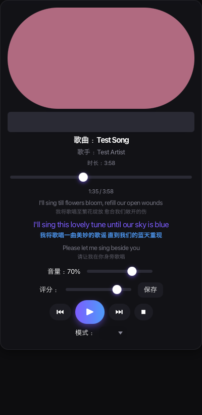

# Potato Player（Java 版）

**当前版本：`2.1.16`** ｜ 完整更新记录见 [`CHANGELOG.md`](CHANGELOG.md)

> 一个本地音乐播放器：VLC 内核 + JavaFX 界面，带歌词、评分 / 块 / 流派管理、
> 均衡器、BPM 与「动图卡点」悬浮窗（原版没有的新功能）。
>
> 本项目是 **Python 版 Potatoplayer（PySide6/Qt）的 Java 移植**，玩法与原版对齐，
> 额外加的东西都记在 CHANGELOG 里。



## 环境要求

| 依赖 | 说明 |
|---|---|
| **JDK 21+** | 必需（Temurin / Oracle / Zulu 都行），`java -version` 能看到 21 即可 |
| **VLC** | 必需，程序通过 `libvlc` 播放。macOS 装到 `/Applications/VLC.app` 就行；Linux 装 `vlc` / `libvlc` 包 |
| **Node.js** | **可选**，只有网易云在线功能（搜索 / 下载 / 登录）需要，本地播放完全用不到；服务用 [api-enhanced](https://github.com/NeteaseCloudMusicApiEnhanced/api-enhanced) |
| 系统 Maven | **不需要**，`./setup.sh` 会往 `.tools/` 下载一份内置的（约 11MB） |

支持平台：macOS 为主要开发平台（含桌面歌词鼠标穿透用的 Cocoa 调用）；Linux / Windows
理论上可跑，但没在真机验证过。

## 快速开始

```bash
git clone https://github.com/why012123/Potatoplayer.git
cd Potatoplayer

./setup.sh   # 首次运行一次：下载内置 Maven
./run.sh     # 启动
```

- 源码没变时 `./run.sh` 直接起 java（不跑 Maven，快）；改了代码才会自动编译一次。
- 想看启动各段耗时：`./run.sh > /tmp/start.log 2>&1`，日志里有 `[启动] … 本段 N ms` 打点。
- 打包成 jar：`./build.sh` → `target/potatoplayer.jar`。

## 第一次跑起来之后

程序不自带任何歌曲，也不会去读别人的数据。首次启动会自动建好数据目录，
把 `mp3` / `flac` 丢进 `<数据目录>/source/music/`，然后在左栏点 **刷新歌曲库** 就能看到它们。

数据目录的位置按下面的顺序决定，**先命中先用**：

| 顺序 | 位置 | 什么时候用 |
|---|---|---|
| 1 | `-Dpotato.baseDir=/path/to/PotatoLibrary` | 想放哪儿就放哪儿（给 `run.sh` 加参数即可） |
| 2 | 工程同级的 `../PotatoLibrary`（**且里面已有 `source/`**） | 老的工作区布局：代码和数据分两个目录放 |
| 3 | 用户主目录的 `~/PotatoLibrary` | 默认值，直接 clone 下来就是这种 |

```
<数据目录>/source/
├── music/            # 歌曲（mp3 / flac）
├── covers/           # 从网易云导入的封面
├── lyrics/           # 导入的 .lrc
├── playlists/        # 已保存歌单
├── ratings.json      # 评分 / 备注 / 块 / 流派 / 评论 / 播放次数 / 封面路径
├── blocks.json  genres.json  lyrics.json  netease_bindings.json
├── metadata_cache.csv  # 元数据缓存（启动不再遍历全库读标签）
├── session.json      # 上次退出的「当前播放列表 + 听到第几首」
├── eq.json           # 均衡器：全局预设 / 命名预设 / 单曲预设
├── bpm.json          # BPM：分析结果 + 置信度 + 手改标记 + 拍点网格
└── config.json       # 主题、音量、播放模式、下载音质、控件不透明度…
```

> 换数据目录：`./run.sh -Dpotato.baseDir=/path/to/PotatoLibrary`
> （`run.sh` 会把参数原样交给 java）。

## 网易云在线功能（可选）

搜索、试听、下载、歌词 / 评论、登录（手机号 / Cookie / 二维码）都走一个**本地 Node 服务**：

> **api-enhanced** —— <https://github.com/NeteaseCloudMusicApiEnhanced/api-enhanced>
> （原 NeteaseCloudMusicApi 的维护增强版，`@neteasecloudmusicapienhanced/api` v4.35.0，MIT，作者 MoeFurina）

本仓库**不包含**这个服务，也不需要它来播放本地音乐。想用在线功能就自己起一个：

```bash
git clone https://github.com/NeteaseCloudMusicApiEnhanced/api-enhanced.git
cd api-enhanced
pnpm i            # 没有 pnpm 用 npm i 也行
node app.js       # 默认监听 3000
```

官方也提供 Docker 镜像：`docker run -d -p 3000:3000 moefurina/ncm-api:latest`。

然后把服务目录接到播放器上（二选一）：

- 放在 `<数据目录>/api/api-enhanced-4.35.0/`（里面要有 `app.js`），或
- 用 `-Dpotato.apiDir=/path/to/api-enhanced` 指定目录；服务地址默认
  `http://localhost:3000`，端口不同就用 `-Dpotato.apiBase=http://host:port`。

其它：

- `node` 会按 `PATH` 找，也可以用 `-Dpotato.node=/path/to/node` 指定。
- 服务已经在跑的话程序不会再拉一次（启动时会先探一次 `/`）。
- 服务目录 / `app.js` / `node` 任何一个缺失，程序就**不启动这个服务**：在线面板不可用，
  本地播放、歌词、BPM、均衡器、动图卡点一切照常。

## 功能清单

- 🎵 音乐库扫描（mp3/flac）、VLC 播放、进度条、音量、4 种播放模式（循环/列表/单曲/随机）
- 🖼️ 元数据读取（歌名/歌手/时长/内嵌封面）、圆形旋转封面
- 📝 LRC 歌词解析、**三行歌词显示（前一句 / 本句 / 后一句）**、**歌词显示模式三选一（双语 / 仅中文 / 仅原文）**、评分、备注、评论、播放次数
- 🗂️ 块 / 流派 / 歌单管理（含二级编辑器、从左边栏添加）；块与流派各有自己的**标识色**，
  歌曲库每行左边就是「块色 + 流派色」双色标识带，进度条**走过的一段用块色、没走过的一段用流派色**
- 🔍 搜索与筛选（关键词 + 评分区间 + 块/流派 + 排序）；歌曲库**索引条显示分组歌曲数**，
  「播放次数」排序时每首歌后面直接标出 **♪ N 次**；排序是**叠加式**的：点过的模式攒成排序栈，
  **后点的是主键、之前点的依次降为次级键**（点过 A → B → C 就是 C ＞ B ＞ A）
- ☁️ 网易云音乐（**需要上面的本地服务**）：手机号/Cookie/二维码登录、账号信息、搜索下载、音质选择、单曲导入、歌单浏览（我的歌单/每日推荐）、批量绑定、批量导入歌词、评论
- 🔐 NCM 解密（纯 Java 实现，不依赖外部工具）
- 🎬 沉浸模式：点击封面进入，左右侧栏淡出滑出，左 40% 控件 + 右 60% 七行歌词（前 3 + 当前 + 后 3），ESC 或再点封面退出；切换是「先布局后动画」，过渡期间冻结周期性刷新，进出一律 300ms
- 🖥 桌面歌词：无边框透明置顶悬浮窗（本句+翻译）、拖拽 / 滚轮调字号 / 右键菜单、描边或底条两种样式、可锁定鼠标穿透
- 🎚️ 均衡器（**原版没有**）：10 段 ISO 倍频程 + 前级（±20 dB，0.5 dB 步进，拖动实时生效）、18 个 VLC 工厂预设、可命名预设、**全局 / 单曲双层预设 + 换曲自动切换**（单曲预设按相对路径 + 网易云 ID 双键匹配）
- ⏳ 任务面板：系统任务（扫描等）与网易云下载同一个列表，进度条 + 可中断 + 清除已结束 / 重试失败
- 🎞 动图卡点（**原版没有**）：导入 GIF/PNG 后独立悬浮窗（可拖动 / **滚轮以指针为焦点缩放** / 右键菜单 / 可锁定穿透），把动图一圈缩放到最接近的**整数倍拍长**；相位直接由播放位置推算（换歌与拖进度条自动对上、不累积漂移），没有 BPM 的曲子按原速播放
  - 悬浮窗本身也是播放遥控器：**双击 = 下一首**、**按住左右小幅快晃 = 上一首**，鼠标停在图上时**空格 = 播放/暂停、↑↓ = 音量±5% 且动图放大/缩小、←→ = 上/下一首**，其余播放控制（播放暂停 / 上下首 / 停止 / 音量 / 播放模式 / 桌面歌词 / 沉浸模式）都在它的右键菜单里；整套特殊手势可在 设置 → 动图卡点 里一键关掉
  - **跟拍卡点**：把一轮锁成「最接近你设的 T 的整数拍」，拍点用从音频里**拟合出来的拍点网格**（第一拍位置 + 精确到 0.01% 的拍长，存在 `bpm.json`；没测过就在后台补，约 0.35 秒，也可在设置页手动重测）；相位用一阶低通吸到拍点（不跳变，换歌按相位重基保持连续），拍点可选**伸长峰**或**压缩谷**，另有毫秒级微调（默认 +110ms，补 libvlc 报时系统性滞后约 113ms）
  - **纵向正弦伸缩**：`h(t) = l·(1 − Ay·sin(2π·t/T))`，默认 T = 1 秒一轮（0.2~6 秒可调）、竖直振幅默认 ±22%；横向另有一路反相的**收放 Ax**（默认 15%），伸长时收窄、压缩时加宽；**有内容的最底端**钉住不动、每轮幅度完全相同、处处连续无跳变；**只在播放时动**，暂停/停止把姿态冻在原地
- 🥁 BPM 速度分析（**原版没有**）：VLC 全速解码 + 谱通量/自相关，全库扫描约 0.7 秒/首（开发机实测）；歌曲编辑里可手填、单曲测速、÷2 / ×2 一键修正倍速错误
- 🎨 4 套主题热切换、控件不透明度调节、设置持久化、元数据 CSV 缓存
- 💖 **偏好**：按 **块 / 流派 / 歌手** 统计**平均评分**排名（满分 10 分，**0 分不计入**，所以不会被没听过的歌稀释），带评分色条与「N 首有评分 / 共 N 首」，另有「至少 2 首有评分才上榜」开关
- 🌫 **屏幕起雾（测试功能，默认关）**：放歌时屏幕逐渐"起雾"（像冬天玻璃），拿小动图在上面擦才看得清，擦过的地方会慢慢重新雾上 —— 全屏透明 + 鼠标穿透，不挡任何点击；参数都在 设置 → 🌫 屏幕起雾 里
- ⚡ **省电**：所有动画心跳都是状态驱动的 —— 暂停 / 停止 / 无歌时悬浮窗 60fps 计时器、进度 / 歌词 / 封面周期刷新、律动条全部停掉（一帧都不画）；启动不再遍历全库读标签（改用 `metadata_cache.csv`）；设置 → ⚡ 性能 里还有**动画 30fps 开关**（默认开、立即生效），相位仍按真实时间算，节奏不受影响

## 与原版的已知差异

1. **拖拽排序**：原版歌单/编辑器用鼠标拖拽重排；Java 版改为「↑ / ↓」按钮移动（歌单详情与当前播放列表均支持）。
2. **播放后端**：仅保留 VLC 后端；原版的 pygame 后端未移植（原版中 pygame 对部分 FLAC 的 seek 问题也一直未解决）。
3. **二维码登录**：Java 版直接弹出网易云返回的二维码图片供扫码，并自动复制登录链接。
4. **数据目录**：Java 版与 Python 版各自独立，不共用数据文件。

## 构建 / 目录结构

```bash
./build.sh          # 产出 target/potatoplayer.jar
```

> 打出的 jar 需要自己给 `java` 传 JavaFX 的 `--module-path`；日常使用直接 `./run.sh`。

```
Potatoplayer/
├── pom.xml                 # Maven 配置（JavaFX / VLCJ / Jackson / Jaudiotagger / JNA）
├── setup.sh                # 下载内置 Maven（.tools/，一次即可）
├── build.sh                # 编译打包
├── run.sh                  # 启动程序
├── docs/                   # 开发时的渲染证据图（界面细节比对）
└── src/main/java/com/potato/player/
    ├── App.java            # JavaFX 入口
    ├── core/               # 后端逻辑（与 UI 解耦）
    │   ├── Paths.java      # 数据目录 / 服务目录解析
    │   ├── Theme.java      # 4 套主题配色
    │   ├── Config.java     # 配置持久化
    │   ├── Store.java      # ratings / blocks / genres / lyrics / bindings 缓存
    │   ├── EqPreset / EqStore.java          # 均衡器
    │   ├── BpmAnalyzer / BpmStore.java      # BPM 分析 + 拍点网格
    │   ├── AnimatedGif / StretchWave.java   # 动图解码 + 拉伸波形
    │   ├── Library.java                     # 歌曲库服务
    │   ├── PlayerEngine.java                # VLC 播放引擎（VLCJ）
    │   ├── NeteaseClient.java               # 网易云 API 封装
    │   ├── NcmDecryptor.java                # NCM 解密（AES-ECB + RC4）
    │   └── ...
    └── ui/
        ├── MainWindow.java          # 主窗口 + 播放逻辑 + 定时器
        ├── SongLibraryPanel.java    # 左栏：音乐库
        ├── PlaybackPanel.java       # 中栏：播放区
        ├── FunctionPanels.java      # 右栏：全部功能面板
        ├── JobCenter.java           # 任务中心
        ├── DesktopLyrics.java       # 桌面歌词悬浮窗
        ├── GifOverlay.java          # 动图卡点悬浮窗
        └── ThemeCss.java            # 主题 → JavaFX CSS
```

## 常见问题

**启动报找不到 `libvlc` / 没有声音**
装 VLC（macOS 装到 `/Applications/VLC.app`）。程序先按 vlcj 的自动发现找，找不到会回退到
`/Applications/VLC.app/Contents/MacOS/lib`；还是不行就给 `java` 加
`-Djna.library.path=/path/to/libvlc`。

**启动说"未找到内置 Maven"**
先跑 `./setup.sh`；没网就自己下 Apache Maven 3.9.x 解压到 `.tools/` 下（目录名保持
`apache-maven-3.9.16`，或改 `run.sh` 里的 `MVN=` 路径）。

**在线功能点不动**
见上面「网易云在线功能（可选）」—— 那是需要自备的本地服务，不影响本地播放。

## 许可

本仓库暂未声明开源许可证。要拿去做别的事情，请先联系作者。
