# PotatoMusic Super

**把曲库、网易云 / QQ 音乐、AI 助手和一起听，放进同一间安静的聆听室。**

PotatoMusic Super（原 Potatoplayer Super）是一个从旧 Potatoplayer Java 版重构而来的桌面音乐播放器：
保留 Java + libVLC 的扫描与播放内核，用 Electron + React 重做主界面、动效与信息架构，
并加入 DeepSeek AI 助手、在线一起听与云歌单同步。

<p align="center">
  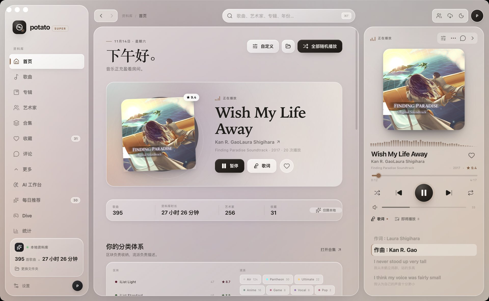
</p>

<p align="center">
  <a href="https://github.com/why012123/Potatoplayer/releases/latest"></a>
  
  
  
  
</p>

<p align="center">
  <a href="CHANGELOG.md">更新日志</a> ·
  <a href="docs/ai-integration.md">AI 接入说明</a> ·
  <a href="server/README.md">一起听中转服务</a> ·
  <a href="docs/macos-packaging.md">打包说明</a>
</p>

---

## 目录

- [亮点](#亮点)
- [界面](#界面)
- [核心功能](#核心功能)
- [AI 助手](#ai-助手)
- [一起听 / Together](#一起听--together)
- [下载与音质](#下载与音质)
- [安装](#安装)
- [快捷键](#快捷键)
- [数据与迁移](#数据与迁移)
- [架构](#架构)
- [开发与测试](#开发与测试)
- [已知限制](#已知限制)
- [致谢](#致谢)
- [License](#license)

## 亮点

| | |
| --- | --- |
| **资料库优先**<br>块 / 流派 / 评分 / 年份 / 收藏 / 歌单，全部可筛选、可批量编辑；搜索支持网易云别名与译名。 | **安静的三栏布局**<br>侧栏 → 页面 → 常驻 Now Playing；没有底部播放条，播放控制集中在右侧。 |
| **AI 助手**<br>DeepSeek 对话、找歌、改资料、下载与音质工具、歌曲记忆、联网查资料；可在右侧栏聊天，也可在 AI 工作台管理历史。 | **一起听 / Together**<br>六位房间码，房主控场、聊天、缺歌经中转服务器补齐，临时曲目不进资料库。 |
| **下载与音质**<br>五档音质（标准 / 高品质 / 无损 / Hi-Res / 超清母带），升级与显式降级都能替换，保留评分与歌单。 | **外观可调**<br>经典毛玻璃 / 编辑纸感、深浅色、强调色、字体、圆角、密度、动效与背景氛围。 |
| **云歌单同步**<br>网易云歌单 ↔ 本地歌单 / 区块 / 流派，支持双向、完全同步与仅添加。 | **原生音频引擎**<br>VLC / potatoHQ / mpv 三选一；potatoHQ 提供空间声场、交叉馈电、EQ 与 48 段真实频谱。 |

## 界面

<table>
  <tr>
    <td width="50%"><br><sub>首页 · 正在播放与资料库概览</sub></td>
    <td width="50%">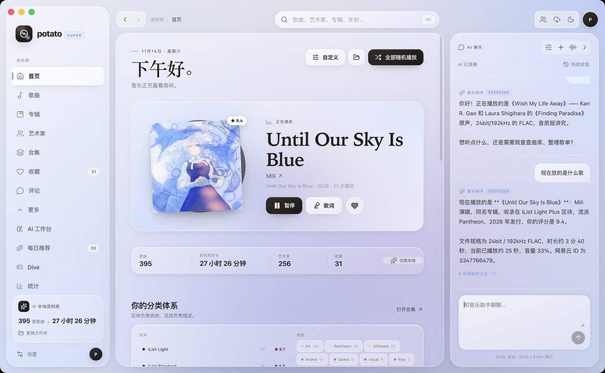<br><sub>右侧栏 AI 聊天 · 与播放视图一键切换</sub></td>
  </tr>
  <tr>
    <td width="50%">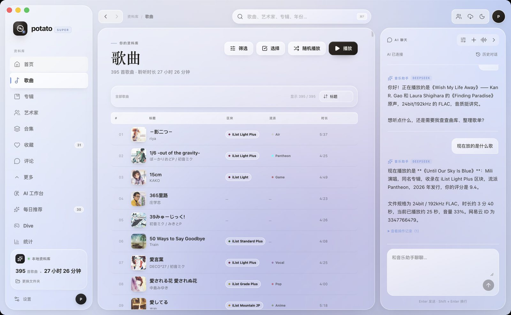<br><sub>歌曲 · 筛选、评分、块与流派</sub></td>
    <td width="50%">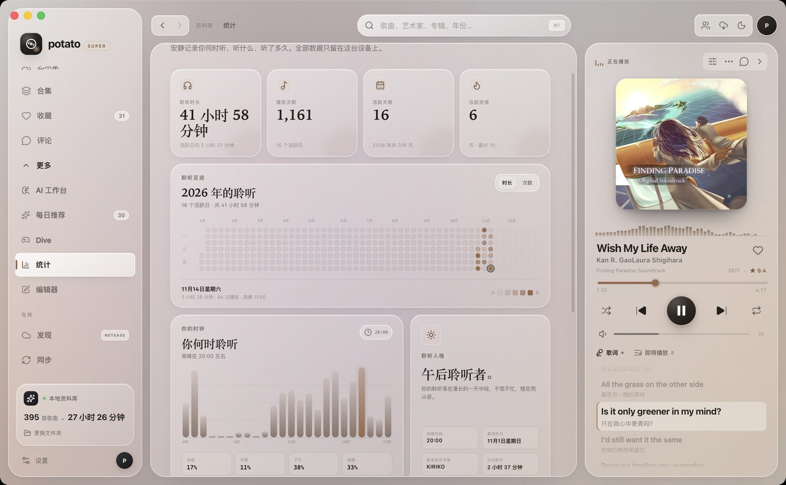<br><sub>聆听统计 · 年度热力图与偏好</sub></td>
  </tr>
  <tr>
    <td width="50%">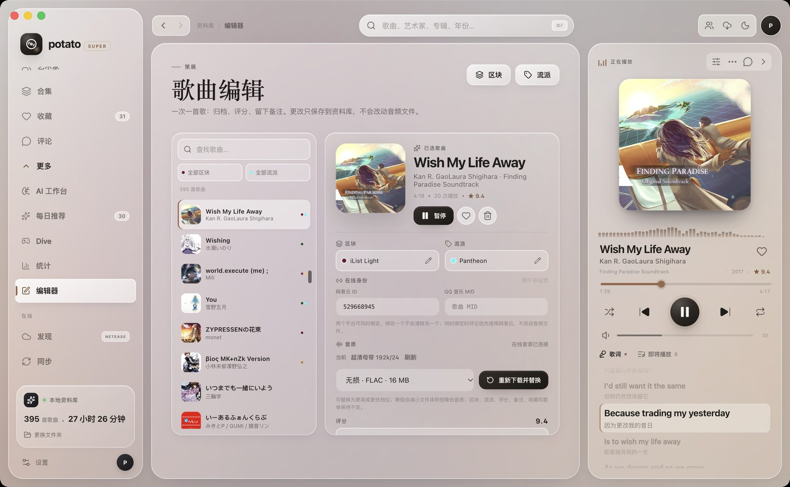<br><sub>歌曲编辑 · 音质区块与平台绑定</sub></td>
    <td width="50%">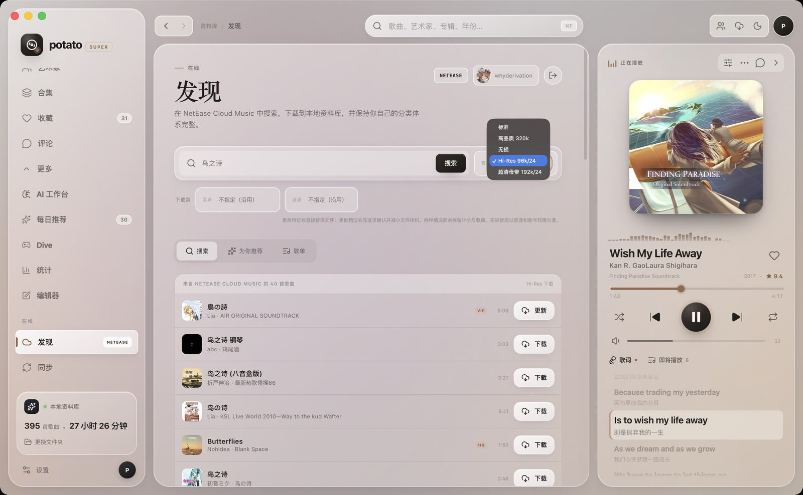<br><sub>发现 · 搜索、下载与五档音质</sub></td>
  </tr>
  <tr>
    <td width="50%">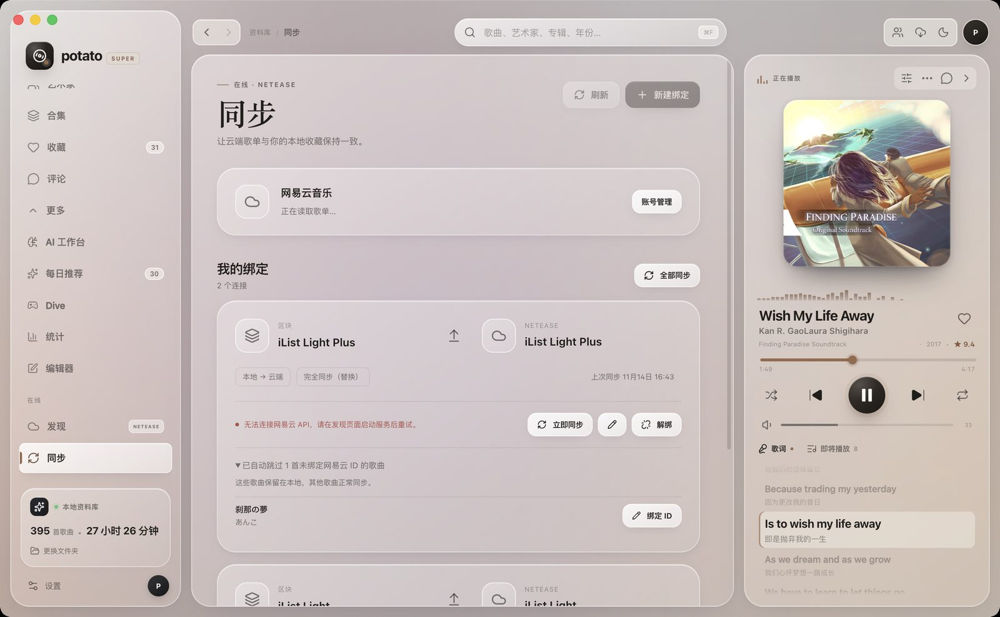<br><sub>云同步 · 云端歌单与本地分类绑定</sub></td>
    <td width="50%">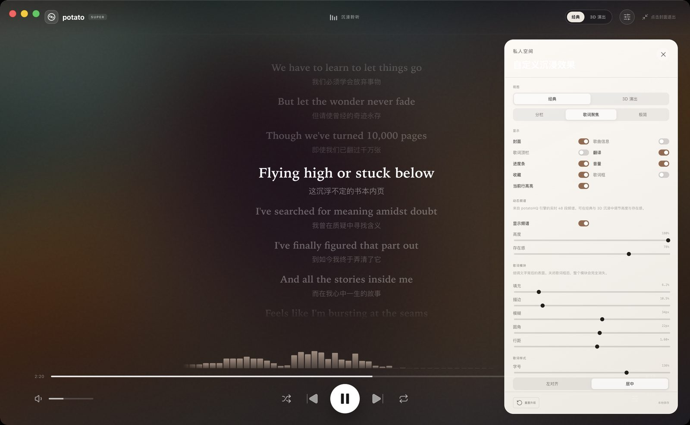<br><sub>沉浸模式 · 跟唱歌词与实时频谱</sub></td>
  </tr>
</table>

## 核心功能

### 资料库

- 扫描本地音乐，读取标题、歌手、专辑、年份、封面、歌词与**真实音频规格**（采样率 / 位深 / 声道 / 编码）。
- **块与流派**两套分类体系，可排序、配色、批量归类；评分支持 0–10 双滑块区间筛选。
- 搜索覆盖歌名、歌手、专辑、备注、按年份搜索，以及网易云别名 / 译名。
- 歌单可拖动排序、键盘排序，顺序持久化；收藏、最近添加、每日推荐与统计各自独立。
- 歌曲编辑页可改资料、换封面、写备注、绑定网易云 ID / QQ MID，修改跨重扫保留。

### 播放

- 三栏布局：左侧导航、中间页面、右侧常驻 Now Playing；收起后变成 Mini Player。
- 队列管理、单曲 / 列表循环、随机播放、无缝预载；播放队列可移除歌曲。
- 三种播放引擎：**VLC**（兼容优先）、**potatoHQ**（原生高质量引擎）、**mpv**（轻量）。
- potatoHQ 支持空间声场、交叉馈电、10 段 EQ、DoP / DSD 输出、采样率跟随与实时频谱。
- **沉浸模式**：全窗歌词（原文 + 翻译）、跟唱高亮、实时 48 段频谱、封面氛围、可自定义布局与材质；另有 3D 演出舞台。
- 系统媒体键、macOS Now Playing 与耳机控制；窗口失焦自动降频，不后台狂刷动画。

### 网易云 / QQ 音乐

- 搜索歌曲、歌手、专辑、歌单，查看评论（含热门与分页）。
- 下载到本地曲库，自动补封面、歌词与发行年份；下载任务可取消、排队、重试。
- B 站 MV 搜索：在系统浏览器中观看，不内嵌播放器。

### 云歌单同步

把网易云歌单与本地歌单、区块或流派绑定，支持：

- 方向：本地 → 云端、云端 → 本地、双向；
- 策略：完全同步（替换）或仅添加；
- 本地修改后自动同步，启动与手动同步时检查云端；缺少网易云 ID 的歌曲自动跳过并列出编辑入口；
- 替换与解绑都不会删除音频文件。

## AI 助手

连接 DeepSeek（API Key 由 Electron `safeStorage` 加密保存）后，AI 可以聊天、找歌、管理歌单与资料、联网查资料、搜索与下载网易云 / QQ 音乐、修改音质。

<p align="center">
  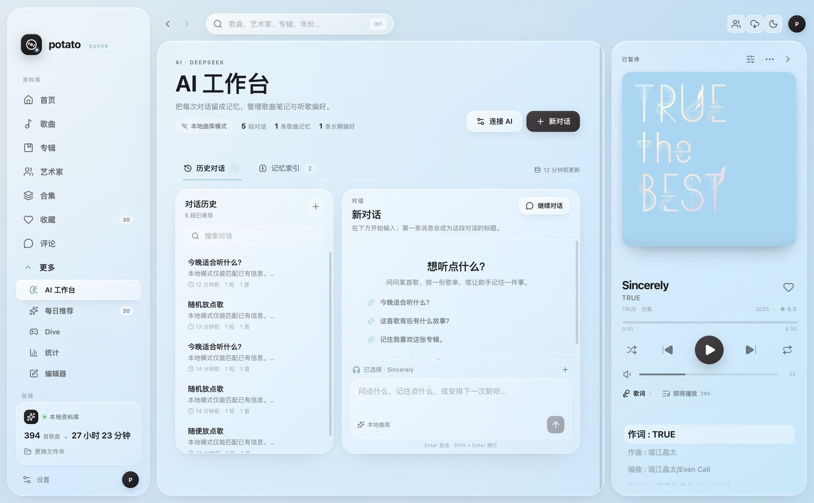
  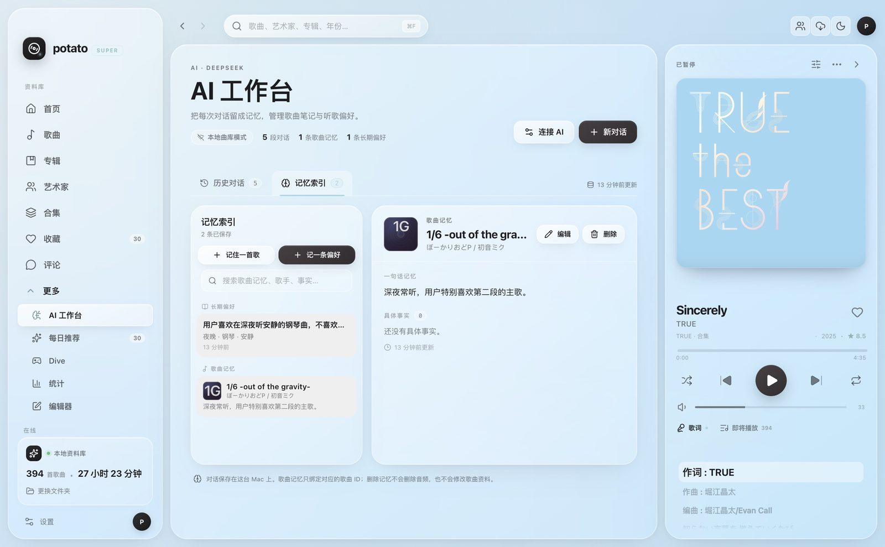
</p>

- **AI 工作台**：历史对话搜索 / 置顶 / 重命名 / 删除 / 继续，歌曲独立记忆与长期偏好索引都保存在本机。
- **右侧 AI 聊天**：在 Now Playing 右上角一键切换「播放 / AI 聊天」，收起后变成迷你聊天条；草稿、历史和回复都会保留（s2.0.2 新增）。
- **工具调用**：找歌与播放、歌单增删改、歌曲资料与平台 ID、下载与音质、记忆读写、联网搜索；操作记录显示在对话里。
- **联网查资料**：使用 DeepSeek 官方 Search / Fetch，回答附带可点击的来源卡片，可在连接设置中关闭。
- **面向 AI 的真实数据**：曲库工具读取扫描器实测的采样率、位深、声道与编码，不按下载档位推测。

<p align="center">
  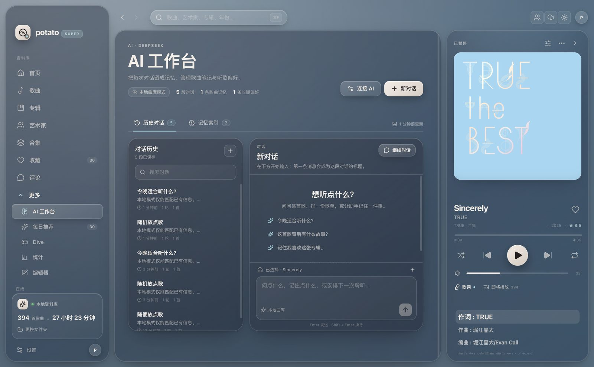
</p>

> 详细说明：[docs/ai-integration.md](docs/ai-integration.md)

## 一起听 / Together

顶栏「一起听」打开房间面板：房主控制播放、暂停与进度，其他成员跟随；六位房间码，面板内含聊天与成员列表。

- **缺歌自动补齐**：房主播放的歌曲不在你的资料库时，拥有该文件的成员经中转服务器上传；你下载并校验 SHA-256 后作为临时曲目播放，不写入资料库。
- **传输可见**：每个上传 / 下载都显示进度，可取消、可重试；断线后自动重连最多 5 次。
- **中转服务器**：仓库内 `server/` 提供中转服务（默认 `ws://127.0.0.1:8787/ws`）：

```bash
cd server
npm install
npm start
```

- 默认限制：单文件 300 MB、单房间 2 GB、空房 10 分钟清理；公网使用请自备 Caddy / Nginx / Cloudflare Tunnel 等 TLS 反向代理。
- 只上传自己拥有或获得授权分享的文件；这是私密房间里的文件接力，不是公共音乐库。

> 详见 [server/README.md](server/README.md)。

## 下载与音质

- 在线下载支持五档：标准、高品质 320k、无损、**Hi-Res 96k/24**、**超清母带 192k/24**。
- 网易云按接口实际返回的 `level` 记录档位（平台可能降级），QQ 音乐以 FLAC 为最高可用档。
- **双向替换**：再次下载同一首歌时先比较档位——更高档替换文件（同容器原地替换、跨容器迁移并保留收藏 / 歌单），同档只更新信息；**显式选择更低档位时也可降级替换**（仅歌曲编辑页、`track.changeQuality` / `library.changeQualities` 或 RPC 显式传入 `allowDowngrade` 时允许）。
- 自动下载与批量升级默认「只升不降」，避免误降。
- 音质档位探测缓存 10 分钟，替换后自动失效；AI 助手也使用同一套音质工具。

## 安装

### 普通用户（macOS Apple Silicon）

1. 打开 [Releases](https://github.com/why012123/Potatoplayer/releases/latest)，下载最新的 `PotatoMusic-<版本>-macOS-arm64.dmg`；
2. 双击 DMG，把 **PotatoMusic.app** 拖进 Applications；
3. 本构建使用本地 ad-hoc 签名、未经 Apple 公证。首次打开若被拦截：右键 → 打开，或到「系统设置 → 隐私与安全性 → 仍要打开」；
4. 安装包已内置 Java、VLC、potatoHQ、mpv、Node 与网易云 / QQ 音乐服务，**不需要安装任何开发环境**。

> macOS 26 的「图标监狱」会缩小旧 `.icns` 图标并放到灰色底板上；打包脚本会自动应用 Finder 自定义图标，安装后图标保持原样。

### 从源码运行

需要 macOS（主力验证）、Node.js 22+、JDK 21+、VLC（本地播放）、Homebrew 的 `mpv`；打包还需要 Xcode Command Line Tools。

```bash
npm install
npm start        # 构建渲染层 + 后端，然后启动 Electron
# 或双击 start.command
```

开发模式：`npm run dev`（Vite 热更新 + Electron，渲染端口 5173）。

## 快捷键

| 快捷键 | 功能 |
| --- | --- |
| `Space` | 播放 / 暂停 |
| `⌘K` | 打开命令面板 |
| `⌘F` | 搜索资料库 |
| `⌘←` / `⌘→` | 上一首 / 下一首 |
| `⌘E` | 打开歌曲编辑页 |
| `⌘A`（`⌘⇧A`） | 打开 AI 工作台 |
| `⌘1` … `⌘8` | 首页 / 歌曲 / 专辑 / 艺术家 / 合集 / 收藏 / 统计 / 发现 |
| `Esc` | 退出沉浸模式、关闭弹层或清除搜索 |
| 点击 Now Playing 右上角 `›` | 收起播放器（变为 Mini Player） |

## 数据与迁移

曲库不移动、不重命名你的音乐文件。

数据目录默认 `~/.potatoplayer-super/`（可用 `POTATOMUSIC_HOME` 覆盖）：

```text
settings.json             播放引擎 / 音量 / 循环 / 上次歌曲与进度
library.json              歌曲索引、收藏、歌单、块、流派、音频规格
stats.json                实际聆听统计（日期、小时、曲目时长与播放次数）
covers/                   封面缓存
netease_bindings.json     网易云 / QQ 下载绑定（封面、专辑、年份、平台 ID）
netease_aliases.json      网易云别名 / 译名缓存
netease_cookie.txt        网易云登录 cookie（不会进入仓库）
playlist_sync.json        云同步绑定 / 同步基准 / 中断恢复记录
ai-settings.json          DeepSeek 连接设置（API Key 加密保存）
ai-conversations.json     AI 工作台历史对话
ai-memory.json            歌曲记忆与长期偏好索引
```

- 旧 Potatoplayer 数据（`ratings.json`、`metadata_cache.csv`、`blocks.json`、`genres.json`、封面等）会在首次扫描时只读导入。
- AI 版与 Super 版共用同一数据目录，切换版本不需要再导数据；两个版本请勿同时运行。
- 设置页可直接打开数据目录、重新扫描曲库；备份只需复制该目录。

## 架构

```text
PotatoMusic.app
├─ Electron 主进程  窗口、媒体键、AI 服务（DeepSeek SSE / 工具 / 会话 / 记忆）
├─ React 渲染层     三栏界面、Now Playing、AI 工作台、沉浸模式、Ultra
├─ Java 后端        扫描、资料库、播放控制、网易云 / QQ 音乐、云同步
├─ 播放引擎         VLC / potatoHQ（C++ 原生）/ mpv
└─ 内置运行时       Java、VLC、potatoHQ、mpv、Node、音乐 API、一起听中转
```

- 渲染层与后端通过 Electron IPC + 行协议 RPC 通信；所有网络请求（网易云、QQ、DeepSeek）都在本机发出。
- AI Key 只交给 Electron 主进程，优先使用 `safeStorage` 加密；聊天与工具所需的歌曲资料才会发送给 DeepSeek。
- 构建产物：`dist/`（渲染层）、`backend/target/`（Java 服务）、`release/`（DMG / PKG，已 gitignore）。

## 开发与测试

```bash
npm run typecheck          # TypeScript 类型检查
npm run build:renderer     # 渲染层构建
npm run build:backend      # Java 后端构建
npm run test:backend       # 后端单元测试（含下载队列、同步、音质判定）
npm run test:ai            # AI 服务与工具（模拟 DeepSeek SSE，不消耗额度）
npm run test:ai-sidebar    # 右侧栏双视图 / 迷你聊天 Electron 检查
npm run test:ai-metadata   # 真实 Java 后端的 AI 元数据 / 平台 ID 测试
npm run test:discover      # 隔离 Electron 下载音质端到端（需要 ffmpeg）
npm run test:migration     # 旧数据迁移测试
npm run test:ui            # Playwright UI 冒烟（需要 VLC、显示器）
npm run test:package       # 安装包冒烟（挂载 DMG 复验）
npm run package:mac        # 产出 .app / .dmg / .pkg 与 SHA256SUMS
```

一起听中转测试：

```bash
cd server && npm install && npm test
```

测试使用隔离数据目录与临时曲库，不会改动真实资料库。

## 已知限制

- **macOS 已验证**；Windows / Linux 代码路径保留但未真机验证。安装包当前只构建 Apple Silicon。
- 本仓库未附带音乐文件、封面或账号数据；所有内容属于各自版权方。
- 网易云依赖本地 `api-enhanced`，QQ 音乐依赖本地 `qq-music-api`，都会受账号等级、地区与版权限制。
- AI 助手需要自行配置 DeepSeek API Key；联网搜索按 DeepSeek 官方规则计费。
- 一起听需要运行 `server/` 中转服务；公网使用需自备 TLS 反向代理。
- 下载音质以平台实际返回为准；Hi-Res / 超清母带需要相应账号权限。
- 桌面歌词、悬浮动图、屏幕起雾、BPM 等旧版实验功能未带入当前版本。

## 致谢

- 原始 [Potatoplayer](https://github.com/why012123/Potatoplayer) Java 版及其 Python 版，提供了功能清单、数据格式与 VLCJ 经验。
- [VLCJ](https://github.com/caprica/vlcj) / [libVLC](https://www.videolan.org/vlc/)、[Electron](https://www.electronjs.org/)、[React](https://react.dev/)、[Motion](https://motion.dev/)、[Lucide](https://lucide.dev/)。
- [api-enhanced](https://github.com/NeteaseCloudMusicApiEnhanced/api-enhanced)（MIT）提供本地网易云 API；[qq-music-api](https://github.com/yakult-green-tea/qq-music-api)（MIT）提供 QQ 音乐服务。
- 所有封面、音频与账号数据属于各自版权方；本仓库不附带音乐文件或 cookie。

## License

本仓库暂未声明开源许可证。原始 Potatoplayer 仓库同样未声明许可证；在重新分发或商用前请先联系作者。第三方依赖遵循各自许可证。
